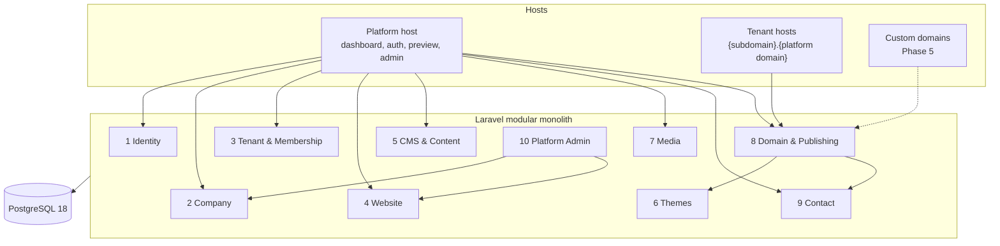

# FirmHub — Architecture

Summary of the architecture approved in Phase 0. The detailed designs live in [docs/phase-0/](phase-0/); where they differ, [0.10](phase-0/0.10-architecture-consolidation-and-phase-1-plan.md) wins. Changes after Phase 0 are recorded in [DECISIONS.md](DECISIONS.md).

## Overview

FirmHub is a **modular Laravel 13 monolith** (PHP 8.3, Livewire 4, Flux, Tailwind 4, PostgreSQL 18). `Company` is the tenant; users join companies through role-based memberships (Owner, Admin, Editor, Viewer). Tenant isolation is enforced explicitly — company in the dashboard URL, membership middleware, scoped bindings, policies on every action — and backed by PostgreSQL constraints, including composite foreign keys that make cross-tenant references impossible. Each company has one website in the MVP (a unique constraint that can be dropped later). Sites are structured content (sections with validated `jsonb` settings plus relational records) rendered by code-defined themes into server-rendered, JavaScript-free, cookie-free pages on `{subdomain}.{platform domain}` (e.g. `acme.firmhub.com`). Custom domains (Cloudflare for SaaS or a self-hosted provider) are designed behind an interface and deferred to Phase 5.

## Request contexts

| Context | Tenant source | Session | Authorization |
|---|---|---|---|
| Dashboard (`/dashboard/{company}/…`) | Company UUID in URL | Yes (host-only cookie) | Membership middleware + policies on every action |
| Public site (tenant host) | Hostname → publicly visible site | None | Visibility rule only; read-only |
| Preview (platform host) | Company in URL | Yes | `preview` permission, `no-store`, `noindex` |
| Platform admin | Cross-tenant | Artisan in MVP | Platform admin flag + 2FA; no `Gate::before` |

## Key decisions by area

| Area | Decisions | Detail |
|---|---|---|
| Product scope | Single-page site (Hero, About, Products/Services, Contact) + privacy page; one site per company; subdomain first; industry chosen at onboarding, never forces a theme | [0.1](phase-0/0.1-product-scope-and-mvp.md) |
| Tenancy | Shared schema; native Laravel, no tenancy or permission package; explicit scoping, no global scope; 404 for non-members, 403 for missing permission | [0.2](phase-0/0.2-multi-tenancy-and-authorization.md) |
| Data | UUIDv7 keys for tenant tables (`users` stays `bigint`); `varchar` + CHECK for enums; `jsonb` only where justified; composite FKs for cross-tenant safety; `timestamptz` for new tables | [0.3](phase-0/0.3-postgresql-data-architecture.md) |
| Domains & publishing | Tenant sites on single-label subdomains of the platform domain (Option A, [DECISIONS](DECISIONS.md) 2026-11-01); strict subdomain rules, reserved names, change cooldown and quarantine; `draft → published ⇄ unpublished` with orthogonal suspension; identical 404 for every non-visible state | [0.4](phase-0/0.4-subdomain-domain-and-publishing.md) |
| CMS & themes | Section type registry with versioned settings schemas; plain text only; themes are code fed only by `SitePageData`; media IDs in settings validated with a usage finder | [0.5](phase-0/0.5-cms-and-website-builder.md) |
| Public site | Stateless middleware group, zero required JavaScript, strict CSP, ≤ 5 queries per page, canonical URLs from `SiteUrlGenerator`, per-host robots/sitemap | [0.6](phase-0/0.6-public-website-seo-and-performance.md) |
| Security & privacy | Hostile tenant as design driver; SEC-* requirements; no visitor IP stored; no cookies or third parties on public sites | [0.7](phase-0/0.7-security-architecture-and-threat-model.md) |
| Technology | Existing stack kept; `database` session and cache, `sync` queue; new dependencies approved per task | [0.8](phase-0/0.8-technology-and-infrastructure-decisions.md) |
| Testing | PostgreSQL only; policy matrices; per-resource tenant isolation tests; deterministic concurrency tests; quality gates G1–G5 | [0.9](phase-0/0.9-testing-and-quality-strategy.md) |

## Code structure

Laravel's default layout, grouped by module inside each layer ([0.8 §6](phase-0/0.8-technology-and-infrastructure-decisions.md)):

- Models stay flat in `app/Models`.
- Business logic in `app/Actions/{Module}`; `app/Services/{Module}` only for justified stateful services; no repository classes.
- Livewire dashboard pages as single-file components under `resources/views/pages/dashboard/{module}/`.
- Module boundaries checked with Pest `arch()` tests.

Module map and boundary rules: [0.8 §7](phase-0/0.8-technology-and-infrastructure-decisions.md).

## Phase 0 documents

| # | Document |
|---|---|
| 0.1 | [Product Scope & MVP](phase-0/0.1-product-scope-and-mvp.md) |
| 0.2 | [Multi-Tenancy & Authorization](phase-0/0.2-multi-tenancy-and-authorization.md) |
| 0.3 | [PostgreSQL Data Architecture](phase-0/0.3-postgresql-data-architecture.md) |
| 0.4 | [Subdomain, Domain & Publishing](phase-0/0.4-subdomain-domain-and-publishing.md) |
| 0.5 | [CMS & Website Builder](phase-0/0.5-cms-and-website-builder.md) |
| 0.6 | [Public Website, SEO & Performance](phase-0/0.6-public-website-seo-and-performance.md) |
| 0.7 | [Security Architecture & Threat Model](phase-0/0.7-security-architecture-and-threat-model.md) |
| 0.8 | [Technology & Infrastructure Decisions](phase-0/0.8-technology-and-infrastructure-decisions.md) |
| 0.9 | [Testing & Quality Strategy](phase-0/0.9-testing-and-quality-strategy.md) |
| 0.10 | [Architecture Consolidation & Phase 1 Plan](phase-0/0.10-architecture-consolidation-and-phase-1-plan.md) |

The Phase 0 documents are a frozen record; their header status lines still read "Draft" because they were written before approval. Approval is recorded in [DECISIONS.md](DECISIONS.md).
