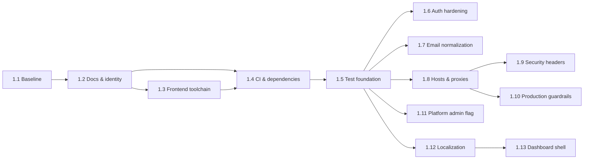
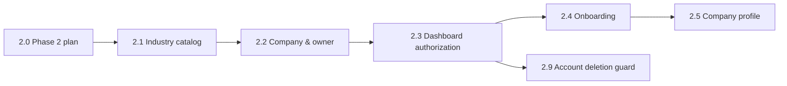

# FirmHub — Roadmap

Phases are delivered as small tasks, one at a time, each ending with a report and explicit approval ([CONTRIBUTING.md](../CONTRIBUTING.md)). Current status of each task: [PROGRESS.md](PROGRESS.md).

> Phase names for Phases 2–7 are derived from the phase assignments in [0.1 §4–5](phase-0/0.1-product-scope-and-mvp.md) and later Phase 0 documents; the product owner may rename them. Only Phase 1 is broken down into tasks; later phases are split into tasks when they start.

## Phases

| Phase | Name | Content | Status |
|---|---|---|---|
| 0 | Architecture & Planning | Documents 0.1–0.10 | Completed, approved |
| 1 | Foundation | Validation, documentation, toolchain and CI hygiene, test foundation, authentication hardening, host/header configuration, production guardrails, platform admin flag, localization, dashboard shell | Closed with exceptions (1.5, 1.9, 1.10 open until before Phase 7) |
| 2 | Companies & Tenancy | Industries, company creation and onboarding, memberships and roles, invitations, company switcher, tenant isolation, company deletion lifecycle | **In progress** (proof of concept: one company per user) |
| 3 | Website, CMS & Publishing (MVP) | One site per company, subdomains, base theme and presets, sections and offerings, media, preview and publishing, public rendering and SEO, contact form and inbox, Turkish dashboard translation | Not started |
| 4 | Extended Content & Themes | Theme catalog and industry-specific themes, multi-page sites and blog, team, multiple locations, FAQ, gallery, testimonials | Not started |
| 5 | Custom Domains | Custom hostname provider (Cloudflare for SaaS and self-hosted), domain verification, TLS | Not started |
| 6 | Platform Administration | Admin panel, suspension tooling, persistent audit log, moderation | Not started |
| 7 | Production Readiness | Production image and web server, backups, scheduler, mail, monitoring, security checklist, staging verification | Not started |

The MVP is complete at the end of Phase 3. Items marked "Future" in [0.1 §5](phase-0/0.1-product-scope-and-mvp.md) (multiple sites per company, revisions, analytics, public API, …) are not scheduled.

## Phase 1 — Foundation

Source: [0.10 §7](phase-0/0.10-architecture-consolidation-and-phase-1-plan.md) (goals, scope and acceptance criteria per task).

| Task | Name | Goal |
|---|---|---|
| 1.1 | Baseline Validation | Confirm the repository matches Phase 0 facts and record a baseline |
| 1.2 | Project Documentation & Identity | Make the project self-describing |
| 1.3 | Frontend Toolchain Remediation | Remove critical `vite-plus` advisories; pin Node 24 |
| 1.4 | CI & Dependency Automation | CI on pull requests into `main`, audits, migration rollback check, Dependabot for Composer and npm |
| 1.5 | Test Foundation | `LazilyRefreshDatabase`, global test isolation, architecture suite |
| 1.6 | Authentication Hardening | Throttles, uniform reset response, configurable `uncompromised()`, auth logging |
| 1.7 | Case-Insensitive Email Uniqueness | Lowercase emails and a unique index on `lower(email)` |
| 1.8 | Platform Host, Trusted Hosts & Proxies | `app.host` from `APP_URL`, trusted hosts/proxies, platform routes bound to the platform host |
| 1.9 | Security Headers Baseline | Platform security headers, report-only dashboard CSP |
| 1.10 | Production Configuration Guardrails | Refuse debug mode in production; document secure production values |
| 1.11 | Platform Admin Foundation | `is_platform_admin` flag, gate and Artisan commands (2FA check deferred) |
| 1.12 | Localization Foundation | English and Turkish dashboard, locale preference (needs OD-6) |
| 1.13 | Dashboard Shell & Branding | FirmHub branding and dashboard navigation shell |

Phase 1 exit criteria (E-1 … E-13) and Phase 2 entry conditions: [0.10 §7.4–7.5](phase-0/0.10-architecture-consolidation-and-phase-1-plan.md).

## Phase 2 — Companies & Tenancy (proof of concept)

Owner decisions of 2026-11-04 ([DECISIONS](DECISIONS.md#change-log)): Phase 1 is closed with exceptions, and Phase 2 is narrowed to a proof of concept in which **a user belongs to at most one company**. The dashboard stays at `/{locale}/dashboard`; a `CurrentCompany` middleware resolves the user's only membership. Sources: [0.1 §4, §6](phase-0/0.1-product-scope-and-mvp.md), [0.2](phase-0/0.2-multi-tenancy-and-authorization.md), [0.3 §5, §9–10](phase-0/0.3-postgresql-data-architecture.md), [0.5 §10](phase-0/0.5-cms-and-website-builder.md), [0.9 §4](phase-0/0.9-testing-and-quality-strategy.md). Each task is planned in detail before it starts.

| Task | Name | Goal |
|---|---|---|
| 2.0 | Phase 1 Closure & Phase 2 Plan | Record the Phase 1 exceptions and the proof-of-concept scope; documentation only |
| 2.1 | Industry Catalog | `industries` table, model and seeder; labels in `lang/{locale}/industries.php` (0.3 D-8) |
| 2.2 | Companies & Owner Membership | `companies` and `company_memberships` (UUIDv7 keys, constraints), `CompanyRole` and `CompanyPermission` enums, `CreateCompany` action creating the company and the Owner membership in one transaction; verified users only; one company per user |
| 2.3 | Dashboard Authorization | `CurrentCompany` middleware on `/{locale}/dashboard`, `CompanyPolicy` and the role permission matrix, tenant test helpers, route inventory test |
| 2.4 | Company Onboarding | Resumable onboarding: name and industry, contact details, primary location (`company_locations`); `onboarding_completed_at` |
| 2.5 | Company Profile | Company page: profile, contact details, location, optional legal information, industry (Owner and Admin) |
| 2.9 | Account Deletion Guard | The last Owner of a company cannot delete the account (0.2 RM-8) |

Deferred until after the proof of concept: 2.6 Company Switcher, 2.7 Member Management (roles, removal, ownership transfer, last-owner locking test), 2.8 Invitations, 2.10 Company Deletion Lifecycle (grace period, scheduled purge), and moving the dashboard to `/{locale}/dashboard/{company}` when users can belong to several companies.

Phase 2 exit criteria (proof of concept): tasks 2.0–2.5 and 2.9 approved individually; every tenant-owned resource has cross-tenant and role-denial tests (0.2 AR-14, checklist in each report); every dashboard route passes `auth`, `verified` and `CurrentCompany` (feature test); the dashboard is complete in English and Turkish; CI green on a pull request into `main`; no new dependency without approval. After Phase 2 the proof of concept continues with a minimal Phase 3 (site, subdomain, core sections, preview, publishing, public rendering), split into tasks when it starts.
