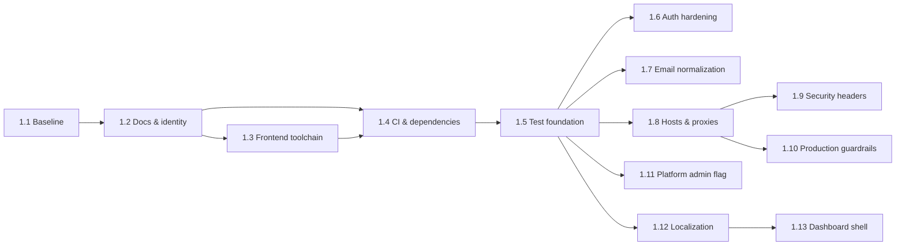

# FirmHub — Roadmap

Phases are delivered as small tasks, one at a time, each ending with a report and explicit approval ([CONTRIBUTING.md](../CONTRIBUTING.md)). Current status of each task: [PROGRESS.md](PROGRESS.md).

> Phase names for Phases 2–7 are derived from the phase assignments in [0.1 §4–5](phase-0/0.1-product-scope-and-mvp.md) and later Phase 0 documents; the product owner may rename them. Only Phase 1 is broken down into tasks; later phases are split into tasks when they start.

## Phases

| Phase | Name | Content | Status |
|---|---|---|---|
| 0 | Architecture & Planning | Documents 0.1–0.10 | Completed, approved |
| 1 | Foundation | Validation, documentation, toolchain and CI hygiene, test foundation, authentication hardening, host/header configuration, production guardrails, platform admin flag, localization, dashboard shell | **In progress** |
| 2 | Companies & Tenancy | Industries, company creation and onboarding, memberships and roles, invitations, company switcher, tenant isolation, company deletion lifecycle | Not started |
| 3 | Website, CMS & Publishing (MVP) | One site per company, subdomains, base theme and presets, sections and offerings, media, preview and publishing, public rendering and SEO, contact form and inbox, Turkish dashboard translation | Not started |
| 4 | Extended Content & Themes | Theme catalog and industry-specific themes, multi-page sites and blog, team, multiple locations, FAQ, gallery, testimonials | Not started |
| 5 | Custom Domains | Custom hostname provider (Cloudflare for SaaS and self-hosted), domain verification, TLS | Not started |
| 6 | Platform Administration | Admin panel, suspension tooling, persistent audit log, moderation | Not started |
| 7 | Production Readiness | Production image and web server, backups, scheduler, mail, monitoring, security checklist, staging verification | Not started |

The MVP is complete at the end of Phase 3. Items marked "Future" in [0.1 §5](phase-0/0.1-product-scope-and-mvp.md) (multiple sites per company, revisions, analytics, public API, …) are not scheduled.

## Phase 1 — Foundation

Source: [0.10 §7](phase-0/0.10-architecture-consolidation-and-phase-1-plan.md) (goals, scope and acceptance criteria per task).

| Task | Name | Goal |
|---|---|---|
| 1.1 | Baseline Validation | Confirm the repository matches Phase 0 facts and record a baseline |
| 1.2 | Project Documentation & Identity | Make the project self-describing |
| 1.3 | Frontend Toolchain Remediation | Remove critical `vite-plus` advisories; pin Node 24 |
| 1.4 | CI & Dependency Automation | CI on `develop`, audits, migration rollback check, Dependabot for Composer and npm |
| 1.5 | Test Foundation | `LazilyRefreshDatabase`, global test isolation, architecture suite |
| 1.6 | Authentication Hardening | Throttles, uniform reset response, configurable `uncompromised()`, auth logging |
| 1.7 | Case-Insensitive Email Uniqueness | Lowercase emails and a unique index on `lower(email)` |
| 1.8 | Platform Host, Trusted Hosts & Proxies | `app.host` from `APP_URL`, trusted hosts/proxies, platform routes bound to the platform host |
| 1.9 | Security Headers Baseline | Platform security headers, report-only dashboard CSP |
| 1.10 | Production Configuration Guardrails | Refuse debug mode in production; document secure production values |
| 1.11 | Platform Admin Foundation | `is_platform_admin` flag, gate and 2FA-checked Artisan commands |
| 1.12 | Localization Foundation | English and Turkish dashboard, locale preference (needs OD-6) |
| 1.13 | Dashboard Shell & Branding | FirmHub branding and dashboard navigation shell |

Phase 1 exit criteria (E-1 … E-13) and Phase 2 entry conditions: [0.10 §7.4–7.5](phase-0/0.10-architecture-consolidation-and-phase-1-plan.md).
