# FirmHub — Product Scope & MVP Definition

| | |
|---|---|
| **Phase / Task** | Phase 0 — Task 0.1 |
| **Status** | Draft — open product questions (Section 8) pending decision |
| **Last updated** | 2026-10-26 |

> All numeric targets and recommendations in this document are proposals until explicitly approved.

---

## 1. Product Scope

**Vision:** Enable non-technical businesses to create, manage and publish a professional company website within minutes, on a platform that can run both self-hosted and as a hosted SaaS.

**Problem:** Small and medium-sized businesses either pay agencies (expensive, slow) or struggle with generic drag-and-drop builders (complex, inconsistent results). FirmHub uses **structured content + curated themes** so that a well-designed site is the default outcome.

**MVP boundary:** A verified user creates a company, selects an industry, creates a single website for that company, fills in the core sections, previews it and publishes it on `{subdomain}.{platform-domain}`. Visitors can reach the company through a contact form.

### Approved product decisions

1. One company, one website in the MVP; architecture must allow multiple sites later.
2. `CompanySiteSection` belongs to `CompanySite`, not directly to `Company`.
3. Subdomain first; custom domains via Cloudflare for SaaS later.
4. Cloudflare-related fields are retained as design candidates only.
5. General-purpose platform; industry is selected during onboarding.
6. Industry-specific theme recommendations in the future.
7. Laravel + Livewire + PostgreSQL + Modular Monolith.

### Glossary

| Term | Definition |
|---|---|
| User | Platform account (identity) |
| Company | Tenant boundary; the business |
| Membership | Role-based relationship between a User and a Company |
| CompanySite | The company's website (one per company in the MVP) |
| Section | Orderable, toggleable content block belonging to a site |
| Industry | Business sector classification of a company |
| Theme | Presentation layer, independent from content |
| Preview | Authorized viewing of an unpublished site |
| Publishing | Making a site publicly available or withdrawing it |

---

## 2. User Personas

| # | Persona | Type | Goal | Key need |
|---|---|---|---|---|
| P1 | **Business Owner** (florist, law firm, construction company) | Primary | Get a professional website quickly | Simple flow, no technical jargon, mobile friendly |
| P2 | **Company Staff / Editor** | Primary | Keep content up to date | Content permissions only; no publishing or membership rights |
| P3 | **Agency / Freelancer** | Secondary | Manage multiple client companies | Multiple memberships, company switching |
| P4 | **Site Visitor** | End user | Find information, get in touch | Fast, accessible site; trustworthy contact form |
| P5 | **Platform Operator** | Operations | Stop abuse | Suspend a site or company (minimal in MVP) |
| P6 | **Self-Hosting Developer** | Open source | Run FirmHub on own infrastructure | Simple setup, no mandatory third-party services |

---

## 3. Main User Journeys

```mermaid
flowchart LR
    A[Register] --> B[Verify email]
    B --> C[Create company]
    C --> D[Select industry]
    D --> E[Complete company info]
    E --> F[Choose subdomain]
    F --> G[Choose theme]
    G --> H[Upload logo / images]
    H --> I[Edit sections]
    I --> J[Preview]
    J --> K{Publish?}
    K -- Yes --> L[Live on subdomain]
    K -- No --> I
    L --> M[Visitor sends contact message]
    M --> N[Team reads message in dashboard]
```

| ID | Journey | Actor | Outcome |
|---|---|---|---|
| J1 | Register, verify email, log in | P1, P2, P3 | Verified account |
| J2 | Create company and select industry (onboarding) | P1, P3 | User becomes Owner; onboarding is resumable |
| J3 | Create site: choose subdomain and theme | P1 | Draft site |
| J4 | Edit content: logo, Hero, About, Products/Services, Contact, company info, social links | P1, P2 | Updated draft |
| J5 | Preview | P1, P2 | Only authorized members can see the draft |
| J6 | Publish / unpublish | P1 (authorized role) | Site goes live or offline on its subdomain |
| J7 | Visitor contact | P4 | Message stored and the company is notified |
| J8 | Read messages | P1, P2 | Message marked as read |
| J9 | Invite member and assign role | P1 | New member joins with the assigned role |
| J10 | Switch between companies | P3 | Active company context changes securely |
| J11 | Suspension | P5 | Suspended site becomes unavailable to the public |

---

## 4. MVP Feature Matrix

Priority: **M** = Must, **S** = Should, **C** = Could. Phase refers to the approved roadmap.

| Module | Feature | Priority | Phase | Notes |
|---|---|---|---|---|
| Identity | Registration, login, logout, password reset, email verification | M | 1 | Already installed; to be validated |
| Identity | 2FA, profile, account deletion | S | 1 | Already installed |
| Company | Create company | M | 2 | Creator automatically becomes Owner |
| Company | Industry selection (predefined list) | M | 2 | Does not enforce a theme |
| Company | Company information (name, contact email, phone, address) | M | 2 | |
| Company | Legal information (legal name, tax number), optional | S | 2 | See Q14 |
| Company | Resumable onboarding wizard | M | 2 | |
| Membership | User can belong to multiple companies | M | 2 | |
| Membership | Company switcher | M | 2 | |
| Membership | Role model: Owner / Admin / Editor / Viewer | M | 2 | Permission matrix in Task 0.2 |
| Membership | Email invitations, member removal | S | 2 | See Q6 |
| Membership | Ownership transfer ("at least one Owner" rule) | S | 2 | Rule is M, transfer UI is S |
| Website | One site per company (application + DB constraint) | M | 3 | |
| Website | Subdomain selection and validation (reserved names, normalization) | M | 3 | Detailed in Task 0.4 |
| Website | Theme selection (one base theme) | M | 3 | |
| Website | Theme color / typography presets | S | 3 | See Q8 |
| Website | Logo, dark logo, favicon, OG image | M/S | 3 | Logo and favicon are M |
| CMS | Hero, About, Products/Services, Contact sections | M | 3 | |
| CMS | Company information (footer) and social links | M | 3 | |
| CMS | Enable / disable sections | M | 3 | |
| CMS | Reorder sections (move up / down) | S | 3 | No drag-and-drop |
| CMS | Product / service items (relational records) | M | 3 | See Q4 |
| Media | Validated image uploads (MIME, size, safe filenames) | M | 3 | |
| Media | Image optimization / resizing | S | 3 | Package decision in Task 0.8 |
| Publishing | Authorized preview | M | 3 | |
| Publishing | Publish / unpublish, `published_at` | M | 3 | |
| Publishing | Suspension | M | 3/6 | Minimal tooling in MVP, see Q12 |
| Public | Blade-rendered site served on its subdomain | M | 3 | |
| Public | Correct HTTP responses for unknown / unpublished / suspended hosts | M | 3 | |
| Contact | Contact form with rate limiting and honeypot | M | 3 | |
| Contact | Message inbox, mark as read | M | 3 | |
| Contact | Email notification on new message | S | 3 | See Q10 |
| Contact | KVKK / GDPR privacy notice or consent | M | 3 | Legal requirement |
| SEO | Title, description, canonical, Open Graph, robots | M | 3 | |
| SEO | `sitemap.xml`, Organization / LocalBusiness structured data | S | 3 | |
| i18n | All dashboard strings translatable (`__()`) | M | 1+ | |
| i18n | Turkish dashboard translation | S | 3 | See Q7 |
| i18n | Single content language per site | S | 3 | See Q7 |
| Lifecycle | Company deletion and data cleanup policy | S | 2 | See Q13 |

---

## 5. Out-of-Scope Features (MVP)

| Feature | Planned for |
|---|---|
| Custom domains, Cloudflare for SaaS, SSL management | Phase 5 (data model preparation at design level only) |
| Multiple sites per company | Future (architecture must not prevent it) |
| Drag-and-drop page builder | Future |
| Theme catalog, industry-specific themes | Phase 4 (MVP only stores `Industry` data) |
| Multi-page sites (`CompanySitePage`), blog / articles | Phase 4 |
| Team, multiple Locations, FAQ, Gallery, Testimonials | Phase 4 |
| Multilingual site content | Future |
| Content revisions, scheduled publishing, approval workflows | Future |
| Custom HTML / CSS / JS injection, third-party scripts | Out of scope (XSS risk) |
| Analytics dashboard | Future |
| E-commerce, cart, payments, inventory | Out of scope |
| Subscriptions, billing, plan limits | See Q1 |
| Public API, webhooks | Future |
| Social login / SSO | Future |
| Full platform administration panel, audit log | Phase 6 |
| Redis, Horizon, dedicated queue workers | Phase 7 evaluation |
| Mandatory object storage | Designed to be compatible; local disk in MVP |
| Booking / appointments, newsletter, AI content generation | Out of scope |

---

## 6. Functional Requirements

### Identity

- **FR-AUTH-01:** Users can register with email and password.
- **FR-AUTH-02:** Unverified users cannot create companies.
- **FR-AUTH-03:** Existing password reset, 2FA and account deletion flows are preserved.

### Company & Onboarding

- **FR-COMP-01:** A verified user can create a company and becomes its Owner.
- **FR-COMP-02:** A single industry is selected during onboarding and can be changed later.
- **FR-COMP-03:** Onboarding progress is persisted; the user resumes where they left off.
- **FR-COMP-04:** Company status (e.g. active / suspended) is managed independently from site status.

### Membership

- **FR-MEM-01:** A user can belong to multiple companies with different roles.
- **FR-MEM-02:** A user can be a member of the same company only once.
- **FR-MEM-03:** Every company must have at least one Owner.
- **FR-MEM-04:** A user can only switch to companies they are a member of.
- **FR-MEM-05:** Authorized roles can send email invitations; invitations expire and are single-use.

### Website

- **FR-SITE-01:** A company can create at most one site in the MVP.
- **FR-SITE-02:** Subdomains are globally unique, normalized to lowercase, and reject reserved names and invalid characters.
- **FR-SITE-03:** A new site starts in Draft status with default sections.
- **FR-SITE-04:** Changing the theme never causes content loss.

### CMS & Media

- **FR-CMS-01:** MVP sections can be edited, enabled / disabled and reordered.
- **FR-CMS-02:** Section settings are validated server-side according to their type.
- **FR-CMS-03:** Product / service items are separate records with name, description, image, sort order and visibility.
- **FR-MEDIA-01:** Only allowed image types within size limits are accepted.
- **FR-MEDIA-02:** Replaced or deleted media files are cleaned up.

### Publishing & Public Site

- **FR-PUB-01:** Only authorized roles can publish or unpublish.
- **FR-PUB-02:** Publishing is blocked until required content is complete (minimum: company name, Hero, contact information).
- **FR-PUB-03:** Preview is available only to authenticated, authorized members.
- **FR-PUBLIC-01:** A published site is server-rendered on its own subdomain.
- **FR-PUBLIC-02:** Unknown, Draft, Unpublished and Suspended sites leak no content and return the appropriate HTTP status code.

### Contact

- **FR-CONTACT-01:** Visitors can send a message via a form protected by rate limiting and bot protection.
- **FR-CONTACT-02:** Messages are visible only to authorized members of the owning company.
- **FR-CONTACT-03:** The form includes a data processing notice.

### SEO

- **FR-SEO-01:** Title, description and OG image are editable per site.
- **FR-SEO-02:** The canonical URL points to the site's own host.

### Platform

- **FR-ADMIN-01:** A platform operator can suspend a site or company; platform privileges are separate from tenant roles.

---

## 7. Non-Functional Requirements

| ID | Category | Requirement |
|---|---|---|
| NFR-SEC-01 | Tenant isolation | No cross-tenant reads or writes; enforced server-side and covered by tests |
| NFR-SEC-02 | Security | OWASP Top 10 controls; CSRF, XSS and mass assignment protection; safe Host header validation |
| NFR-PERF-01 | Public performance | Mobile LCP < 2.5 s, CLS < 0.1, INP < 200 ms (Core Web Vitals "good") |
| NFR-PERF-02 | Public JavaScript | Livewire is not loaded on public sites by default; minimal JavaScript |
| NFR-PERF-03 | Queries | Public page rendering uses a small, constant number of queries (no N+1) |
| NFR-A11Y-01 | Accessibility | WCAG 2.2 AA target for the public theme and dashboard |
| NFR-UX-01 | Responsive | Mobile-first; dashboard usable on tablet and mobile |
| NFR-UX-02 | Usability | A non-technical user can publish a first site in about 15 minutes |
| NFR-I18N-01 | Localization | All user-facing strings are translatable; no hard-coded text |
| NFR-DATA-01 | Integrity | Critical rules (single site, unique subdomain, unique membership) enforced by PostgreSQL constraints |
| NFR-DATA-02 | Consistency | Multi-step operations (company creation + Owner membership) run in transactions |
| NFR-PRIV-01 | Privacy | KVKK / GDPR: data minimization, retention periods, right to erasure, no personal data in logs |
| NFR-PORT-01 | Portability | Self-hosted deployments require no paid or proprietary services |
| NFR-MAINT-01 | Maintainability | Critical business rules covered by Pest tests; Pint and Larastan pass |
| NFR-OPS-01 | Simple infrastructure | MVP runs with application + PostgreSQL only (sync queue, file cache / session) |
| NFR-SCALE-01 | Scale assumption | Initial target of a few thousand tenants on a shared database (see Q15) |
| NFR-COMPAT-01 | Browsers | Latest two versions of Chrome, Safari, Firefox, Edge; iOS / Android browsers |

---

## 8. Unresolved Product Questions

| # | Question | Recommendation | Blocks |
|---|---|---|---|
| Q1 | Billing / plan limits in the MVP? | No; design must not prevent adding plan limits later | 0.3 |
| Q2 | Who can create companies; per-user limit? | Any verified user; configurable limit against abuse | 0.2 |
| Q3 | Platform approval (moderation) before publishing? | No; suspension and reserved name list are sufficient | 0.4 |
| Q4 | Separate Product and Service models or a single "offering" list? | Single list in the MVP with configurable section heading ("Products" / "Services") | 0.3, 0.5 |
| Q5 | Is the MVP site a single page (anchored sections)? | Yes; plus a privacy / data processing notice page | 0.5, 0.6 |
| Q6 | Member invitations in the MVP; is the Viewer role needed? | Invitations: yes (S). Viewer: defined with minimal permissions | 0.2 |
| Q7 | Dashboard language and site content language? | Dashboard EN + TR; one content language per site; theme static strings EN / TR | 0.5 |
| Q8 | Number of themes in the MVP? | One base theme + 3–4 color / typography presets | 0.5 |
| Q9 | Can the subdomain be changed after publishing? | Yes, limited; the old name is quarantined for a period (takeover / reputation risk) | 0.4 |
| Q10 | Email notification for new messages in the MVP (requires mail config)? | Yes (S); the database remains the source of truth, mail failure never loses a message | 0.8 |
| Q11 | Retention period for contact messages? | Requires legal review; proposal: 24 months, then automatic deletion | 0.7 |
| Q12 | Platform operator tooling in the MVP? | Artisan command + separate platform admin flag; UI in Phase 6 | 0.2 |
| Q13 | Company deletion behavior? | Deletion with a grace period (e.g. 30 days) followed by permanent purge; subdomain quarantine | 0.3 |
| Q14 | Display legal name, tax number, MERSIS number on the site? | Optional fields shown in the footer when filled. Legal obligation under Turkish law is **not verified** and requires legal review | 0.3 |
| Q15 | Expected tenant count in year one and hosting region? | A few thousand tenants; data location must be defined for KVKK | 0.8 |
| Q16 | Is the original `website` field (existing external site) needed? | Not needed in the MVP; can be dropped | 0.3 |
| Q17 | Map in the Contact section? | External "open in maps" link instead of an embedded map (avoids third-party cookies / KVKK risk) | 0.5 |
| Q18 | Positioning: self-hosted + hosted SaaS? License MIT? | Both; MIT pending approval | 0.8 |

---

## 9. Task 0.1 Acceptance Criteria Evaluation

| Criterion | Status | Evidence |
|---|---|---|
| First release boundaries are clear | Met | Section 1 MVP boundary and Section 4 matrix |
| MVP and future features are separated | Met | M/S/C priorities with phase column; Section 5 |
| One-site-per-company decision preserved | Met | FR-SITE-01, NFR-DATA-01; multiple sites marked as future |
| Subdomain-first decision preserved | Met | FR-SITE-02, FR-PUBLIC-01; custom domains in Phase 5 |
| Industry-based theme extensibility planned | Met | FR-COMP-02, FR-SITE-04; industry and theme kept separate |
| Important open product questions listed | Met | Q1–Q18 with affected tasks |
