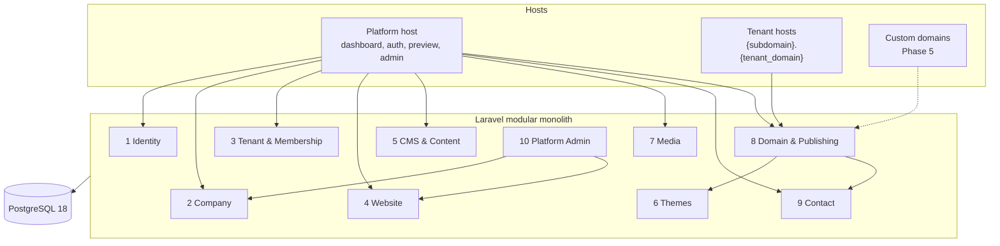
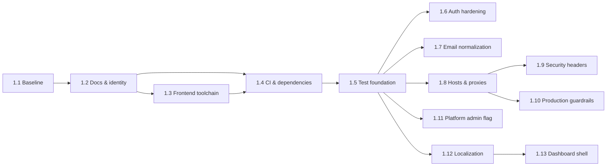

# FirmHub — Architecture Consolidation & Phase 1 Plan

| | |
|---|---|
| **Phase / Task** | Phase 0 — Task 0.10 |
| **Status** | Draft — pending owner decisions (Section 6) and approval of the Phase 1 plan |
| **Depends on** | [0.1](0.1-product-scope-and-mvp.md) · [0.2](0.2-multi-tenancy-and-authorization.md) · [0.3](0.3-postgresql-data-architecture.md) · [0.4](0.4-subdomain-domain-and-publishing.md) · [0.5](0.5-cms-and-website-builder.md) · [0.6](0.6-public-website-seo-and-performance.md) · [0.7](0.7-security-architecture-and-threat-model.md) · [0.8](0.8-technology-and-infrastructure-decisions.md) · [0.9](0.9-testing-and-quality-strategy.md) |
| **Last updated** | 2026-10-29 |

> This document is the index and decision record for Phase 0. Details stay in the task documents; where this document and a task document differ, **this document wins** (Section 4 lists every amendment). No code, configuration or repository change is made in Phase 0.

---

## 1. Consolidated Architecture Summary

### 1.1 One-paragraph overview

FirmHub is a **modular Laravel 13 monolith** (PHP 8.3, Livewire 4, Flux, Tailwind 4, PostgreSQL 18). `Company` is the tenant; users join companies through role-based memberships (Owner, Admin, Editor, Viewer). Tenant isolation is enforced explicitly — company in the dashboard URL, membership middleware, scoped bindings, policies on every action — and backed by PostgreSQL constraints, including composite foreign keys that make cross-tenant references impossible. Each company has one website in the MVP (enforced by a unique constraint that can be dropped later). Sites are structured content (sections with validated `jsonb` settings plus relational records) rendered by code-defined themes through a single renderer into server-rendered, JavaScript-free, cookie-free pages served on `{subdomain}.{tenant_domain}`. Publishing controls visibility of live content; preview runs on the platform host. Custom domains (Cloudflare for SaaS or a self-hosted provider) are designed behind an interface and deferred to Phase 5.

### 1.2 Request contexts and modules

| Context | Tenant source | Session | Authorization | Source |
|---|---|---|---|---|
| Dashboard (`/dashboard/{company}/…`) | Company UUID in URL | Yes (host-only cookie) | Membership middleware + policies on every action | 0.2 §4 |
| Public site (tenant host) | Hostname → publicly visible site | **None** | Visibility rule only; read-only | 0.4 §3, 0.6 §3 |
| Preview (platform host) | Company in URL | Yes | `preview` permission, `no-store`, `noindex` | 0.4 §7.4 |
| Platform admin | — (cross-tenant) | Artisan in MVP | Platform admin flag + 2FA; no `Gate::before` | 0.2 §10, 0.7 SEC-ADMIN |

### 1.3 Architecture by area

| Area | Key decisions | Detail |
|---|---|---|
| Product scope | Single-page site (Hero, About, Products/Services, Contact) + privacy page; one site per company; subdomain first; industry chosen at onboarding, never forces a theme | 0.1 |
| Tenancy | Shared schema; native Laravel, no tenancy or permission package; explicit scoping, no global scope; 404 for non-members, 403 for missing permission | 0.2 |
| Roles | `CompanyRole` enum + code-level permission map; ≥ 1 Owner enforced with row locks; invitations hashed, single-use, email-bound | 0.2 §6–9 |
| Data | UUIDv7 PKs for tenant tables (`users` stays `bigint`); `varchar` + CHECK for enums; `jsonb` only for section settings, social links, message meta; composite FKs for cross-tenant safety; `timestamptz` for new tables | 0.3 |
| Domains | Platform host and tenant domain are independent config values; separate registrable tenant domain in production; strict subdomain format, reserved list, 30-day change cooldown, 90-day quarantine with redirect; identical 404 for every non-visible state | 0.4 |
| Publishing | `draft → published ⇄ unpublished`; suspension is an orthogonal flag; live content model; readiness checklist in one place | 0.4 §7 |
| CMS | `SectionDefinition` registry with versioned settings schemas; plain text only; company facts never copied into sections; media IDs in settings validated + usage finder | 0.5 |
| Themes | Code-defined manifests, Blade views fed only by `SitePageData`, presets as CSS custom properties, separate Vite entry, self-hosted fonts | 0.5 §5 |
| Media | JPEG/PNG/WebP only, decode + re-encode, size/pixel limits, generated tenant-scoped paths, quotas, orphan cleanup; production media on a non-platform origin | 0.5 §7, 0.7 SEC-MEDIA |
| Public site | Stateless middleware group, zero required JS, strict CSP, ≤ 5 queries per page, canonical URLs only from `SiteUrlGenerator`, per-host robots/sitemap, `max-age=60` + validators | 0.6 |
| Security | Threat model with hostile tenant as design driver; SEC-* requirements for auth, sessions, headers, hosts, contact, media, content, logging, admin, abuse, SSRF, supply chain | 0.7 |
| Privacy | FirmHub = controller for accounts, processor for contact messages; no visitor IP stored; 24-month message retention; no cookies or third parties on public sites | 0.7 §7 |
| Technology | Existing stack kept; `database` session/cache, `sync` queue, scheduler when needed; three new dependency requests, each approved at the task that needs it | 0.8 |
| Structure | Laravel default layout grouped by module (`app/Actions/{Module}`), flat models, Pest `arch()` boundary rules | 0.8 §6–7 |
| Testing | PostgreSQL only; policy matrices; per-resource tenant isolation tests; deterministic two-connection concurrency tests; quality gates G1–G5 | 0.9 |

---

## 2. Approved Decision Register

### 2.1 How statuses were assigned

The task outputs 0.7, 0.8 and 0.9 were explicitly approved; 0.1–0.6 were prepared by the product owner and used as the approved basis. **A recommendation contained in an approved document is recorded as `Accepted`.** Items that need information or authority outside engineering keep a different status. Any `Accepted` item can be reopened — say which ID.

| Status | Meaning |
|---|---|
| **Accepted** | Recommendation adopted; implement as written |
| **Accepted → amended** | Adopted with the change described in Section 4 |
| **Owner input** | Product owner must decide or provide data |
| **Legal** | Engineering default adopted; legal review required before production |
| **Approval at use** | New dependency or container; approve when the implementing task starts |
| **Deferred** | Decided in the named later phase |
| **In task** | Resolved inside the named Phase 1 task, reported for approval |

### 2.2 Approved architectural decisions (baseline)

| ID | Decision |
|---|---|
| AD-1 | One website per company in the MVP; architecture ready for many |
| AD-2 | `CompanySiteSection` belongs to `CompanySite` |
| AD-3 | Subdomain first; custom domains via Cloudflare for SaaS (and a self-hosted provider) in Phase 5 |
| AD-4 | Cloudflare fields preserved as a future `company_site_domains` model (0.3 §6) |
| AD-5 | General-purpose platform; industry selected during onboarding; industry-specific theme recommendations later |
| AD-6 | Laravel + Livewire + PostgreSQL + modular monolith |

### 2.3 Open questions from 0.1–0.9

**0.1 Product Scope**

| ID | Decision | Status |
|---|---|---|
| Q1 | No billing / plan limits in MVP; design must not prevent them | Accepted |
| Q2 | Any verified user creates companies; configurable limit (default 5, 0.2 O-8) | Accepted |
| Q3 | No pre-publish moderation | Accepted |
| Q4 | Single offerings list with configurable heading | Accepted |
| Q5 | Single-page site + privacy page | Accepted |
| Q6 | Invitations in MVP; Viewer is read-only | Accepted |
| Q7 | Dashboard EN + TR; one content language per site | Accepted (dashboard locale selection: Section 6, OD-6) |
| Q8 | One base theme + 3–4 presets | Accepted |
| Q9 | Subdomain change allowed with cooldown and quarantine (0.4 §5) | Accepted |
| Q10 | Email notification for new messages (Should); DB is the source of truth | Accepted |
| Q11 | Contact message retention 24 months + purge | Legal |
| Q12 | Platform admin flag + Artisan; admin UI in Phase 6 | Accepted |
| Q13 | Company soft delete, 30-day grace, purge, subdomain quarantine | Accepted |
| Q14 | Legal fields optional, shown in footer when filled | Legal (display obligation unverified) |
| Q15 | Scale assumption: a few thousand tenants | Accepted; hosting region: Owner input |
| Q16 | Drop `Company.website` | Accepted |
| Q17 | External "open in maps" link, no embed | Accepted |
| Q18 | Self-hosted + hosted SaaS; license | Positioning Accepted; **license: Owner input** |

**0.2 Multi-Tenancy & Authorization**

| ID | Decision | Status |
|---|---|---|
| O-1 | Editors do not see contact messages | Accepted |
| O-2 | Multiple Owners allowed | Accepted |
| O-3 | Invitation acceptance requires matching verified email | Accepted |
| O-4 | Platform admins must have 2FA | Accepted (0.7 SEC-ADMIN-1) |
| O-5 | Owners and Admins can change the subdomain | Accepted |
| O-6 | UUIDv7 route keys / PKs | Accepted (0.3 §3) |
| O-7 | Separate registrable tenant domain in production | Accepted (0.7 SEC-HOST-3); domain names: Owner input (P-3) |
| O-8 | Company creation limit default 5 | Accepted |

**0.3 Data Architecture**

| ID | Decision | Status |
|---|---|---|
| D-1 | Offerings company-scoped | Accepted |
| D-2 | `company_locations` with one primary in MVP | Accepted |
| D-3 | UUIDv7 PKs | Accepted |
| D-4 | 30-day deletion grace period | Accepted |
| D-5 | No visitor IP stored | Accepted (0.7 PRIV-1) |
| D-6 | Lowercase emails + functional unique index | Accepted → Phase 1 task 1.7 |
| D-7 | `timestamptz` for new tables only | Accepted |
| D-8 | Industry labels in lang files | Accepted |
| D-9 | Media references in section settings | **Accepted → amended**: IDs in JSON + validation + usage finder (0.5 §4.5), not a pivot |
| D-10 | No `kind` column on offerings | Accepted |

**0.4 Domains & Publishing**

| ID | Decision | Status |
|---|---|---|
| P-1 | Live content publishing model | Accepted (risk R-6 accepted, 0.7 SQ-5) |
| P-2 | Separate tenant domain (Option B), configurable | Accepted |
| P-3 | Production platform and tenant domain names | Owner input (needed by Phase 7 / staging) |
| P-4 | 30-day cooldown, 90-day quarantine | Accepted |
| P-5 | Suspended sites return 404 | Accepted |
| P-6 | `*.localhost` default, dnsmasq fallback | Accepted (Safari check in 0.9 §10) |
| P-7 | Shareable preview links | Deferred (future) |

**0.5 CMS & Website Builder**

| ID | Decision | Status |
|---|---|---|
| C-1 | Hero pinned first | Accepted |
| C-2 | Plain text with paragraphs | Accepted |
| C-3 | No SVG uploads | Accepted (0.7 SEC-MEDIA-4) |
| C-4 | `intervention/image` | Approval at use (Phase 3, 0.8 ND-1) |
| C-5 | Explicit save, no autosave | Accepted |
| C-6 | Company info and social links as layout regions | Accepted |
| C-7 | 200 files / 250 MB, 50 offerings, configurable | Accepted |
| C-8 | Generic localized starter content | Accepted |
| C-9 | Theme recommendations in manifests | Accepted |

**0.6 Public Website, SEO & Performance**

| ID | Decision | Status |
|---|---|---|
| S-1 | "Powered by FirmHub" link: on for hosted SaaS, configurable | Accepted |
| S-2 | Privacy page `noindex, follow` | Accepted |
| S-3 | Industry → schema.org mapping | Accepted |
| S-4 | Public HTML `max-age=60` + validators | Accepted |
| S-5 | No visitor analytics in MVP | Accepted |
| S-6 | Tenant-themed 404 for unknown paths | Accepted |
| S-7 | Stateless contact form | Accepted (0.7 SEC-SESS-4) |
| S-8 | Browser / a11y test tooling | Approval at use (Phase 3, 0.8 ND-3) |

**0.7 Security**

| ID | Decision | Status |
|---|---|---|
| SQ-1 | Separate tenant domain | Accepted |
| SQ-2 | Media origin isolation in production | Accepted |
| SQ-3 | Contact limits 5/10 min per IP+site, 100/day per site, 20/h per IP | Accepted |
| SQ-4 | Notice + link; checkbox only if legally required | Legal |
| SQ-5 | Editors' edits go live immediately | Accepted |
| SQ-6 | No message body in notification emails | Accepted |
| SQ-7 | Encourage (not enforce) Owner 2FA | Accepted |
| SQ-8 | 14-day log retention | Accepted |
| SQ-9 | Hosting region / mail provider location | Owner input |
| SQ-10 | `SECURITY.md` + `security.txt` | Accepted → `SECURITY.md` in task 1.2; `security.txt` with the hosted launch |

**0.8 Technology & Infrastructure**

| ID | Decision | Status |
|---|---|---|
| 0.8 Q-1 | `intervention/image` | Approval at use (Phase 3) |
| 0.8 Q-2 | `vite-plus` remediation: evaluate replacement by plain `vite` first | In task 1.3 |
| 0.8 Q-3 | PHP 8.3 for MVP | Accepted |
| 0.8 Q-4 | Caddy + PHP-FPM vs FrankenPHP | Deferred (Phase 7) |
| 0.8 Q-5 | Mailpit in Sail | Approval at use (Phase 2, invitations) |
| 0.8 Q-6 | `database` session and cache | Accepted → amends 0.1 NFR-OPS-01 (Section 4) |
| 0.8 Q-7 | License | Owner input (same as 0.1 Q18) |
| 0.8 Q-8 | `laravel/chisel` removal | In task 1.4 (verify; removal needs approval) |
| ND-1 … ND-3 | New dependencies | Approval at use |
| MD-1 … MD-9 | Maintenance of existing dependencies | Scheduled in Phase 1 (Section 5), MD-9 in Phase 3 |

**0.9 Testing & Quality**

| ID | Decision | Status |
|---|---|---|
| 0.9 Q-1 | Concurrency tests in the same CI job | Accepted |
| 0.9 Q-2 | `LazilyRefreshDatabase` | Accepted → task 1.5 |
| 0.9 Q-3 | Working `down()` migrations + rollback check in CI until first production release | Accepted → task 1.4 |
| 0.9 Q-4 | Coverage threshold | Deferred (after Phase 3) |
| 0.9 Q-5 | Browser testing plugin | Approval at use (Phase 3) |
| 0.9 Q-6 | Branch protection on `develop` and `main` | Owner input (repository setting) |

---

## 3. Resolved Contradictions

| # | Conflict | Resolution |
|---|---|---|
| X-1 | 0.1 NFR-OPS-01 and the master prompt suggest `file` cache/session; 0.8 keeps `database` | **`database`** for cache and session (shared state across instances, rate limits; already configured). NFR-OPS-01 amended |
| X-2 | 0.5 §7.2 media URL = `APP_URL` (platform host) vs 0.7 SEC-MEDIA-2 | Media disk URL is configuration: `APP_URL/storage`-style locally; **non-platform origin in production** |
| X-3 | 0.5 §4.3 Contact form fields include "privacy notice acknowledgement" vs 0.7 PRIV-3 | **Information notice + link** by default; acknowledgement checkbox only if legal review requires it (SQ-4). 0.5 field list amended |
| X-4 | 0.3 D-9 preferred FK columns / pivot; 0.5 §4.5 chose IDs in JSON | 0.5 approach adopted with compensating rules |
| X-5 | 0.2 AR-13 / 0.4 SD-5 "evaluate `__Host-` and HSTS" | Decided in 0.7 SEC-SESS-2 / SEC-HDR-4 |
| X-6 | 0.4 §3.3 contact-form CSRF strategy open | Decided: stateless form token (0.6 §3.3, 0.7 SEC-SESS-4) |
| X-7 | Node 22 (CI) vs Node 24 (Sail, host, prompt) | Node 24 everywhere (0.8 MD-2) |
| X-8 | 0.7 RF-14 said CI runs tests only | Corrected in 0.8 §1.5 (CI runs Pint + Larastan + Pest) |
| X-9 | 0.8 §6.2 test tree by module vs 0.9 mirrored layout | 0.9 §4.1 layout adopted; 0.8 updated |
| X-10 | Master roadmap Phase 1.2 (PostgreSQL) and 1.3 (Docker) vs repository state | Already implemented in commits `6dee784`, `9ce92a5`, `46c08fe`; Phase 1 **validates** them (task 1.1) instead of rebuilding |
| X-11 | Master roadmap 1.5 "public site layout foundations" vs 0.5 theme architecture | Public layout is part of the theme (Phase 3); building it in Phase 1 would create a future module early. Phase 1 covers the dashboard layout only |

---

## 4. Amendments to Task Documents

These amendments apply when the corresponding migration or feature is implemented; the task documents are not rewritten.

| Document | Amendment |
|---|---|
| 0.1 NFR-OPS-01 | "sync queue, `database` cache / session" (X-1) |
| 0.3 §5.7 `company_media` | Add `variants jsonb`, `purpose` (0.5 §7.6) |
| 0.3 §5.8 `company_sites` | Add `content_updated_at timestamptz` (0.6 §7.4) |
| 0.3 §4.2 / 0.4 §5.1 | `released_subdomains` is an MVP table (Phase 3), shape per 0.4 §5.1 |
| 0.3 D-9 | Superseded by 0.5 §4.5 (X-4) |
| 0.5 §4.3 Contact | Form shows notice + link; acknowledgement checkbox conditional (X-3) |
| 0.5 §7.2 | Media origin configurable; production non-platform origin (X-2) |
| 0.8 §6.2 | Test layout per 0.9 §4.1 (already applied) |

---

## 5. Consolidated Risk Register (Top Risks)

Full registers: 0.2 §12, 0.4 §12, 0.7 §5 and §10, 0.8 §10.

| ID | Risk | Rating | Primary mitigation | Phase |
|---|---|---|---|---|
| CR-1 | Missing tenant scope in new code (no global scope) | High | Per-resource isolation tests, policy-per-model arch test, review checklist (0.9 §4.3, §4.8) | 2+ |
| CR-2 | Livewire action without authorization / property tampering | High | Policy in every action, `#[Locked]`, direct-call tests | 2+ |
| CR-3 | Draft or foreign content on a public host | High | Single resolver + visibility rule, identical 404s, two-tenant rendering tests | 3 |
| CR-4 | Host header poisoning of account emails | High | Trusted hosts, URLs from `APP_URL`/`SiteUrlGenerator` (task 1.8) | 1 |
| CR-5 | Stored XSS in public site, dashboard or mail | High | Plain text, Blade escaping, `{!!` scan, CSP | 1 (headers), 3 |
| CR-6 | Malicious uploads | High | Allow-list, re-encode, limits, non-platform media origin | 3 |
| CR-7 | Phishing on tenant sites harming reputation | High | Separate tenant domain, reserved names, suspension, abuse contact | 3/6 |
| CR-8 | Critical advisories in `vite-plus` toolchain | High | Task 1.3 | 1 |
| CR-9 | Self-hosters run with development defaults | High | Production guard, documented production configuration (task 1.10) | 1 |
| CR-10 | Concurrency bugs only visible on PostgreSQL | High | Deterministic two-connection tests (0.9 §5.3) | 2/3 |
| CR-11 | KVKK/GDPR obligations misread | High | Legal review before production (Owner) | 7 |
| CR-12 | Unverified framework behavior (Livewire locking, uploads, CSP nonces, UUID version) | Medium | Verify against official docs at implementation; tests | 2/3 |

---

## 6. Owner Decisions Still Required

| # | Decision | Needed by | Blocks |
|---|---|---|---|
| OD-1 | Project license (MIT proposed) — 0.1 Q18 / 0.8 Q-7 | Task 1.2 | Only the `LICENSE` file and `composer.json` license field; task 1.2 proceeds without them if undecided |
| OD-2 | Branch protection with required CI checks on `develop` / `main` — 0.9 Q-6 | After task 1.4 | Nothing; owner configures GitHub |
| OD-3 | Production platform and tenant domain names — 0.4 P-3 | Public staging (before Phase 5) | Staging, Phase 5/7 |
| OD-4 | Hosting region and mail provider location — 0.1 Q15 / 0.7 SQ-9 | Phase 7 | Production |
| OD-5 | Legal review: retention (Q11), legal footer fields (Q14), consent checkbox (SQ-4), controller/processor roles and DPA (0.7 §7.1) | Before production | Production |
| OD-6 | **New:** How the dashboard language is chosen (0.1 Q7). Recommendation: per-user preference stored on `users` (default `APP_LOCALE`), editable in settings; no URL locale prefix | Task 1.12 | Task 1.12 scope |

---

## 7. Phase 1 — Foundation: Task Plan

### 7.1 Goal and boundaries

Turn the existing starter-kit installation into a secure, documented and tested foundation for Phase 2. **In scope:** validation, documentation, toolchain and CI hygiene, test foundation, authentication hardening, host/proxy/header configuration, production guardrails, platform admin flag, localization and dashboard shell. **Out of scope:** companies, memberships, invitations, sites, tenant routes, themes, media (Phases 2–3), and any new runtime dependency.

### 7.2 Task sequence

Tasks are executed **one at a time**, in numeric order unless the owner reorders them; each ends with a report and explicit approval (prompt §2). Each task is sized for one Conventional Commit on a `feature/*` branch targeting `develop`.

### 7.3 Task details

#### 1.1 — Baseline Validation

| | |
|---|---|
| Goal | Confirm the repository matches the Phase 0 facts and record a green baseline |
| Scope | Start Sail; `migrate:fresh`; full Pest suite; Pint; Larastan; `npm run build`; `sail composer audit`; `npm audit`; check `*.localhost` reaches the app; re-verify versions (0.8 §1) |
| Changes | None expected (findings only) |
| Acceptance | All checks run and reported with real output; existing 34 tests pass on PostgreSQL 18, or failures are reported with cause; known audit findings listed |
| Commit | None (validation only) |

#### 1.2 — Project Documentation & Identity

| | |
|---|---|
| Goal | Make the project self-describing and commit the Phase 0 record |
| Scope | Commit `docs/phase-0/*`; create `README.md` (Sail setup, commands, `*.localhost`), `CONTRIBUTING.md` (branching `feature/* → develop → main`, Conventional Commits, Definition of Done 0.9 §11), `SECURITY.md` (disclosure policy), `docs/ROADMAP.md`, `docs/ARCHITECTURE.md` (summary + links), `docs/DECISIONS.md` (Section 2 register), `docs/PROGRESS.md`; `composer.json` name/description; `APP_NAME=FirmHub` in `.env.example`; `LICENSE` only if OD-1 is decided |
| Acceptance | Documents exist and match Phase 0 decisions; `composer validate` passes; no code behavior change |
| Commit | `docs: add project documentation and phase 0 architecture records` |

#### 1.3 — Frontend Toolchain Remediation

| | |
|---|---|
| Goal | Remove critical advisories and align Node (0.8 MD-1, MD-2) |
| Scope | Evaluate replacing `vp build` / `vp dev` with `vite` and removing `vite-plus` vs upgrading to `vite-plus@1.x`; implement the chosen option after reporting it; add `.nvmrc` (24) and `engines` |
| Acceptance | `npm audit --audit-level=high` reports no high/critical findings; `npm run build` and `npm run dev` work; fonts still self-hosted in `public/build`; existing tests pass; no `--force` used |
| Commit | `build: replace vite-plus toolchain and pin node 24` (wording depends on option) |

#### 1.4 — CI & Dependency Automation

| | |
|---|---|
| Goal | Make CI the quality gate described in 0.9 §9 (G3) |
| Scope | Push trigger for `develop`; Node 24; `composer audit` and `npm audit --audit-level=high` steps; migration rollback check (`migrate:fresh` → `migrate:rollback` → `migrate`); Dependabot for `composer` and `npm` with grouping and cooldown; verify `laravel/chisel` runtime usage and report (removal only with approval) |
| Acceptance | CI green on a PR to `develop`; each new step demonstrably fails on a broken input (verified locally or in a draft PR); Dependabot configuration validates |
| Commit | `ci: run on develop, add dependency audits and migration rollback check` |

#### 1.5 — Test Foundation

| | |
|---|---|
| Goal | Prepare the suite for Phase 2 conventions (0.9 §5–7) |
| Scope | `LazilyRefreshDatabase`; global `Http::preventStrayRequests()` and `Sleep::fake()` (verify API); `Arch` test suite in `phpunit.xml` with `php` and `security` presets and debug-function rule; remove the placeholder `expect()->extend('toBeOne')` / `something()` helpers only if unused (report first) |
| Acceptance | Existing tests pass unchanged in behavior; arch suite runs in CI; a deliberate stray HTTP call fails a test |
| Commit | `test: add architecture suite and global test isolation` |

#### 1.6 — Authentication Hardening

| | |
|---|---|
| Goal | Close 0.7 AU-3, AU-4, AU-5 |
| Scope | Throttle `POST /forgot-password` and `POST /register` (SEC-AUTH-1); uniform password-reset response (SEC-AUTH-2); configurable `uncompromised()` (SEC-AUTH-3); log auth events without secrets (SEC-AUTH-8) |
| Acceptance | Tests: throttles return `429` after the limit; reset response identical for known/unknown emails; production password policy configurable; no password/token in logs |
| Commit | `feat(auth): throttle registration and reset requests and prevent account enumeration` |

#### 1.7 — Case-Insensitive Email Uniqueness

| | |
|---|---|
| Goal | Implement 0.3 D-6 / SEC-AUTH-5 |
| Scope | Normalize email to lowercase in registration and profile update; check existing data for case-duplicates; migration adding a unique index on `lower(email)` with working `down()` |
| Acceptance | Feature tests reject `User@x.com` when `user@x.com` exists (registration and profile); database test asserts the index rejects a direct case-variant insert (`23505`); migration rollback works |
| Commit | `feat(auth): enforce case-insensitive unique user emails` |

#### 1.8 — Platform Host, Trusted Hosts & Proxies

| | |
|---|---|
| Goal | Establish host security before tenant hosts exist (0.4 HH-1 … HH-3, SD-2; 0.7 SEC-HOST-1, 2) |
| Scope | `config/firmhub.php` with `platform_host`, `tenant_domain`, `tenant_scheme`, `tenant_port` (only keys needed now); trusted hosts (platform host + `*.{tenant_domain}`) and trusted proxies from environment; platform routes (web, settings, Fortify, Livewire endpoints) constrained to the platform host; `/up` stays host-agnostic for trusted hosts |
| Acceptance | Tests: untrusted `Host` rejected; dashboard and login on `acme.localhost` → 404; forged `Host` / `X-Forwarded-Host` does not change password-reset links; local development on `localhost` unaffected |
| Commit | `feat(platform): constrain platform routes to the platform host and configure trusted hosts` |

#### 1.9 — Security Headers Baseline

| | |
|---|---|
| Goal | Platform-side headers (0.7 SEC-HDR-2, 3, 5) |
| Scope | `SecurityHeaders` middleware: `nosniff`, `Referrer-Policy`, `Permissions-Policy`, `frame-ancestors 'none'`, dashboard CSP in **report-only** mode, `Cache-Control: private, no-store` for authenticated pages; HSTS only when enabled by configuration (production) |
| Acceptance | Header tests per route group; manual check: dashboard, auth and settings pages work with no enforced-CSP breakage; report-only violations listed in the task report |
| Commit | `feat(security): add baseline security headers for platform routes` |

#### 1.10 — Production Configuration Guardrails

| | |
|---|---|
| Goal | Prevent insecure production defaults (0.7 SEC-OPS-1, SEC-SESS-1/2, SEC-LOG-3) |
| Scope | Boot-time check refusing `APP_DEBUG=true` in production; `.env.example` documents production values (secure cookie, `__Host-` session cookie name, `LOG_STACK=daily`, 14-day retention, trusted proxies); no behavior change for local |
| Acceptance | Test proves the guard triggers only for `production` + debug; documentation reviewed; existing tests pass |
| Commit | `feat(platform): guard production configuration and document secure defaults` |

#### 1.11 — Platform Admin Foundation

| | |
|---|---|
| Goal | Identity-level platform role needed by suspension in Phase 2/3 (0.2 §10, 0.7 SEC-ADMIN-1/2) |
| Scope | Migration `users.is_platform_admin boolean not null default false`; not fillable; `platform.admin` gate (no `Gate::before`); Artisan commands to grant/revoke by email that refuse users without confirmed 2FA and log actor/target |
| Acceptance | Tests: flag cannot be mass-assigned via profile update; grant refused without 2FA; gate denies non-admins; revoke works; migration rollback works |
| Commit | `feat(admin): add platform admin flag and management commands` |

#### 1.12 — Localization Foundation

| | |
|---|---|
| Goal | EN + TR dashboard (0.1 Q7, NFR-I18N-01) |
| Scope | Publish language files; Turkish translations for existing auth, settings and validation strings; dashboard locale selection per OD-6 decision; `lang/{en,tr}/site.php` placeholder **not** created yet (Phase 3) |
| Acceptance | All existing UI strings go through `__()`; switching locale renders Turkish; tests for locale selection; no hard-coded strings in touched views |
| Commit | `feat(i18n): add turkish dashboard translations and locale preference` |

#### 1.13 — Dashboard Shell & Branding

| | |
|---|---|
| Goal | Base admin layout ready for company-scoped navigation (original roadmap 1.5, dashboard part) |
| Scope | FirmHub name/logo component in starter-kit layouts; navigation structure prepared for 0.5 §10 sections without linking to unbuilt pages; `noindex` on platform auth/dashboard pages; responsive and keyboard check |
| Acceptance | Existing pages render with FirmHub branding; no dead links; `noindex` asserted by test; manual responsive/keyboard check reported |
| Commit | `feat(ui): add firmhub branding and dashboard navigation shell` |

### 7.4 Phase 1 acceptance criteria (exit)

| # | Criterion | Measured by |
|---|---|---|
| E-1 | Tasks 1.1–1.13 approved individually | Task reports |
| E-2 | Full Pest suite green on PostgreSQL 18 locally and in CI, including the `Arch` suite | CI run on `develop` |
| E-3 | Pint and Larastan level 7 pass | CI |
| E-4 | `composer audit` clean; `npm audit` has no high/critical findings | CI |
| E-5 | Migrations apply and roll back cleanly | CI rollback check |
| E-6 | Authentication findings AU-3, AU-4, AU-5 and AU-6 (0.3 D-6) closed with tests | Tests from 1.6, 1.7 |
| E-7 | Platform routes unreachable on tenant hosts; untrusted hosts rejected; reset links immune to forged hosts | Tests from 1.8 |
| E-8 | Baseline security headers on platform responses | Tests from 1.9 |
| E-9 | Production guard and documented production configuration exist | 1.10 |
| E-10 | Platform admin flag manageable only through 2FA-checked Artisan commands | Tests from 1.11 |
| E-11 | Dashboard usable in English and Turkish | 1.12 |
| E-12 | README, CONTRIBUTING, SECURITY, ROADMAP, ARCHITECTURE, DECISIONS, PROGRESS present and current | 1.2, updated per task |
| E-13 | No new runtime dependency added without approval | Composer/npm diff review |

### 7.5 Phase 2 entry conditions

1. Phase 1 exit criteria E-1 … E-13 met.
2. Owner decisions OD-1 and OD-6 made (OD-2 recommended).
3. Phase 2 split into small tasks and approved (first likely tasks: `Industry` model + seeder; `Company` + Owner membership creation; membership middleware and policies; tenant isolation test helpers).

---

## 8. Phase 0 Completion Summary

| Task | Document | State |
|---|---|---|
| 0.1 | Product Scope & MVP | Basis; decisions in §2.3 |
| 0.2 | Multi-Tenancy & Authorization | Basis; decisions in §2.3 |
| 0.3 | PostgreSQL Data Architecture | Basis; amended (§4) |
| 0.4 | Subdomain, Domain & Publishing | Basis; decisions in §2.3 |
| 0.5 | CMS & Website Builder | Basis; amended (§4) |
| 0.6 | Public Website, SEO & Performance | Basis; decisions in §2.3 |
| 0.7 | Security Architecture & Threat Model | Approved |
| 0.8 | Technology & Infrastructure Decisions | Approved |
| 0.9 | Testing & Quality Strategy | Approved |
| 0.10 | This document | Pending approval |

---

## 9. Task 0.10 Acceptance Criteria Evaluation

| Criterion | Status | Evidence |
|---|---|---|
| Architectural contradictions resolved | Met | §3 (X-1 … X-11) and §4 amendments |
| Critical product decisions recorded | Met | §2 decision register for every open question in 0.1–0.9; §6 remaining owner decisions with what they block |
| Phase 1 split into small, implementable tasks | Met | §7.2–7.3: 13 tasks, each with goal, scope, acceptance criteria and a single commit |
| Clear, measurable start conditions for development | Met | §7.4 exit criteria E-1 … E-13; §7.5 Phase 2 entry conditions; task 1.1 baseline as the first coding-phase step |
