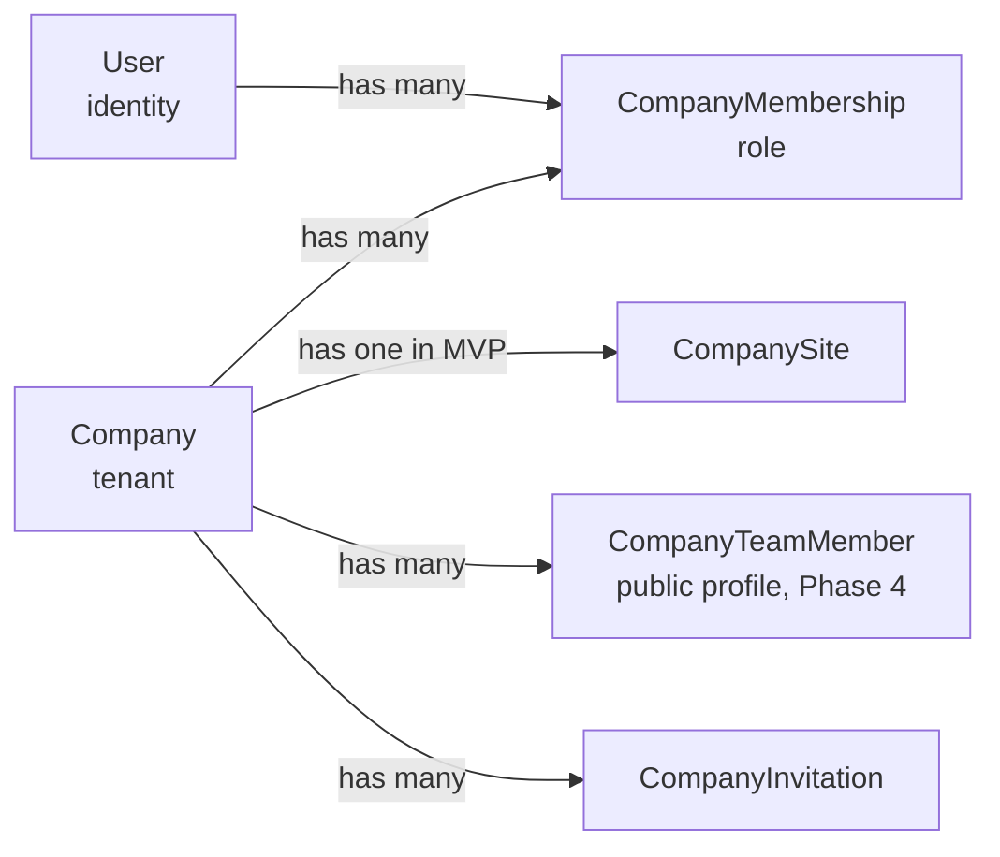
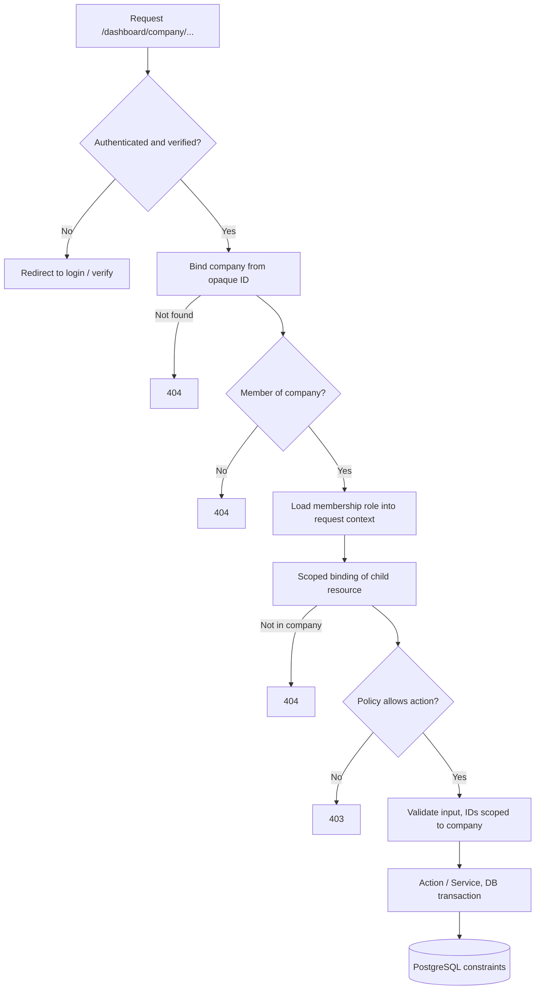

# FirmHub — Multi-Tenancy & Authorization Architecture

| | |
|---|---|
| **Phase / Task** | Phase 0 — Task 0.2 |
| **Status** | Draft — open questions (Section 13) pending decision |
| **Depends on** | [0.1 Product Scope & MVP](0.1-product-scope-and-mvp.md) |
| **Last updated** | 2026-10-26 |

> This document defines architecture and rules, not a database schema. Column types, primary key strategy and exact constraints are finalized in Task 0.3. Subdomain resolution details are finalized in Task 0.4.

---

## 1. Inputs & Assumptions

### Repository facts (verified, read-only)

- `users.id` is an auto-incrementing integer (starter kit default).
- Fortify provides registration, password reset, email verification and 2FA; `User` implements `MustVerifyEmail`.
- Dashboard routes use `auth` + `verified` middleware; Livewire pages are registered with `Route::livewire(...)`.
- No custom middleware, policies or gates exist yet.
- `SESSION_DOMAIN=null` (host-only session cookie); `.env.example` uses `SESSION_DRIVER=database`.
- The starter kit includes a self-service "delete account" flow.

### Assumptions taken from 0.1 recommendations (not yet confirmed)

| 0.1 question | Assumption used in this document |
|---|---|
| Q2 — Who can create companies | Any verified user; configurable per-user limit |
| Q6 — Invitations / Viewer role | Email invitations in MVP; Viewer is a read-only role |
| Q12 — Platform operator tooling | Platform admin flag + Artisan commands; no admin UI in MVP |

---

## 2. Tenant Boundary

**`Company` is the tenant.** Every piece of private business data belongs to exactly one company.

**Strategy:** Shared database, shared schema, company-based isolation.

### 2.1 Data classification

| Class | Definition | Examples |
|---|---|---|
| **Global** | Not owned by any tenant; readable by all authenticated users or the public | `Industry`, `SiteTheme`, reserved subdomain list |
| **Identity** | Belongs to a person, not a company | `User`, sessions, 2FA secrets |
| **Tenant-owned (direct)** | Has a mandatory owning `company_id` | `CompanySite`, `CompanyMembership`, `CompanyInvitation`, `CompanyContactMessage`, `CompanyLocation` |
| **Tenant-owned (indirect)** | Owned through a mandatory parent chain that ends at a company | `CompanySiteSection` → `CompanySite` → `Company` |
| **Platform** | Platform operation data, never visible to tenants | Platform admin flag, suspension metadata, future audit log |

### 2.2 Ownership rules

1. **OR-1:** Every tenant-owned record's owning company must be derivable through non-nullable foreign keys.
2. **OR-2:** A tenant-owned record must never reference a tenant-owned record of another company. This must be enforced by the database where a record references two tenant-owned parents (e.g. a contact message referencing a location). Candidate technique: composite foreign keys such as `(location_id, company_id) → company_locations(id, company_id)`. Final decision in 0.3.
3. **OR-3:** Indirectly owned records (e.g. sections) are always accessed through their parent (`$site->sections()`), never by global ID lookup alone.
4. **OR-4:** Ownership is immutable. A record is never moved between companies through user input.
5. **OR-5:** `company_id`, `company_site_id` and `role` are never mass-assignable from request data; they are set through relationships or explicit server-side code.

---

## 3. Identity, Membership & Public Profiles

| Concept | Purpose | Authenticates? | Public? |
|---|---|---|---|
| `User` | A person who can log in | Yes | No |
| `CompanyMembership` | Grants a user a role in a company | — | No |
| `CompanyInvitation` | Pending, time-limited offer of a membership | — | No |
| `CompanyTeamMember` (Phase 4) | Public staff profile shown on the website | No | Yes |

A team profile never grants access. A membership never creates a public profile automatically.

---

## 4. Request Contexts

FirmHub has three distinct request contexts. They must never share tenant resolution logic.

| Context | Entry point | Tenant source | Authentication | Data access |
|---|---|---|---|---|
| **Dashboard** | Platform host, `/dashboard/...` | Company identifier in the URL path | Required + verified email | Read/write, policy-checked |
| **Public site** | Tenant subdomain | Hostname → published `CompanySite` (Task 0.4) | None | Read-only, published content only |
| **Platform admin** | Platform host, `/admin/...` or Artisan | None (cross-tenant by design) | Required + platform admin flag | Limited operational actions |

### 4.1 Dashboard tenant resolution

**Decision: the active company is part of the URL** — e.g. `/dashboard/{company}/site`, `/dashboard/{company}/members`.

| Option | Pros | Cons | Verdict |
|---|---|---|---|
| **A. Company in URL path** | Stateless; multiple tabs with different companies work (persona P3); bookmarkable; route model binding + scoped bindings; every request is explicitly authorized | Slightly longer URLs | **Chosen** |
| B. Session `current_company_id` | Short URLs | Breaks with multiple tabs; Livewire requests can act on a different company than the page shows; hidden state | Rejected |
| C. `users.current_company_id` column | Persistent across devices | Same multi-tab problem as B; a write on every switch | Rejected as authority; acceptable as "last used" hint |

- The route key is an **opaque, non-sequential public identifier**, not the auto-increment ID and not the editable slug (slugs change; sequential IDs leak counts). The exact identifier type (ULID / UUID / short code) is decided in 0.3.
- A **"last used company"** value (session or user column) may be stored only to redirect `/dashboard` to a sensible default. It is never used for authorization.
- `/dashboard` root behavior:
  - No memberships → redirect to company onboarding.
  - Has memberships → redirect to the last used company if still a member, otherwise to a company picker.

### 4.2 Resolution & enforcement responsibilities

| Responsibility | Component (proposed) | Notes |
|---|---|---|
| Authenticate, require verified email | `auth`, `verified` (existing) | |
| Resolve `{company}` from the URL | Route model binding | 404 for unknown identifiers |
| Verify membership, load role | `EnsureCompanyMembership` middleware | 404 (not 403) for non-members to avoid confirming existence |
| Expose current company and membership to views/components | Request-scoped `CurrentCompany` context, populated by the middleware | Convenience only; policies still receive the model explicitly |
| Resolve child records within the company | `Route::scopeBindings()` / relationship queries | `/dashboard/{company}/messages/{message}` cannot load another company's message |
| Decide whether an action is allowed | Policies (`CompanyPolicy`, `CompanySitePolicy`, `CompanyMembershipPolicy`, ...) | Called in every controller action and every Livewire action |
| Validate referenced IDs belong to the company | Validation rules scoped by company (e.g. `Rule::exists(...)->where('company_id', ...)`) | Prevents attaching foreign records |
| Final integrity guarantee | PostgreSQL foreign keys and composite constraints (0.3) | |

### 4.3 Query scoping strategy

**Decision: explicit relationship-based scoping in the MVP; no automatic global tenant scope.**

| Option | Assessment |
|---|---|
| **Explicit scoping** (`$company->sites()`, scoped bindings, policies) | Visible, testable, works identically in HTTP, Livewire, console and the public context. **Chosen.** |
| Automatic global scope tied to "current tenant" | Defense in depth, but hidden behavior; breaks or silently empties results in console, public and platform admin contexts; easy to bypass with `withoutGlobalScopes()`. **Re-evaluate after Phase 3** if tests reveal gaps. |
| PostgreSQL Row-Level Security | Strongest isolation, but requires setting a session variable per request/connection and complicates migrations, tests and platform admin access. **Deferred** to Phase 7 hardening review. |

Compensating controls for not using a global scope: policies on every action, scoped bindings, mandatory cross-tenant tests for every tenant-owned resource (Section 11), and Pest architecture tests where practical.

### 4.4 Public site context (summary; details in 0.4)

- The tenant is resolved only from the hostname, and only to sites in **Published** status whose company is not suspended.
- The public context never reads the dashboard session's company, never runs tenant policies and never exposes draft data.
- **Preview is served from the dashboard context** (platform host, authenticated, policy-checked), not from the tenant subdomain. This keeps the session cookie host-only on the platform host and avoids sharing authentication with tenant hosts.

---

## 5. Tenancy Package Evaluation

| Option | Fit | Verdict |
|---|---|---|
| **Native Laravel** (route binding, middleware, policies, gates) | Covers all MVP needs; FirmHub's problem is membership-based authorization, not infrastructure-level tenant switching | **Chosen** |
| `stancl/tenancy` | Feature-rich, strong multi-database focus; single-database mode exists but brings concepts (tenant bootstrappers, central vs tenant connections) FirmHub does not need | Not adopted |
| `spatie/laravel-multitenancy` | Lightweight, but built around "one current tenant per request" found by domain; mismatched with a user who belongs to multiple companies in the dashboard | Not adopted |
| `spatie/laravel-permission` (for roles) | Supports team-scoped roles, but adds tables, caching and dynamic permissions for a fixed set of four roles | Not adopted |

Revisit only if per-tenant databases, dynamic custom roles or tenant-defined permissions become requirements. No package is added in Phase 0.

---

## 6. Role Model

### 6.1 Storage

- One role per membership, stored on `CompanyMembership` as a string column backed by a PHP enum `CompanyRole` (`Owner`, `Admin`, `Editor`, `Viewer`).
- The role → permission mapping lives in code (a `CompanyPermission` enum plus a mapping on `CompanyRole`), consumed by policies. No permission tables in the MVP.
- Roles have an explicit rank: `Owner (4) > Admin (3) > Editor (2) > Viewer (1)`. Rank drives the role-management rules in Section 8.

### 6.2 Role intent

| Role | Intent |
|---|---|
| **Owner** | Legal/business owner. Full control including destructive and ownership actions. Multiple owners allowed. |
| **Admin** | Day-to-day manager. Manages site, publishing, content and lower-ranked members. Cannot delete the company or manage owners/admins. |
| **Editor** | Content contributor. Edits site content and media. Cannot publish, manage members or change company-level settings. |
| **Viewer** | Read-only. Sees the dashboard, content and previews. Useful for reviewers and stakeholders. |

---

## 7. Permission Matrix

Legend: ✅ allowed · ❌ denied · ⚠️ allowed with restrictions (see note).

### 7.1 Company

| Capability | Owner | Admin | Editor | Viewer |
|---|---|---|---|---|
| View company dashboard | ✅ | ✅ | ✅ | ✅ |
| Edit company profile (name, contact info, legal info) | ✅ | ✅ | ❌ | ❌ |
| Change industry | ✅ | ✅ | ❌ | ❌ |
| Complete / edit onboarding steps | ✅ | ✅ | ❌ | ❌ |
| Delete company | ✅ | ❌ | ❌ | ❌ |

### 7.2 Membership & invitations

| Capability | Owner | Admin | Editor | Viewer |
|---|---|---|---|---|
| View member list | ✅ | ✅ | ✅ | ✅ |
| Invite members | ✅ | ⚠️ ¹ | ❌ | ❌ |
| Revoke pending invitations | ✅ | ⚠️ ¹ | ❌ | ❌ |
| Change a member's role | ✅ ² | ⚠️ ¹ | ❌ | ❌ |
| Remove a member | ✅ ² | ⚠️ ¹ | ❌ | ❌ |
| Grant Owner role / transfer ownership | ✅ | ❌ | ❌ | ❌ |
| Leave company | ⚠️ ² | ✅ | ✅ | ✅ |

¹ Admins may only invite, change or remove **Editor** and **Viewer** members, and may only assign Editor or Viewer.
² Subject to the last-owner rule (Section 8).

### 7.3 Website & content

| Capability | Owner | Admin | Editor | Viewer |
|---|---|---|---|---|
| Create site (one per company in MVP) | ✅ | ✅ | ❌ | ❌ |
| Edit site settings (name, language) | ✅ | ✅ | ❌ | ❌ |
| Change subdomain | ✅ | ✅ | ❌ | ❌ |
| Change theme / theme preset | ✅ | ✅ | ❌ | ❌ |
| Edit section content | ✅ | ✅ | ✅ | ❌ |
| Enable / disable / reorder sections | ✅ | ✅ | ✅ | ❌ |
| Manage products / services items | ✅ | ✅ | ✅ | ❌ |
| Upload / replace / delete media | ✅ | ✅ | ✅ | ❌ |
| Edit SEO metadata | ✅ | ✅ | ✅ | ❌ |
| Preview draft site | ✅ | ✅ | ✅ | ✅ |
| Publish / unpublish | ✅ | ✅ | ❌ | ❌ |
| Delete site | ✅ | ❌ | ❌ | ❌ |

### 7.4 Contact messages (personal data)

| Capability | Owner | Admin | Editor | Viewer |
|---|---|---|---|---|
| View messages | ✅ | ✅ | ❌ ³ | ❌ |
| Mark read / unread | ✅ | ✅ | ❌ ³ | ❌ |
| Delete messages | ✅ | ✅ | ❌ | ❌ |
| Receive new-message notifications | ✅ | ✅ | ❌ ³ | ❌ |

³ Data minimization default (KVKK/GDPR): visitor personal data is limited to roles responsible for the business relationship. See open question O-1.

### 7.5 Platform administration (separate from tenant roles)

| Capability | Platform admin | Any tenant role |
|---|---|---|
| Suspend / unsuspend a company or site | ✅ | ❌ |
| List companies and sites (operational metadata only) | ✅ | ❌ |
| Read tenant content or contact messages | ❌ (MVP) | per matrix above |
| Edit tenant content | ❌ | per matrix above |
| Impersonate users | ❌ (MVP) | ❌ |

---

## 8. Role Management Invariants

| ID | Rule |
|---|---|
| RM-1 | A company always has **at least one Owner**. Demoting or removing the last Owner, or the last Owner leaving, is rejected. |
| RM-2 | The last-owner check runs inside a transaction that locks the company's owner memberships (`SELECT ... FOR UPDATE`) to prevent two concurrent demotions from leaving zero owners. Must be verified with a PostgreSQL concurrency test. |
| RM-3 | Nobody can assign a role ranked higher than their own; only Owners can assign Owner. |
| RM-4 | Admins cannot modify or remove Owners or other Admins. |
| RM-5 | A user cannot change their own role (except an Owner stepping down when another Owner exists). |
| RM-6 | A user has at most one membership per company (unique `company_id, user_id`). |
| RM-7 | Role changes and removals take effect on the next request. Roles are never cached in the session. |
| RM-8 | **Account deletion:** a user who is the last Owner of any company cannot delete their account until they transfer ownership or delete the company. The existing starter-kit delete-account flow must be adapted in Phase 2. |
| RM-9 | Company creation and the creator's Owner membership are created in a single transaction. |
| RM-10 | Per-user company creation limit is configurable (abuse prevention). |

---

## 9. Invitations

| ID | Rule |
|---|---|
| INV-1 | An invitation targets an email address, a company and a role. |
| INV-2 | The token is random, stored only as a hash, single-use and expires (proposal: 7 days). |
| INV-3 | Acceptance requires an authenticated user with a **verified email matching the invited email** (case-insensitive). See open question O-3. |
| INV-4 | Inviter permissions (Section 7.2, RM-3/RM-4) are checked when sending **and re-checked when accepting** (the inviter may have been demoted or removed). |
| INV-5 | Inviting an existing member or duplicating a pending invitation for the same email is rejected. |
| INV-6 | Sending invitations is rate-limited per company and per inviter. |
| INV-7 | Invitation links reveal no company data to unauthenticated visitors beyond the company name. |
| INV-8 | Expired, revoked and accepted invitations cannot be reused; acceptance is idempotent. |

---

## 10. Platform Administration Boundaries

- Platform admin status is a property of the **User**, not a company role (proposal: a boolean flag such as `is_platform_admin`; final shape in 0.3).
- The flag is **not mass-assignable**, not editable via any UI in the MVP, and set only through an Artisan command.
- Authorization through a dedicated gate (e.g. `platform.admin`). **No `Gate::before` bypass:** platform admins do not implicitly receive tenant permissions.
- Platform admin routes live in a separate route group (`/admin`) with their own middleware. In the MVP, suspension may be performed through Artisan commands only.
- Platform admins should be required to have 2FA enabled (see open question O-4).
- Suspension actions are logged (actor, target, reason, timestamp) to the application log in the MVP; a persistent audit log is Phase 6.

---

## 11. Authorization Requirements

| ID | Requirement |
|---|---|
| AR-1 | Every dashboard route under `/dashboard/{company}` passes `auth`, `verified` and `EnsureCompanyMembership`. |
| AR-2 | Non-members receive **404** for company-scoped URLs; members lacking a permission receive **403**. |
| AR-3 | Every controller action and **every Livewire action** calls a policy. Authorizing only in `mount()` is insufficient because Livewire actions are separate requests. |
| AR-4 | Livewire components never accept a tenant identifier from client-writable state. IDs held in public properties are `#[Locked]`; Eloquent model properties are re-authorized on every action. (Livewire 4 tampering protection behavior must be verified against official docs during implementation.) |
| AR-5 | Client-submitted `company_id` is never trusted. The company comes from the authorized route context only. |
| AR-6 | Child resources are resolved with scoped bindings or through relationships of the authorized company/site. |
| AR-7 | Foreign keys referenced in input (location, item, media) are validated as belonging to the same company/site. |
| AR-8 | Tenant-owned models do not expose `company_id`, `company_site_id` or `role` as fillable from request data. |
| AR-9 | Cache keys for tenant data include the company (or site) identifier. |
| AR-10 | Tenant files are stored under company-scoped paths; private files are served only through an authorized controller (details in 0.5/0.7). |
| AR-11 | Queued jobs and notifications (sync in MVP) receive model identifiers and re-load data; they never rely on a "current tenant" global. |
| AR-12 | Logs never contain contact message bodies, invitation tokens or other sensitive data. |
| AR-13 | The session cookie stays **host-only** on the platform host (`SESSION_DOMAIN` unset); it must never be scoped to the parent domain shared with tenant subdomains. The `__Host-` cookie prefix should be evaluated for production (0.7). |
| AR-14 | Every tenant-owned resource has at least one automated cross-tenant access test (read, update, delete) and one role-denial test. |

### Request authorization pipeline

---

## 12. Cross-Tenant Risk Register

| ID | Risk | Mitigation | Verified by |
|---|---|---|---|
| T-1 | IDOR: guessing another company's ID in URL | Opaque route keys + membership check + 404 | Feature tests per route |
| T-2 | IDOR on child resource (`/companies/A/messages/{id-of-B}`) | Scoped bindings, relationship queries | Cross-tenant tests |
| T-3 | Livewire property tampering (changing an ID client-side) | `#[Locked]`, re-authorization per action, no client tenant IDs | Livewire component tests |
| T-4 | Authorizing only on page load | Policy call in every action (AR-3) | Tests calling actions directly |
| T-5 | Attaching another tenant's record via form input | Scoped `exists` validation + composite FKs | Validation + DB tests |
| T-6 | Mass assignment of `company_id` / `role` | Not fillable; relationship-based creation | Unit/feature tests |
| T-7 | Privilege escalation via role management | RM-3, RM-4, RM-5 | Role management tests |
| T-8 | Zero owners through concurrent demotion | RM-2 row locking | PostgreSQL concurrency test |
| T-9 | Stale role after removal | No role caching (RM-7) | Test: removed user's next request denied |
| T-10 | Invitation hijacking / reuse | INV-2, INV-3, INV-8 | Invitation tests |
| T-11 | Session/cookie leakage to tenant subdomains | Host-only cookie, preview on platform host (AR-13, 4.4) | Configuration test, 0.7 review |
| T-12 | Draft content exposed on public host | Public context resolves Published only (4.4) | Public routing tests (0.4) |
| T-13 | Platform admin implicitly bypassing tenant rules | No `Gate::before`, separate gate | Authorization tests |
| T-14 | Cross-tenant cache poisoning | Tenant-scoped cache keys (AR-9) | Code review, tests where cached |
| T-15 | Information disclosure via 403 vs 404 differences | 404 for non-members (AR-2) | Feature tests |

---

## 13. Open Questions

| # | Question | Recommendation | Blocks |
|---|---|---|---|
| O-1 | Should Editors see contact messages? | No by default (data minimization). Revisit if users request it. | 0.5, Phase 3 |
| O-2 | Allow multiple Owners per company? | Yes; RM-1/RM-2 protect the last owner | 0.3 |
| O-3 | Must the accepting user's email match the invited email? | Yes (prevents forwarded-link takeover) | Phase 2 |
| O-4 | Require 2FA for platform admins? | Yes, enforced by middleware on admin routes | 0.7 |
| O-5 | Should Admins be allowed to change the subdomain? | Yes, as specified; Owner-only is the stricter alternative | 0.4 |
| O-6 | Opaque route identifier type for companies (ULID, UUID, short code)? | Decide in 0.3 with PostgreSQL considerations | 0.3 |
| O-7 | Serve tenant sites from a separate registrable domain (e.g. `firmhub.site` vs `firmhub.com`), as GitHub does with `github.io`? | Strongly consider: isolates platform cookies and reputation from tenant content | 0.4, 0.7 |
| O-8 | Default per-user company creation limit? | Proposal: 5, configurable | Phase 2 |

---

## 14. Impact on Existing Code (for later phases; no changes in Phase 0)

- `routes/web.php`: `dashboard` will become company-scoped (`/dashboard/{company}/...`) with a root redirect.
- Settings > delete account: must enforce RM-8 (Phase 2).
- `bootstrap/app.php`: middleware alias registration for `EnsureCompanyMembership` (Phase 2).
- `config/session.php` / `.env.example`: keep `SESSION_DOMAIN` unset; document the reason (Phase 1/2).

---

## 15. Task 0.2 Acceptance Criteria Evaluation

| Criterion | Status | Evidence |
|---|---|---|
| Tenant boundary is clear | Met | Section 2: Company as tenant, data classification, ownership rules |
| Roles are defined | Met | Sections 6–8: role intent, permission matrix, invariants |
| Cross-tenant access risks identified | Met | Section 12 risk register with mitigations and tests |
| Need for a tenancy package justified | Met | Section 5: native Laravel chosen with rationale |
