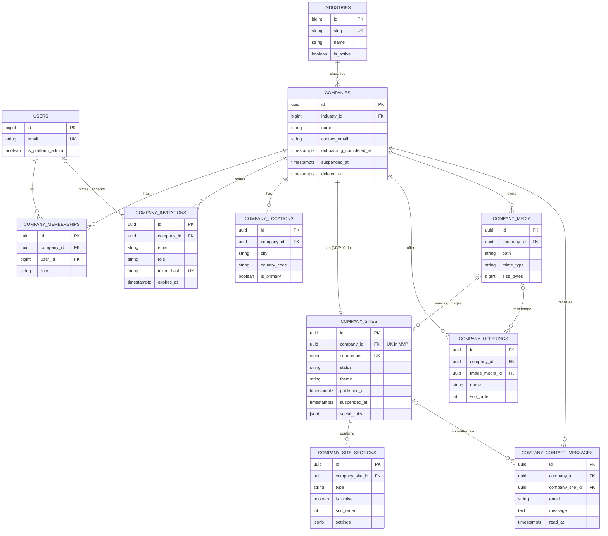
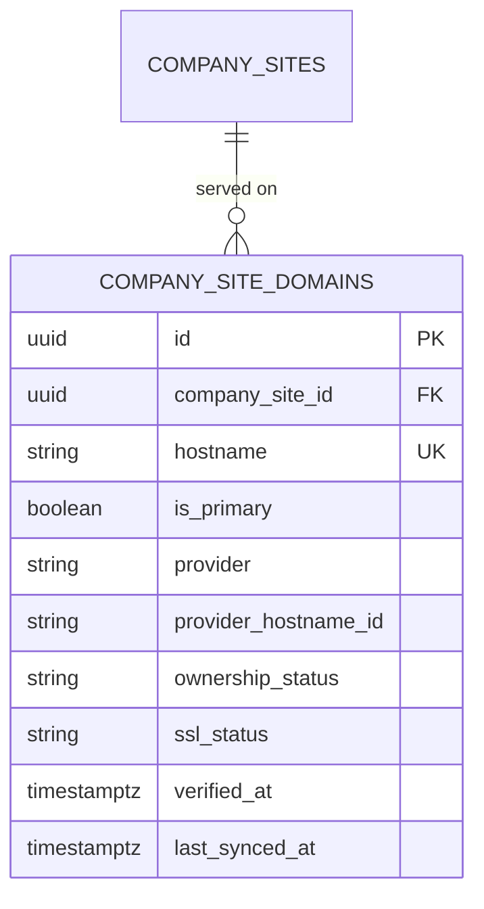

# FirmHub — PostgreSQL Data Architecture

| | |
|---|---|
| **Phase / Task** | Phase 0 — Task 0.3 |
| **Status** | Draft — open decisions (Section 12) pending |
| **Depends on** | [0.1 Product Scope](0.1-product-scope-and-mvp.md), [0.2 Multi-Tenancy & Authorization](0.2-multi-tenancy-and-authorization.md) |
| **Last updated** | 2026-10-26 |

> This is a conceptual and logical data model. It is **not** a migration specification. Column lists are indicative; exact types, names and defaults are finalized when each migration is implemented in Phases 2–3. Subdomain format rules are finalized in 0.4 and section content schemas in 0.5.

---

## 1. Inputs & Environment

### Verified repository facts

- PostgreSQL image: `postgres:18-alpine` (Sail); a separate testing database is created by Sail's init script.
- `users.id` is `bigint` (`$table->id()`); `users.email` has a case-sensitive unique index.
- Laravel `timestamps()` on PostgreSQL produces `timestamp without time zone` columns (existing tables).
- Connection: `search_path = public`, charset `utf8`.

### Assumptions carried from earlier tasks (unconfirmed)

| Source | Assumption |
|---|---|
| 0.1 Q4 | Products and services are a single "offering" list in the MVP |
| 0.1 Q5 | MVP site is a single page |
| 0.1 Q7 | One content language per site; no translation tables in MVP |
| 0.1 Q13 | Company deletion uses a grace period before permanent purge |
| 0.1 Q16 | The original `website` field is dropped |
| 0.2 O-2 | Multiple Owners per company are allowed |
| 0.2 O-6 | Opaque identifier type is decided here (Section 3) |

---

## 2. Global Modeling Conventions

| ID | Convention | Rationale |
|---|---|---|
| C-1 | Table names: plural `snake_case`, tenant tables prefixed `company_` | Matches Laravel conventions and the candidate model names |
| C-2 | Enumerated values stored as `varchar` + `CHECK` constraint, mapped to PHP backed enums (TitleCase cases) | PostgreSQL native `ENUM` types are hard to alter; CHECK constraints are easy to change in migrations |
| C-3 | JSON data uses `jsonb`, never `json` | Binary storage, validation on write, indexable if needed |
| C-4 | JSON only for data that is read/written as a whole, bounded in size and not queried relationally (Section 8) | Avoids hiding relational data in documents |
| C-5 | **Every foreign key column is indexed** unless it is the leading column of another index | PostgreSQL does not index FK columns automatically; unindexed FKs slow joins and cascading deletes |
| C-6 | New tables use `timestamptz` (`timestampsTz()`), application timezone UTC | Unambiguous instants; see open decision D-7 for consistency with existing tables |
| C-7 | `varchar(n)` only where the length is a domain rule (subdomain 63, email 254, ISO codes); otherwise `text` | No performance difference in PostgreSQL; limits must be meaningful |
| C-8 | Email values stored normalized to lowercase, enforced by `CHECK (email = lower(email))` on new tables | Avoids requiring the `citext` extension |
| C-9 | State lifecycles prefer timestamps (`published_at`, `suspended_at`, `read_at`) over redundant boolean/status pairs when the state is binary | Fewer invalid state combinations |
| C-10 | Constraints the Blueprint API cannot express (partial unique indexes, composite FKs with `ON DELETE SET NULL (col)`, CHECK regex) are written as raw SQL in migrations and covered by PostgreSQL tests | Integrity over convenience |

---

## 3. Primary Key Strategy

| Option | Assessment |
|---|---|
| A. `bigint` identity PK + separate public UUID column | Compact keys, but two identifiers per entity and constant risk of exposing the wrong one |
| **B. UUIDv7 PK (native `uuid` type) for tenant-owned entities** | One identifier; non-enumerable (satisfies 0.2 route-key requirement); time-ordered, so B-tree inserts stay localized unlike UUIDv4; 16 bytes vs 8 is negligible at the expected scale |
| C. ULID | Laravel stores ULIDs as `char(26)` on PostgreSQL: larger and slower to compare than native `uuid` |

**Decision: Option B.**

- **Tenant-owned and externally referenced entities:** `uuid` PK, UUIDv7, generated by the application (`HasUuids`). The UUID version produced by the installed Laravel version must be verified during implementation; PostgreSQL 18's native `uuidv7()` is an alternative default.
- **`users`:** keep the existing `bigint` PK. Changing the starter-kit identity table brings risk without benefit, since user IDs are never used as tenant route keys.
- **Global lookup tables** (`industries`): `bigint` identity PK; exposed by `slug`, not ID.
- **Known trade-off:** UUIDv7 embeds the creation timestamp (millisecond precision). Creation time of a company or message is not considered sensitive.

---

## 4. Conceptual Data Model

### 4.1 MVP entities

| Entity | Class (0.2) | Responsibility |
|---|---|---|
| `User` | Identity | Login identity (existing); gains a platform admin flag |
| `Industry` | Global | Business sector taxonomy chosen at onboarding |
| `Company` | Tenant root | Business identity, legal and contact information, platform suspension |
| `CompanyMembership` | Tenant (direct) | User ↔ company role |
| `CompanyInvitation` | Tenant (direct) | Pending, time-limited membership offer |
| `CompanyLocation` | Tenant (direct) | Physical address(es); exactly one primary in MVP |
| `CompanySite` | Tenant (direct) | Website: subdomain, theme, lifecycle, branding, SEO defaults |
| `CompanySiteSection` | Tenant (indirect, via site) | Ordered, toggleable content block with typed settings |
| `CompanyOffering` | Tenant (direct) | Product or service item shown in the Products/Services section |
| `CompanyMedia` | Tenant (direct) | Uploaded file metadata (logos, images) |
| `CompanyContactMessage` | Tenant (direct) | Visitor message submitted via a published site |

### 4.2 Future entities (designed for, not created in MVP)

| Entity | Phase | Purpose |
|---|---|---|
| `CompanySiteDomain` | 5 | Custom hostnames, Cloudflare for SaaS state, primary/canonical domain |
| `SiteTheme` + `industry_site_theme` pivot | 4 | Theme catalog and industry recommendations |
| `CompanyTeamMember` | 4 | Public staff profiles |
| `CompanyFaq` | 4 | FAQ entries |
| `CompanyArticle` | 4 | Articles / blog posts (generalized author relation) |
| `CompanySitePage` | 4+ | Multi-page sites |
| `CompanyContentRevision` | Future | Content history |
| `ReleasedSubdomain` | 3 (pending 0.4 / 0.1 Q9) | Quarantine of released subdomains |
| `AuditLog` | 6 | Platform and tenant audit trail |
| Geo reference tables (country/state/city) | Future | Only if structured geo filtering is required |

### 4.3 Removed or replaced candidate fields and models

| Original | Decision | Reason |
|---|---|---|
| `Company.slug` | **Removed** | Route key is the UUID (0.2); public identity is the site subdomain; a second slug duplicates it |
| `Company.website` | **Removed** | 0.1 Q16 |
| `Company.provided_category_id` | **Replaced** by `industry_id` | Explicit meaning (0.1 / prompt §9.1) |
| `Company.status` | **Replaced** by `suspended_at` (+ `deleted_at`) | Company has no other lifecycle states in MVP |
| `Company.onboarding_completed` | **Replaced** by `onboarding_completed_at` | Timestamp carries more information; current step is derived from data completeness, not stored |
| `CompanySite.custom_domain*` (4 fields) | **Moved** to future `CompanySiteDomain` | A site will have multiple hostnames; ownership status and SSL status are separate states (prompt §8.3); provider data does not belong on the site row |
| `CompanySite.theme` | **Kept as string key** + `theme_preset` | Themes are code-defined in MVP; a `site_themes` table is introduced only with the catalog (Phase 4) |
| `CompanySite.features` | **Removed** | Purpose undefined; sections and their `is_active` flag cover feature toggling |
| `CompanySite.bar_association` | **Removed** | Industry-specific; not part of the general platform |
| `CompanySite.legal_name`, `tax_no`, `registered_address`, `established_year` | **Moved** to `Company` | Facts about the business, not the website; avoids duplication when multiple sites exist |
| `CompanySite.phone`, `phone_whatsapp`, `email_secondary` | `phone`, `whatsapp_phone` **moved** to `Company`; `email_secondary` **removed** | Business contact facts; secondary email has no MVP use |
| `CompanySite.fax` | **Removed** | No MVP use |
| `CompanySite.logo_path`, `logo_dark_path`, `favicon_path`, `og_image_path` | **Replaced** by FKs to `company_media` | Integrity, cleanup, metadata (dimensions, MIME) |
| `CompanySite.social` | **Kept as `jsonb`** (`social_links`) | Bounded list, read/written as a whole (Section 8) |
| `CompanySite.seo` | **Replaced** by columns `seo_title`, `seo_description` + `og_image_media_id` | Few fixed fields; columns are validated and typed |
| `CompanyLocation.country_id/state_id/city_id` | **Replaced** by `country_code` (ISO 3166-1 alpha-2) + text `city`/`region` | No geo reference data in MVP |
| `CompanyLocation.slug`, `hours`, `lat`, `lng` | **Deferred** to Phase 4 (nullable additions) | Single address in MVP; maps via external link (0.1 Q17) |
| `CompanyPracticeArea` | **Replaced** by `CompanyOffering` | General-purpose platform |
| `CompanyContactMessage.location_id` | **Deferred** | Single location in MVP |
| `CompanyArticle.author_consultant_id` | Future: author → `CompanyTeamMember` (nullable) | Generalized; Phase 4 |

---

## 5. Logical Model (MVP)

Notation: **PK** primary key · **FK** foreign key · **UQ** unique · **NN** not null · **IX** index.

### 5.1 `users` (existing, extended)

| Column | Notes |
|---|---|
| existing columns | unchanged |
| `is_platform_admin` | `boolean` NN default `false`; not mass-assignable (0.2 §10) |

Existing issue: `users.email` uniqueness is case-sensitive. See D-6.

### 5.2 `industries`

| Column | Notes |
|---|---|
| `id` | `bigint` identity PK |
| `slug` | UQ, NN; stable key used for translations (`industries.{slug}` lang keys) |
| `name` | NN; English fallback label |
| `is_active` | NN default `true`; inactive industries are hidden from onboarding, never deleted |
| `sort_order` | NN |
| timestamps | |

Seeded and platform-managed. Translations live in Laravel lang files, not in the database (see D-8).

### 5.3 `companies`

| Column | Notes |
|---|---|
| `id` | `uuid` PK |
| `name` | NN |
| `industry_id` | FK → `industries`, NN, `ON DELETE RESTRICT`, IX |
| `contact_email` | NN, lowercase CHECK |
| `phone`, `whatsapp_phone` | nullable; E.164 normalization rule in 0.5 |
| `legal_name`, `tax_number`, `tax_office`, `trade_registry_number` | nullable (0.1 Q14 — legal display requirements unverified) |
| `established_year` | `smallint` nullable, CHECK reasonable range |
| `onboarding_completed_at` | nullable |
| `suspended_at`, `suspension_reason` | nullable; platform-managed |
| `deleted_at` | soft delete; grace period before purge (Section 9) |
| timestamps | |

### 5.4 `company_memberships`

| Column | Notes |
|---|---|
| `id` | `uuid` PK (used in member-management URLs) |
| `company_id` | FK → `companies` NN `ON DELETE CASCADE` |
| `user_id` | FK → `users` NN `ON DELETE CASCADE`, IX |
| `role` | NN, CHECK in (`owner`,`admin`,`editor`,`viewer`) |
| `invited_by_user_id` | FK → `users` nullable `ON DELETE SET NULL`, IX |
| timestamps | |
| **UQ** | `(company_id, user_id)` — RM-6; also serves as the `company_id` index |
| **IX** | `(company_id) WHERE role = 'owner'` partial index — fast last-owner checks |

"At least one Owner" (RM-1) is enforced in the application with row locking (RM-2). A database trigger is possible but deferred (see Section 10).

### 5.5 `company_invitations`

| Column | Notes |
|---|---|
| `id` | `uuid` PK |
| `company_id` | FK → `companies` NN `ON DELETE CASCADE` |
| `email` | NN, lowercase CHECK |
| `role` | NN, CHECK in (`admin`,`editor`,`viewer`) — Owner is granted only by transfer |
| `token_hash` | NN, UQ (SHA-256 of the random token; plain token never stored) |
| `invited_by_user_id` | FK → `users` nullable `ON DELETE SET NULL`, IX |
| `expires_at` | NN |
| `accepted_at`, `accepted_by_user_id` | nullable; FK → `users` `ON DELETE SET NULL`, IX |
| `revoked_at` | nullable |
| timestamps | |
| **CHECK** | not both `accepted_at` and `revoked_at` set |
| **UQ (partial)** | `(company_id, email) WHERE accepted_at IS NULL AND revoked_at IS NULL` — INV-5 (re-inviting revokes the previous pending invitation in the same transaction) |

### 5.6 `company_locations`

| Column | Notes |
|---|---|
| `id` | `uuid` PK |
| `company_id` | FK → `companies` NN `ON DELETE CASCADE` |
| `label` | nullable (e.g. "Head office") |
| `address_line1` NN, `address_line2`, `postal_code`, `city` NN, `region` | text |
| `country_code` | `char(2)` NN, CHECK uppercase ISO alpha-2 |
| `phone`, `email` | nullable; location-specific overrides |
| `is_primary` | NN default `false` |
| `sort_order` | NN |
| timestamps | |
| **IX** | `(company_id, sort_order)` |
| **UQ (partial)** | `(company_id) WHERE is_primary` — at most one primary location |

MVP UI manages a single primary location; the table already supports Phase 4 multi-location (see D-2).

### 5.7 `company_media`

| Column | Notes |
|---|---|
| `id` | `uuid` PK |
| `company_id` | FK → `companies` NN `ON DELETE CASCADE` |
| `disk` | NN (e.g. `public`) |
| `path` | NN; generated, company-scoped (`companies/{company_id}/...`), never user-supplied |
| `original_name` | sanitized display name |
| `mime_type` | NN, detected server-side |
| `size_bytes` | `bigint` NN, CHECK > 0 |
| `width`, `height` | nullable `integer` |
| `checksum_sha256` | nullable |
| `alt_text` | nullable |
| `uploaded_by_user_id` | FK → `users` nullable `ON DELETE SET NULL`, IX |
| timestamps | |
| **UQ** | `(disk, path)` |
| **UQ** | `(id, company_id)` — target for composite FKs (OR-2) |
| **IX** | `(company_id, created_at)` |

Image variants (resized versions) and orphan cleanup are designed in 0.5.

### 5.8 `company_sites`

| Column | Notes |
|---|---|
| `id` | `uuid` PK |
| `company_id` | FK → `companies` NN `ON DELETE CASCADE` |
| `subdomain` | `varchar(63)` NN, **UQ**; CHECK lowercase DNS-label format (exact regex and length rules in 0.4) |
| `locale` | NN default `en` (site content language) |
| `theme` | NN; validated against the code-defined theme registry |
| `theme_preset` | nullable; validated against the theme's presets |
| `status` | NN, CHECK in (`draft`,`published`,`unpublished`), default `draft` |
| `published_at` | nullable; last publish time |
| `first_published_at` | nullable |
| `suspended_at`, `suspension_reason` | nullable; **orthogonal to `status`** so unsuspending restores the previous state |
| `logo_media_id`, `logo_dark_media_id`, `favicon_media_id`, `og_image_media_id` | nullable; composite FKs `(x_media_id, company_id) → company_media(id, company_id)` `ON DELETE SET NULL (x_media_id)` |
| `seo_title`, `seo_description` | nullable |
| `social_links` | `jsonb` NN default `'[]'` (Section 8) |
| timestamps | |
| **UQ** | `(company_id)` — **MVP one-site-per-company rule**; dropped when multi-site is introduced |
| **UQ** | `(id, company_id)` — target for composite FKs |
| **CHECK** | `status = 'published'` ⇒ `published_at IS NOT NULL` |
| **IX** | `subdomain` is covered by its UQ index (hot path for public host resolution) |

The public resolution query (0.4) filters `status = 'published' AND suspended_at IS NULL` and joins `companies` with `suspended_at IS NULL AND deleted_at IS NULL`.

### 5.9 `company_site_sections`

| Column | Notes |
|---|---|
| `id` | `uuid` PK |
| `company_site_id` | FK → `company_sites` NN `ON DELETE CASCADE` |
| `type` | NN, CHECK in MVP types (`hero`,`about`,`offerings`,`contact`); final list in 0.5 |
| `is_active` | NN default `true` |
| `sort_order` | NN |
| `settings` | `jsonb` NN default `'{}'`; schema validated per `type` in the application (0.5) |
| timestamps | |
| **UQ** | `(company_site_id, type)` — one section per type in MVP; relaxed when repeatable section types arrive |
| **IX** | `(company_site_id, sort_order)` |

No `company_id` column: ownership is derived through the site (approved decision). `sort_order` is not unique; reordering locks the parent site row and rewrites the order in one transaction, and reads sort by `(sort_order, id)` for determinism.

**Media referenced inside `settings`** (e.g. hero image) cannot be protected by a foreign key. Rule: on save, referenced media IDs are validated to belong to the site's company; media deletion checks references. Final approach decided in 0.5 (see D-9).

### 5.10 `company_offerings`

| Column | Notes |
|---|---|
| `id` | `uuid` PK |
| `company_id` | FK → `companies` NN `ON DELETE CASCADE` |
| `name` | NN |
| `description` | nullable `text` |
| `price_label` | nullable free text (e.g. "from 500 TL"); no commerce semantics |
| `image_media_id` | nullable; composite FK `(image_media_id, company_id) → company_media(id, company_id)` `ON DELETE SET NULL (image_media_id)` |
| `is_active` | NN default `true` |
| `sort_order` | NN |
| timestamps | |
| **IX** | `(company_id, sort_order)` |

Company-scoped rather than site-scoped: offerings are business data that exist independently of a website; a future multi-site setup can add a per-site selection pivot (see D-1).

### 5.11 `company_contact_messages`

| Column | Notes |
|---|---|
| `id` | `uuid` PK |
| `company_id` | FK → `companies` NN `ON DELETE CASCADE` |
| `company_site_id` | nullable; composite FK `(company_site_id, company_id) → company_sites(id, company_id)` `ON DELETE SET NULL (company_site_id)` |
| `name`, `email` | NN; email lowercase CHECK |
| `phone`, `subject` | nullable |
| `message` | NN `text`, length limit enforced in validation |
| `locale` | NN |
| `privacy_notice_version` | NN; which notice text the visitor was shown (KVKK/GDPR evidence) |
| `meta` | `jsonb` NN default `'{}'`; minimal (e.g. user agent) — **no raw IP address** (see D-5) |
| `read_at` | nullable |
| `created_at`, `updated_at` | |
| **IX** | `(company_id, created_at DESC)` — inbox listing |
| **IX (partial)** | `(company_id) WHERE read_at IS NULL` — unread counts |
| **IX** | `(created_at)` — retention purge |

---

## 6. Mermaid ERD (MVP)

### Future extension (Phase 5): domains

This preserves the original Cloudflare candidates (`custom_domain` → `hostname`, `custom_domain_verified_at` → `verified_at`, `custom_domain_cf_hostname_id` → `provider_hostname_id`, `custom_domain_status` → split into `ownership_status` and `ssl_status`). The platform subdomain stays on `company_sites`, because every site always has one and it is platform-managed. Details in 0.4.

---

## 7. Relationship Matrix

| Parent | Child | Cardinality | FK | On delete | Tenant integrity |
|---|---|---|---|---|---|
| `industries` | `companies` | 1 : N | `industry_id` | RESTRICT | Global → tenant |
| `users` | `company_memberships` | 1 : N | `user_id` | CASCADE (app blocks last owner, RM-8) | — |
| `companies` | `company_memberships` | 1 : N | `company_id` | CASCADE | UQ `(company_id, user_id)` |
| `companies` | `company_invitations` | 1 : N | `company_id` | CASCADE | — |
| `users` | `company_invitations` | 1 : N (inviter, accepter) | `invited_by_user_id`, `accepted_by_user_id` | SET NULL | — |
| `companies` | `company_locations` | 1 : N (MVP UI: 1) | `company_id` | CASCADE | Partial UQ primary |
| `companies` | `company_sites` | 1 : 0..1 (MVP), 1 : N (future) | `company_id` | CASCADE | UQ `(company_id)` in MVP |
| `company_sites` | `company_site_sections` | 1 : N | `company_site_id` | CASCADE | Ownership via site |
| `companies` | `company_offerings` | 1 : N | `company_id` | CASCADE | — |
| `companies` | `company_media` | 1 : N | `company_id` | CASCADE (files purged first, §9) | — |
| `company_media` | `company_sites` (4 image slots) | 1 : N | `*_media_id` | SET NULL (column only) | Composite FK with `company_id` |
| `company_media` | `company_offerings` | 1 : N | `image_media_id` | SET NULL (column only) | Composite FK with `company_id` |
| `companies` | `company_contact_messages` | 1 : N | `company_id` | CASCADE | — |
| `company_sites` | `company_contact_messages` | 1 : N | `company_site_id` | SET NULL (column only) | Composite FK with `company_id` |
| `users` | `company_media` | 1 : N (uploader) | `uploaded_by_user_id` | SET NULL | — |

---

## 8. JSON vs Relational Decisions

| Data | Storage | Reason |
|---|---|---|
| Section settings | `jsonb` | Shape varies by section type; always loaded with the section; validated per type in code (0.5) |
| Social links | `jsonb` array of `{platform, url}` | Bounded (≈10 items), read/written as a whole, never queried; platform values validated against an enum |
| Contact message meta | `jsonb` | Optional, non-queried diagnostic data |
| SEO fields | Columns | Fixed, small set; typed and validated |
| Offerings | Table | Independent records with ordering, visibility and images |
| Domains (future) | Table | Lifecycle, uniqueness and provider sync |
| Branding images | FK columns | Referential integrity and cleanup |
| Company legal / contact info | Columns | Fixed fields, displayed and validated individually |

---

## 9. Delete & Retention Policies

| Entity | Policy |
|---|---|
| **User** | Self-deletion blocked while the user is the last Owner of any company (RM-8). Otherwise memberships cascade; authorship references (`invited_by`, `uploaded_by`) set null. |
| **Company** | Soft delete (`deleted_at`) by an Owner. Grace period (proposal: 30 days, D-4), during which the site is offline and the subdomain stays reserved. A scheduled purge job then deletes stored files, then hard-deletes the company; FK cascades remove all tenant rows. Restore is possible during the grace period. |
| **CompanySite** | Hard delete by an Owner; sections cascade; contact messages are kept with `company_site_id = NULL`. The subdomain enters quarantine if adopted (0.4). |
| **CompanySiteSection** | Not user-deletable in MVP (fixed set per site); disabled via `is_active`. |
| **CompanyMedia** | Hard delete row + file. Referencing FK columns become null; JSON references checked by the application (D-9). |
| **CompanyInvitation** | Kept after acceptance or revocation for traceability; expired/closed invitations purged after a retention period (proposal: 90 days). |
| **CompanyContactMessage** | Hard delete by authorized roles; automatic purge after the retention period (0.1 Q11, proposal 24 months). |
| **Industry** | Never deleted while referenced (RESTRICT); deactivate instead. |

Purge jobs run on the Laravel scheduler (introduced when needed, Phase 2/3).

---

## 10. Transactions & Concurrency

| Operation | Strategy |
|---|---|
| Create company | Single transaction: company + Owner membership (RM-9) |
| Change role / remove member / leave | Transaction; `SELECT ... FOR UPDATE` on the company's owner memberships before checking RM-1 (RM-2) |
| Claim or change subdomain | Rely on the UQ constraint; catch unique violation (SQLSTATE `23505`) and return a validation error. Pre-checks are for UX only, never for correctness |
| Create site | Rely on UQ `(company_id)`; catch `23505` |
| Accept invitation | Transaction; lock the invitation row `FOR UPDATE`; verify state; insert membership (UQ handles races); set `accepted_at` |
| Publish / unpublish | Transaction; lock the site row `FOR UPDATE`; validate completeness; update status and timestamps |
| Reorder sections | Transaction; lock the site row; rewrite `sort_order` |
| Concurrent content edits | MVP: last write wins. Optimistic locking on sections (compare `updated_at`) is a **Should** for Phase 3 |
| Set primary location | Transaction: unset previous primary, set new; partial UQ prevents two primaries |
| File uploads | Store file first, then insert the media row in a transaction; on DB failure delete the stored file. External/long operations stay outside DB transactions |
| Deferred | DB trigger guaranteeing ≥1 Owner; Row-Level Security (0.2 §4.3) — reconsider in Phase 7 |

All of the above must be covered by tests running on **real PostgreSQL** (not SQLite), including at least one concurrency test for RM-2 and one for subdomain claiming.

---

## 11. Indexing Strategy Summary

| Table | Indexes (beyond PK) | Query served |
|---|---|---|
| `industries` | UQ `slug` | Onboarding list, lookup by slug |
| `companies` | `industry_id` | FK / future analytics |
| `company_memberships` | UQ `(company_id, user_id)`; `user_id`; partial `(company_id) WHERE role='owner'` | Membership check per request; company switcher; last-owner check |
| `company_invitations` | UQ `token_hash`; partial UQ `(company_id, email)` pending; FK indexes | Acceptance lookup; duplicate prevention |
| `company_locations` | `(company_id, sort_order)`; partial UQ primary | Listing; primary lookup |
| `company_media` | UQ `(disk, path)`; UQ `(id, company_id)`; `(company_id, created_at)` | Media library; composite FK target |
| `company_sites` | UQ `subdomain`; UQ `(company_id)`; UQ `(id, company_id)`; media FK columns | **Public host resolution (hot path)**; dashboard site lookup |
| `company_site_sections` | UQ `(company_site_id, type)`; `(company_site_id, sort_order)` | Render ordered sections |
| `company_offerings` | `(company_id, sort_order)`; `image_media_id` | Render ordered items |
| `company_contact_messages` | `(company_id, created_at DESC)`; partial unread; `(created_at)`; `company_site_id` | Inbox; unread badge; retention purge |

No speculative indexes beyond these; additional indexes require a measured query need.

---

## 12. Open Decisions

| # | Decision | Recommendation | Affects |
|---|---|---|---|
| D-1 | Offerings scoped to company or site? | Company (business data); per-site selection pivot when multi-site arrives | 0.5 |
| D-2 | Single address on `companies` or `company_locations` table in MVP? | `company_locations` with one primary — avoids a data migration in Phase 4 | 0.5 |
| D-3 | UUIDv7 PK vs bigint + public UUID | UUIDv7 PK (Section 3) | All tenant tables |
| D-4 | Company deletion grace period | 30 days | Phase 2 |
| D-5 | Store visitor IP addresses with contact messages? | No; rate limiting uses the cache. If abuse investigation needs it, store a salted hash with short retention | 0.7 |
| D-6 | Fix case-sensitive `users.email` uniqueness? | Yes: normalize to lowercase in Fortify actions + functional unique index on `lower(email)` (Phase 1/2 task, existing data check first) | Phase 1/2 |
| D-7 | `timestamptz` for new tables while existing tables use `timestamp`? | Yes for new tables; leave starter-kit tables unchanged | All migrations |
| D-8 | Industry labels: lang files vs DB translations | Lang files keyed by slug (platform-managed, small list) | Phase 2 |
| D-9 | Integrity of media references inside section `settings` | Prefer dedicated nullable media FK columns or a `company_site_section_media` pivot over IDs in JSON; decide in 0.5 | 0.5 |
| D-10 | Add a `kind` (product/service) column to offerings now? | No (YAGNI); a later migration can add it if the list is split | 0.5 |

---

## 13. Multi-Site Readiness Check

| Future change | Required schema change |
|---|---|
| Allow N sites per company | Drop UQ `company_sites(company_id)`; nothing else |
| Sections per site | None — already site-scoped |
| Messages per site | None — `company_site_id` already present |
| Custom domains per site | Add `company_site_domains` |
| Different offerings per site | Add a site ↔ offering pivot |
| Site-specific contact info | Nullable override columns on `company_sites` |

---

## 14. Task 0.3 Acceptance Criteria Evaluation

| Criterion | Status | Evidence |
|---|---|---|
| Tenant relationships are correct | Met | Sections 4–7; composite FKs prevent cross-tenant references (OR-2) |
| MVP single-site rule supported | Met | UQ `company_sites(company_id)` + application check (§5.8, §10) |
| Future multi-site readiness evaluated | Met | Section 13 |
| Redundant columns and models identified | Met | Section 4.3 |
| Deletion and integrity rules explained | Met | Sections 7, 9, 10 |
