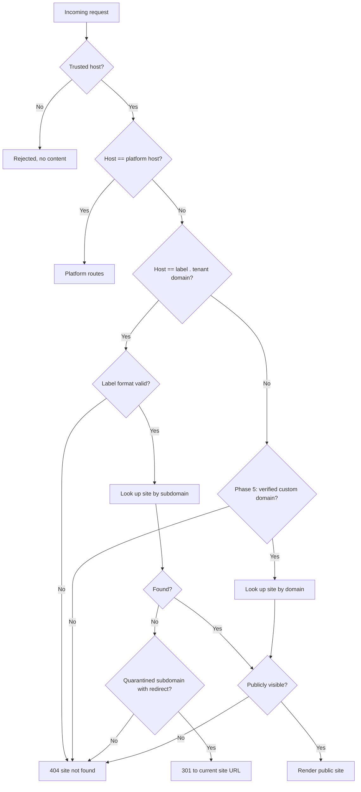
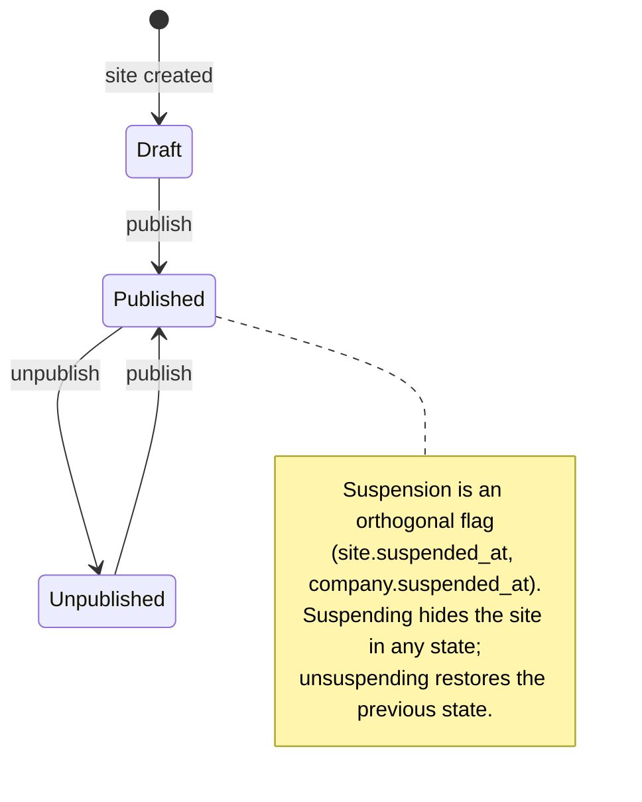
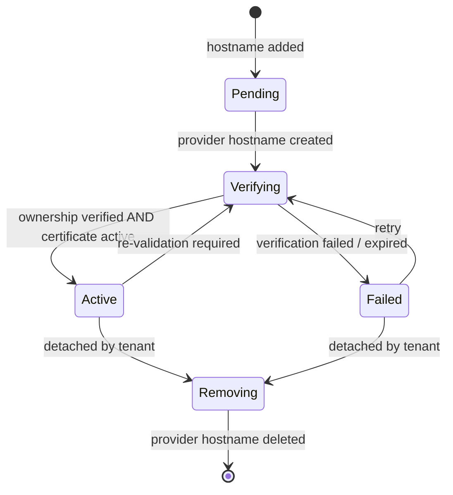

# FirmHub — Subdomain, Domain & Publishing Architecture

| | |
|---|---|
| **Phase / Task** | Phase 0 — Task 0.4 |
| **Status** | Draft — open questions (Section 14) pending decision |
| **Depends on** | [0.1](0.1-product-scope-and-mvp.md), [0.2](0.2-multi-tenancy-and-authorization.md), [0.3](0.3-postgresql-data-architecture.md) |
| **Last updated** | 2026-10-29 |

> Architecture only. No routes, middleware, configuration or DNS changes are made in Phase 0. Component names are proposals for Phases 3 and 5.

---

## 1. Inputs & Assumptions

### Verified repository facts

- `APP_URL=http://localhost`; `SESSION_DOMAIN=null` (host-only session cookie).
- Sail exposes the application on host port `${APP_PORT:-80}`; the health route `/up` is registered without a domain constraint.
- `bootstrap/app.php` registers no custom middleware; no trusted host or trusted proxy configuration exists yet.
- Only `routes/web.php` and `routes/settings.php` exist (platform routes).

### Carried decisions and assumptions

| Source | Item |
|---|---|
| Approved | Subdomain first; custom domains via Cloudflare for SaaS later; no Cloudflare code now |
| 0.1 Q3 | No platform approval before publishing (assumed) |
| 0.1 Q9 | Subdomain may change after publishing, limited, with quarantine (assumed; specified in §5) |
| 0.2 §4.4 | Preview is served from the dashboard (platform host), not from tenant hosts |
| 0.2 O-5 | Owners and Admins can change the subdomain (assumed) |
| 0.2 O-7 | Separate registrable domain for tenant sites — evaluated in §2 |
| 0.3 §5.8 | `company_sites.subdomain` `varchar(63)` UQ; `status` + orthogonal `suspended_at` |

---

## 2. Host Topology

FirmHub serves two kinds of hosts:

| Host type | Example (production) | Example (local) | Serves |
|---|---|---|---|
| **Platform host** | `firmhub.com` | `localhost` | Marketing page, auth, dashboard, preview, platform admin |
| **Tenant host** | `acme.{tenant-domain}` | `acme.localhost` | Published public company sites only |
| **Custom domain** (Phase 5) | `www.acme.com` | — (public staging only) | Published public company site |

### 2.1 Tenant domain options

| Option | Example | Assessment |
|---|---|---|
| A. Subdomains of the platform domain | `acme.firmhub.com` | Simple branding. Tenant hosts are **same-site** with the dashboard: a cookie mistakenly scoped to `.firmhub.com` would reach every tenant host; tenant content reputation (phishing, spam blocklists) affects the platform domain |
| **B. Separate registrable domain** | `acme.firmhub.site` | Tenant hosts are **cross-site** with the dashboard; platform cookies can never reach them; reputation isolated. Same approach as `github.io`, `vercel.app`, `netlify.app`. Costs one more domain and certificate |
| C. Nested subdomain of the platform domain | `acme.sites.firmhub.com` | Still same-site with the platform; needs a two-level wildcard; no real isolation benefit |

**Recommendation: Option B for production.** The architecture must not hard-code either choice: platform host and tenant domain are **independent configuration values** (`firmhub.platform_host`, `firmhub.tenant_domain`), so Option A remains possible. If Option A is chosen, controls SD-4 and SD-5 (Section 11) become mandatory rather than recommended.

Submitting the tenant domain to the Public Suffix List (prevents tenants from setting cookies for each other) is relevant only once tenants can run their own JavaScript; it is out of scope for the MVP and noted for Phase 7.

---

## 3. Request Routing Architecture

### 3.1 Route groups

| Group | Route file | Host constraint | Middleware (proposed) |
|---|---|---|---|
| Platform | `routes/web.php`, `routes/settings.php` (existing) | `Route::domain(platform_host)` | `web`, existing auth middleware |
| Tenant public site | `routes/tenant.php` (new, Phase 3) | **No domain constraint**; registered after platform routes | `web` (session-less variant, see §3.3), `ResolvePublicSite` |
| Health | `/up` (existing) | Any trusted host | — |

Platform routes are constrained to the platform host so that a tenant host can never reach `/dashboard`, `/login` or `/admin`. Tenant routes are deliberately **not** bound to a `{subdomain}.{tenant_domain}` route pattern: in Phase 5 arbitrary custom hostnames must reach the same routes, so host-to-site resolution is the job of a resolver, not of the router.

### 3.2 Host resolution



**Publicly visible** = `site.status = 'published'` AND `site.suspended_at IS NULL` AND `company.suspended_at IS NULL` AND `company.deleted_at IS NULL` (single indexed query, 0.3 §5.8).

### 3.3 Responsibilities

| Component (proposed) | Responsibility |
|---|---|
| `config/firmhub.php` | `platform_host`, `tenant_domain`, `tenant_scheme`, `tenant_port`, subdomain rules (min/max length, quarantine days, change cooldown) |
| `SiteHostResolver` | Pure service: hostname → `CompanySite` or `null`. MVP: subdomain lookup. Phase 5: adds custom domain lookup. No HTTP concerns |
| `ResolvePublicSite` middleware | Calls the resolver, applies the visibility rule, handles quarantine redirects, aborts with 404, stores the resolved site in a request-scoped `CurrentSite` context |
| `SiteUrlGenerator` | **Single source of truth** for site URLs (canonical, "view site" links, sitemap, redirects, emails). Builds URLs from configuration + site record, never from the request `Host` header |
| `ValidSubdomain` rule + `ReservedSubdomains` | Format validation, normalization, reserved-name check (§4) |
| Actions: `ClaimSubdomain`, `ChangeSiteSubdomain`, `PublishSite`, `UnpublishSite`, `SuspendSite`, `UnsuspendSite` | Business operations with transactions and locking (§5, §7) |
| Artisan commands | Platform suspension in MVP (0.2 §10) |

Public site routes should not start sessions or emit cookies (no `StartSession`, no CSRF cookie) except for the contact form submission, which needs CSRF or an equivalent protection. The exact middleware stack and contact-form CSRF strategy are decided in 0.6/0.7.

---

## 4. Subdomain Naming Rules

### 4.1 Format

| Rule | Value | Reason |
|---|---|---|
| Normalization | Trim, lowercase before validation and storage | Hostnames are case-insensitive |
| Allowed characters | `a-z`, `0-9`, `-` (ASCII only) | DNS label rules (LDH) |
| Start / end | Alphanumeric | DNS label rules |
| Consecutive hyphens | Not allowed (`--`) | Blocks `xn--` punycode labels and look-alikes |
| Length | 3–63 | 63 is the DNS label maximum; < 3 is too short and collision-prone |
| All-numeric | Not allowed | Avoids confusion with IDs and IP-like names |
| IDN / Unicode | Not supported in MVP | Homograph attack risk |
| Multi-level (`www.acme.`) | Not supported | Wildcard certificates cover one level only |

Database CHECK (0.3, C-10), indicative:

```sql
CHECK (
    subdomain ~ '^[a-z0-9][a-z0-9-]{1,61}[a-z0-9]$'
    AND position('--' in subdomain) = 0
    AND subdomain !~ '^[0-9]+$'
)
```

The same rules are implemented in the `ValidSubdomain` validation rule so that users get friendly messages; the CHECK is the last line of defense.

### 4.2 Reserved names

Maintained in code (version-controlled), not in the database, grouped by reason:

| Group | Examples |
|---|---|
| Platform & product | `www`, `app`, `api`, `admin`, `dashboard`, `account`, `accounts`, `billing`, `login`, `logout`, `register`, `signup`, `auth`, `sso`, `oauth`, `firmhub` |
| Infrastructure | `mail`, `smtp`, `imap`, `pop`, `mx`, `ns1`, `ns2`, `dns`, `ftp`, `cdn`, `static`, `assets`, `media`, `storage`, `files`, `img`, `status`, `health` |
| Content & support | `blog`, `docs`, `help`, `support`, `about`, `contact`, `legal`, `privacy`, `terms`, `security` |
| Environments | `dev`, `test`, `staging`, `demo`, `beta`, `preview`, `sandbox`, `internal`, `localhost` |

- Every DNS record the platform ever creates under the tenant domain must also be in this list (subdomain takeover prevention, §8.4).
- Brand impersonation and offensive-name screening is a Phase 6 moderation concern; the list structure must allow adding groups later.

### 4.3 Suggested subdomain

During site creation the system proposes a subdomain from the company name: transliterate (Turkish characters `ç ğ ı İ ö ş ü` → `c g i i o s u`), slugify, trim to the length limit, and append a short numeric suffix on collision. The user can edit the suggestion; the suggestion is not reserved until saved.

---

## 5. Subdomain Lifecycle & Change Policy

| Situation | Behavior |
|---|---|
| Site never published | Subdomain can be changed freely |
| Site has been published | Change allowed for Owner/Admin, at most once per **30 days** (configurable) |
| Old subdomain after a change | Enters **quarantine for 90 days** (configurable): reserved for the same company, and requests to it receive a **301 redirect** to the new site URL |
| Company reclaims its old subdomain during quarantine | Allowed; the quarantine record is removed |
| Quarantine expires | Name becomes available to everyone |
| Company soft-deleted (grace period) | Subdomain stays on the site row; site is not visible; name is not claimable |
| Company purged | Subdomain enters quarantine without redirect (no owner) for 90 days |
| Site deleted | Subdomain enters quarantine without redirect for 90 days |

### 5.1 Data shape (extends 0.3 §4.2 `ReleasedSubdomain`)

`released_subdomains`: `subdomain` (PK), `company_id` (nullable FK, `ON DELETE SET NULL`), `redirect_site_id` (nullable FK → `company_sites`, `ON DELETE SET NULL`), `released_at`, `available_at`. Index on `available_at` for cleanup. Expired rows are deleted by a scheduled job.

### 5.2 Claiming a subdomain safely

Uniqueness spans two tables (`company_sites.subdomain` and non-expired `released_subdomains`), so a single unique constraint cannot cover it. `ClaimSubdomain` / `ChangeSiteSubdomain`:

1. Normalize and validate format and reserved list.
2. Open a transaction and take a transaction-scoped advisory lock on the name: `pg_advisory_xact_lock(hashtext(:subdomain))`.
3. Check quarantine (`available_at > now()` and different company → reject).
4. Insert/update `company_sites.subdomain`; the UQ constraint remains the final guarantee (catch SQLSTATE `23505` → validation error).
5. On change: insert the old name into `released_subdomains` in the same transaction.

Covered by a PostgreSQL concurrency test (two simultaneous claims for the same name).

---

## 6. HTTP Behavior Matrix (Tenant Hosts)

| Condition | Response | Notes |
|---|---|---|
| Published, visible | `200` | Canonical URL from `SiteUrlGenerator` |
| Unknown subdomain | `404` | Generic platform-branded "site not found" page |
| Invalid label format / multi-level host | `404` | Resolver short-circuits before querying |
| Draft | `404` | Never reveal that a draft exists |
| Unpublished | `404` | |
| Site or company suspended | `404` | Same page as unknown — does not disclose moderation state |
| Company soft-deleted | `404` | May be restored during grace period |
| Quarantined old subdomain with redirect | `301` → current site URL | Path is preserved |
| Untrusted host (not platform, not tenant domain, not verified custom domain) | Rejected | No application content rendered |
| Platform-only paths on a tenant host (`/dashboard`, `/login`) | `404` | Platform routes are host-constrained |

All non-200 tenant responses send `X-Robots-Tag: noindex`. Responses for non-public states are identical (status, body, headers) so that probing cannot distinguish them (risk D-3 in §12).

---

## 7. Publishing State Model

### 7.1 States

`status` (stored on `company_sites`) and **suspension** (flags on site and company) are orthogonal (0.3 §5.8).



| Transition | Who | Effects |
|---|---|---|
| Draft → Published | Owner, Admin | `status = published`, `published_at = now()`, `first_published_at` set once |
| Published → Unpublished | Owner, Admin | `status = unpublished`; site returns 404 |
| Unpublished → Published | Owner, Admin | `published_at = now()` |
| Published/Unpublished → Draft | — | Not allowed |
| Suspend / unsuspend | Platform admin (Artisan in MVP) | Sets/clears `suspended_at` + reason; status unchanged |

All transitions run in a transaction with the site row locked `FOR UPDATE` (0.3 §10) and are logged (actor, site, transition, timestamp) to the application log; persistent audit log in Phase 6.

### 7.2 Publish preconditions

Publishing is rejected with actionable messages unless:

1. Company onboarding is completed and the company is not suspended or deleted.
2. The site is not suspended.
3. A valid subdomain and a valid theme are set.
4. The Hero section is active and has a headline.
5. At least one contact channel exists (contact email or phone).
6. The privacy / data processing notice required by the contact form is available (platform default template allowed).
7. The acting user has the publish permission (0.2 §7.3).

The precondition list lives in one place (e.g. a `SitePublishReadiness` checker) so the dashboard can show a checklist using the same logic.

### 7.3 Content publishing model

| Option | Description | Assessment |
|---|---|---|
| **A. Live content** | The public site always renders the current content; publishing controls only visibility | Simple; no content duplication. Risk: half-finished edits are visible immediately on a published site |
| B. Snapshot publishing | Edits are made on a draft copy; publishing copies a snapshot to "live" | Safe editing, enables revisions and rollback. Requires duplicate content storage or a revision system — overlaps with future `CompanyContentRevision` |

**Recommendation: Option A for the MVP**, with clear dashboard messaging ("changes on a published site go live immediately") and preview before first publish. Option B is a future evolution together with content revisions. See open question P-1.

### 7.4 Preview

| Aspect | Decision |
|---|---|
| Location | Dashboard route on the platform host, e.g. `/dashboard/{company}/site/preview` |
| Access | `auth`, `verified`, membership, `preview` permission (all roles, 0.2 §7.3) |
| Rendering | Same theme views and `SiteRenderer` as the public site, fed with current content regardless of status |
| Headers | `X-Robots-Tag: noindex, nofollow`; `Cache-Control: private, no-store` |
| Behavior | Visible "Preview" banner; contact form disabled (no messages created); internal links stay inside preview |
| Suspended sites | Preview remains available to members so they can fix content; publishing stays blocked |
| Shareable preview links for external reviewers | Out of scope (future: signed, expiring URLs) |

---

## 8. Infrastructure: Local, Production, DNS & TLS

### 8.1 Local development

| Option | Wildcard | Setup | Assessment |
|---|---|---|---|
| **`*.localhost`** | Yes | None in Chrome, Firefox, Edge and curl (resolved to loopback). Safari / macOS system resolver behavior **must be verified** | **Default**: `platform_host=localhost`, `tenant_domain=localhost`, matches current `APP_URL` |
| dnsmasq `*.firmhub.test` → `127.0.0.1` | Yes | One-time macOS/Linux setup | Documented fallback (Safari, or when `localhost` causes conflicts) |
| `/etc/hosts` | No | Per-subdomain entries | Only for occasional manual testing |
| Laravel Herd / Valet | Yes (`*.test`) | Runs PHP outside Docker | Conflicts with the Sail-based environment; not recommended |

- Host port: Sail binds `${APP_PORT:-80}`; `SiteUrlGenerator` includes `tenant_port` when it is non-default.
- **Automated tests need no DNS**: feature tests send requests with full URLs (`http://acme.localhost/`), which set the `Host` header directly.
- Custom domain, real DNS and certificate validation require a **public staging environment** (Phase 5).

### 8.2 Production DNS

| Record | Purpose |
|---|---|
| `A`/`AAAA` (or `CNAME`) for the platform host | Dashboard |
| Wildcard `*.{tenant_domain}` → application / load balancer | All tenant subdomains |
| Apex of the tenant domain | Redirect to the platform marketing page or a landing page |
| Phase 5: fallback origin (e.g. `customers.{tenant_domain}`) | CNAME target for custom domains |

### 8.3 TLS

- Tenant subdomains require a **wildcard certificate** `*.{tenant_domain}`. Wildcards can only be issued via the ACME **DNS-01** challenge (HTTP-01 cannot issue wildcards).
- Self-hosted options: Caddy or Traefik with a DNS provider plugin, or certbot with a DNS plugin; alternatively, a CDN/proxy terminating TLS (e.g. Cloudflare in front of the origin).
- A wildcard covers exactly one label level — consistent with the "no multi-level subdomains" rule (§4.1).
- HTTPS redirect and HSTS on platform and tenant hosts; `includeSubDomains` must be decided per domain choice (with Option A it forces HTTPS on every tenant host, which is acceptable with a wildcard certificate).

### 8.4 Subdomain takeover

- With a wildcard record pointing at FirmHub, tenant subdomains never dangle: unknown names resolve to the application and return 404.
- Takeover risk remains for **explicit** DNS records under the tenant or platform domain pointing at third-party services (e.g. `docs` → a deprovisioned SaaS). Rule: every explicit record name is reserved (§4.2) and DNS records are reviewed when services are decommissioned.
- Phase 5: custom hostnames must be removed from the provider when a domain is detached, and re-attaching a hostname always requires fresh ownership verification.

---

## 9. Host Header & URL Generation Security

| ID | Rule |
|---|---|
| HH-1 | Configure trusted hosts: platform host + `*.{tenant_domain}` pattern. Requests with other `Host` values are rejected before reaching application code. Phase 5 replaces the static pattern for custom domains with resolver-based validation (unknown host → no content, no URL generation) |
| HH-2 | **Never build absolute URLs from the request `Host` header.** Platform URLs (password reset, verification, invitation links) use `APP_URL`; site URLs use `SiteUrlGenerator`. Emails generated during a tenant-host request must still link to the platform host |
| HH-3 | Configure trusted proxies explicitly; `X-Forwarded-Host` / `X-Forwarded-Proto` are honored only from known proxy addresses |
| HH-4 | The resolver normalizes the host (lowercase, strip trailing dot, ignore port) before lookup |
| HH-5 | Session and CSRF cookies are host-only on the platform host (0.2 AR-13); tenant hosts do not set authentication cookies |
| HH-6 | Open redirect prevention: quarantine redirects target only URLs produced by `SiteUrlGenerator` |

---

## 10. Future Custom Domains (Phase 5 Outline)

> Design outline only. No SDK, API client, migration or configuration is created before Phase 5.

### 10.1 Provider abstraction

```text
CustomHostnameProvider (interface)
├── createHostname(hostname): ProviderHostname
├── getHostname(providerId): ProviderHostname   // ownership + SSL status
└── deleteHostname(providerId): void

Implementations
├── CloudflareForSaasProvider   // hosted platform
├── ManualDnsProvider           // self-hosted: TXT verification + on-demand TLS (e.g. Caddy "ask" endpoint)
└── FakeCustomHostnameProvider  // tests and local development
```

The self-hosted option keeps FirmHub free of a mandatory proprietary service (0.1 NFR-PORT-01). An on-demand TLS "ask" endpoint must approve only hostnames that exist and are verified, otherwise anyone could trigger certificate issuance.

### 10.2 Data

`company_site_domains` (0.3 §6): `hostname` UQ, `is_primary`, `provider`, `provider_hostname_id`, `ownership_status`, `ssl_status`, `verified_at`, `last_synced_at`, plus provider verification data. **Ownership status and SSL status are stored and displayed separately.** Provider-specific raw statuses are kept alongside internal mapped statuses; Cloudflare's exact status values must be verified against its documentation at implementation time.

### 10.3 Lifecycle



### 10.4 Rules

| ID | Rule |
|---|---|
| CD-1 | Hostname validation: valid FQDN, not an IP, not the platform host, not under the tenant domain, globally unique |
| CD-2 | Provider API calls run **outside** database transactions; the local record is created first, then the provider call; operations are idempotent (stored provider ID, safe retries) |
| CD-3 | Status synchronization by scheduled polling; webhooks/events, if used, are idempotent and tolerate duplicates and out-of-order delivery |
| CD-4 | Only an `Active` domain can become primary; the primary domain becomes the canonical URL, and the subdomain plus other domains 301-redirect to it |
| CD-5 | Detaching a domain deletes the provider hostname; if the provider call fails, the record stays in `Removing` and is retried |
| CD-6 | Apex domains need ALIAS/ANAME/CNAME flattening or A records — documented for users |
| CD-7 | Real verification is tested only on a public staging environment; automated tests use the fake provider (expired verification, failures, duplicate events, recovery) |

---

## 11. Security Requirements Summary

| ID | Requirement |
|---|---|
| SD-1 | Draft, unpublished, suspended and deleted sites are indistinguishable from unknown sites on tenant hosts (§6) |
| SD-2 | Platform routes are constrained to the platform host (§3.1) |
| SD-3 | Subdomain format, reserved names and quarantine enforced in validation **and** database (§4, §5) |
| SD-4 | Platform cookies are host-only; no cookie is ever scoped to a parent domain shared with tenant hosts (mandatory with domain Option A) |
| SD-5 | `__Host-` cookie prefix and HSTS evaluated for production (mandatory consideration with Option A; decided in 0.7) |
| SD-6 | Host header rules HH-1 … HH-6 |
| SD-7 | Preview is authenticated, authorized, non-indexable and non-cacheable (§7.4) |
| SD-8 | Concurrent subdomain claims are serialized (§5.2) |
| SD-9 | All explicit DNS names are reserved; takeover review on decommissioning (§8.4) |

---

## 12. Risk Register (Domain & Publishing)

| ID | Risk | Mitigation | Verified by |
|---|---|---|---|
| D-1 | Host header poisoning in password reset / invitation emails | HH-2, HH-1 | Feature test with a forged `Host` header |
| D-2 | Draft content exposed publicly | Visibility rule in resolver (§3.2) | Tests for each status and suspension combination |
| D-3 | Probing reveals drafts or suspensions | Identical 404 responses (§6) | Test comparing responses |
| D-4 | Dashboard reachable on tenant host | Host-constrained platform routes | Test `GET acme.localhost/dashboard` → 404 |
| D-5 | Duplicate subdomain under concurrency | Advisory lock + UQ (§5.2) | PostgreSQL concurrency test |
| D-6 | Hijacking a recently released subdomain (phishing on old links) | 90-day quarantine + redirect (§5) | Quarantine tests |
| D-7 | Reserved / infrastructure name claimed | Reserved list + DB CHECK | Validation tests |
| D-8 | Homograph / punycode look-alikes | ASCII only, no `--` (§4.1) | Validation tests |
| D-9 | Subdomain takeover via dangling explicit DNS record | §8.4 | Operational review (Phase 7) |
| D-10 | Certificate abuse via on-demand TLS (Phase 5 self-hosted) | "ask" endpoint approves verified hostnames only | Phase 5 tests |
| D-11 | Wrong site rendered for a host (tenant mix-up) | Single resolver, request-scoped `CurrentSite`, URLs from `SiteUrlGenerator` | Tests with two tenants asserting content and canonical URLs |

---

## 13. Test Requirements (Handed to 0.9)

- Resolver: platform host, valid/invalid labels, uppercase host, trailing dot, multi-level host, unknown host.
- Visibility matrix: every combination of `status` × site suspended × company suspended × company deleted.
- Quarantine: redirect with path preservation, same-company reclaim, other-company rejection, expiry.
- Subdomain validation: format, length, reserved names, numeric-only, punycode, normalization.
- Concurrency (PostgreSQL): simultaneous claims of the same subdomain.
- Publishing: preconditions, permissions per role, transitions, disallowed transitions.
- Preview: access per role, non-member 404, headers, contact form disabled.
- Host header: forged host on platform routes and in generated emails.

---

## 14. Open Questions

| # | Question | Recommendation | Affects |
|---|---|---|---|
| P-1 | Live content vs snapshot publishing in the MVP? | Live content (§7.3); snapshots with future revisions | 0.5, Phase 3 |
| P-2 | Tenant domain: separate registrable domain (Option B) or platform subdomains (Option A)? | Option B for production; configurable either way | 0.7, deployment |
| P-3 | Production platform and tenant domain names | To be provided by the product owner | Phase 7 |
| P-4 | Subdomain change cooldown and quarantine durations | 30 days / 90 days, configurable | Phase 3 |
| P-5 | HTTP status for suspended sites | `404` (no disclosure); alternative `451`/`403` with a notice page if transparency is preferred | Phase 3 |
| P-6 | Default local hosts | `localhost` / `*.localhost`, dnsmasq `*.firmhub.test` as documented fallback | Phase 1/3 |
| P-7 | Shareable preview links for external reviewers | Out of MVP; signed expiring URLs later | Future |

---

## 15. Task 0.4 Acceptance Criteria Evaluation

| Criterion | Status | Evidence |
|---|---|---|
| MVP subdomain solution defined | Met | §2–§6: topology, routing, resolver, naming rules, lifecycle, HTTP matrix |
| Local development approach defined | Met | §8.1: `*.localhost` default, dnsmasq fallback, DNS-free tests |
| Draft/published access separated | Met | §3.2 visibility rule, §6, §7 state model and authorized preview |
| Custom domain and SSL lifecycle planned for the future | Met | §10: provider abstraction, separate ownership/SSL status, lifecycle, rules |

