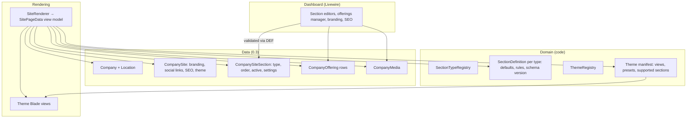
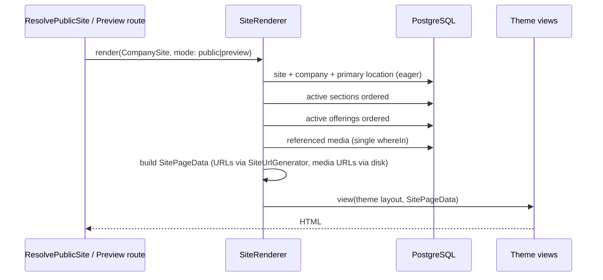

# FirmHub — CMS & Website Builder Architecture

| | |
|---|---|
| **Phase / Task** | Phase 0 — Task 0.5 |
| **Status** | Draft — open questions (Section 13) pending decision |
| **Depends on** | [0.3 Data Architecture](0.3-postgresql-data-architecture.md), [0.4 Subdomain, Domain & Publishing](0.4-subdomain-domain-and-publishing.md) |
| **Last updated** | 2026-10-29 |

> Architecture only. Class, view and route names are proposals for Phase 3. No package is added in Phase 0; package needs are flagged for Task 0.8.

---

## 1. Inputs & Assumptions

### Verified repository facts

- Views: starter-kit layouts (`layouts/app`, `layouts/auth`), Flux components, Livewire pages under `resources/views/pages`. No public-site or theme views exist.
- `public` disk: local, `storage/app/public`, URL `APP_URL/storage`.
- No image processing package is installed. PHP extensions on the host include `gd`, `exif`, `fileinfo`, `intl` (availability inside the Sail container must be verified).
- No `lang/` directory is published yet.
- `fontaine` is present as an npm dev dependency.

### Carried decisions and assumptions

| Source | Item |
|---|---|
| Approved | `CompanySiteSection` belongs to `CompanySite`; content separated from theme; drag-and-drop not in MVP |
| 0.1 Q4 | Single offerings list ("Products" or "Services" heading) |
| 0.1 Q5 | Single-page site + privacy notice page |
| 0.1 Q7 | One content language per site |
| 0.1 Q8 | One base theme with 3–4 presets |
| 0.1 Q17 | External "open in maps" link, no embedded map |
| 0.3 D-1, D-2, D-10 | Offerings company-scoped; `company_locations` with one primary; no `kind` column |
| 0.4 P-1 | **Live content model**: published sites render current content; publishing controls visibility only |

---

## 2. Content Architecture Principles

| ID | Principle |
|---|---|
| CP-1 | **Single source of truth.** Company facts (name, phone, email, address, legal info) live on `Company` / `CompanyLocation`. Sections reference them; they never copy them. |
| CP-2 | **Records stay relational.** Offerings (and later team members, FAQs, articles) are table rows, never arrays inside section JSON. |
| CP-3 | **Section `settings` hold only section copy and theme-agnostic options**, validated against a per-type schema. |
| CP-4 | **Content is theme-agnostic.** Switching themes never loses or transforms content. Theme-specific presentation choices live at site level, keyed by theme. |
| CP-5 | **Plain text in the MVP.** No user-supplied HTML, Markdown or CSS. All output escaped by Blade (`{{ }}`); `{!! !!}` is never used on tenant content. |
| CP-6 | **Server-side validation of the whole settings document on every save.** Unknown keys are stripped; partial client-side patches are not trusted. |
| CP-7 | **Rendering never queries lazily.** The public renderer builds a complete view model with a fixed number of queries; theme views receive data, not Eloquent models. |

---

## 3. CMS Component Model

### 3.1 Layers



### 3.2 Page structure

A site page consists of **fixed layout regions** rendered by the theme and **orderable sections**:

| Region | Kind | Orderable | Content source |
|---|---|---|---|
| Header | Layout region | No | Site logo, company name, auto-generated anchor navigation from active sections |
| Hero | Section | Pinned first (see C-1) | Section settings |
| About | Section | Yes | Section settings + company (`established_year`) |
| Products / Services | Section | Yes | Section settings + `company_offerings` |
| Contact | Section | Yes | Section settings + company + primary location; contact form |
| Footer ("Company information" + "Social links") | Layout region | No | Company legal info, primary location, site social links, privacy notice link |
| Privacy notice page | Separate route | — | Platform template filled with company data (0.7) |

"Company information" and "Social links" (0.1 MVP list) are modeled as **layout regions, not sections**: they appear in a fixed position in every theme, so ordering and toggling them as sections adds complexity without benefit (see C-6).

---

## 4. Section Type System

### 4.1 Registry

- `SectionType` — PHP backed enum: `Hero`, `About`, `Offerings`, `Contact` (values `hero`, `about`, `offerings`, `contact`; matches the 0.3 CHECK constraint).
- `SectionDefinition` — interface, one implementation per type:

| Member | Purpose |
|---|---|
| `type(): SectionType` | Identity |
| `schemaVersion(): int` | Current settings schema version |
| `defaults(string $locale): array` | Default settings (localized starter copy) |
| `rules(CompanySite $site): array` | Laravel validation rules for the whole settings document (media ownership checks need the site) |
| `normalize(array $input): array` | Strip unknown keys, trim strings, apply defaults |
| `publishRequirements(): array` | Conditions contributing to `SitePublishReadiness` (0.4 §7.2) |
| `editorComponent(): string` | Livewire editor component name |

- `SectionTypeRegistry` maps `SectionType` → definition. No dynamic plugin loading in the MVP.

### 4.2 Settings document shape

```json
{
  "version": 1,
  "content": { "headline": "…", "subheadline": "…" },
  "options": { "show_established_year": true }
}
```

- `content`: copy written by the user.
- `options`: theme-agnostic, semantic toggles (e.g. "show map link"); never colors, layouts or CSS.
- `version`: settings schema version. Changing a schema requires a data migration command that upgrades stored documents; renderers accept only the current version.

### 4.3 MVP section specifications

Lengths are proposals; final values are fixed with the validation rules in Phase 3.

**Hero** (required for publishing)

| Field | Type | Rules |
|---|---|---|
| `content.headline` | text | Required, ≤ 80 |
| `content.subheadline` | text | Optional, ≤ 200 |
| `content.image_media_id` | media reference | Optional; image of the same company |
| `content.image_is_decorative` | bool | If false, media alt text is required |
| `content.cta_label` | text | Optional, ≤ 30; required if `cta_target` set |
| `content.cta_target` | enum | `contact_section`, `phone`, `whatsapp`, `external_url` |
| `content.cta_url` | URL | Only when `external_url`; `https://` only |

**About**

| Field | Type | Rules |
|---|---|---|
| `content.title` | text | Required, ≤ 80; localized default ("About us") |
| `content.body` | plain text | Required to be active, ≤ 3000; blank lines become paragraphs |
| `content.image_media_id` | media reference | Optional |
| `options.show_established_year` | bool | Uses `companies.established_year` |

**Products / Services** (`offerings`)

| Field | Type | Rules |
|---|---|---|
| `content.title` | text | Required, ≤ 80; default "Our services" or "Our products" (chosen at setup) |
| `content.intro` | plain text | Optional, ≤ 500 |
| `options.show_prices` | bool | Shows `price_label` of items |
| Items | — | Active `company_offerings` rows ordered by `sort_order`; section is hidden on the public site if no active items exist |

**Contact**

| Field | Type | Rules |
|---|---|---|
| `content.title` | text | Required, ≤ 80 |
| `content.intro` | plain text | Optional, ≤ 500 |
| `options.show_form` | bool | Default true |
| `options.show_address` | bool | Uses primary location |
| `options.show_map_link` | bool | External link built from the address; no embed |
| `options.show_whatsapp` | bool | Uses `companies.whatsapp_phone` |
| Contact channels | — | `companies.contact_email`, `phone`, `whatsapp_phone` (CP-1) |
| Form fields | fixed | Name, email, phone (optional), message, privacy notice acknowledgement |

### 4.4 Section lifecycle

| Operation | MVP behavior |
|---|---|
| Creation | When a site is created, one section per MVP type is created with localized defaults (site `locale`) and default order: Hero, About, Offerings, Contact |
| Enable / disable | `is_active` toggle (Owner, Admin, Editor). Disabled sections are not rendered and not in navigation |
| Reorder | Move up / down buttons; Hero pinned first (C-1); transaction with site row lock (0.3 §10) |
| Delete / add | Not available in MVP (fixed set, UQ `(company_site_id, type)`) |
| Repeatable sections | Future; requires relaxing the UQ and an "add section" UI |

### 4.5 Media references inside settings (resolves 0.3 D-9)

| Option | Assessment |
|---|---|
| **IDs in JSON at well-known keys (`*_media_id`) + application checks** | No schema duplication; sections keep no `company_id` (approved decision). Integrity enforced by validation, a usage finder and tolerant rendering. **Chosen for MVP** |
| Pivot `company_site_section_media` | Real FKs, but cross-tenant guarantee still needs `company_id` on the pivot and on sections; more tables for two image slots |
| Dedicated FK columns on sections | Type-specific columns on a generic table |

Compensating rules:

1. **On save**, each referenced media ID must exist in `company_media` with the site's `company_id` (validation rule).
2. **`MediaUsageFinder`** answers "where is this media used?" by checking the site FK columns, offerings and section settings (`jsonb` path queries on the known keys).
3. **Media deletion** from the media library is blocked while the media is in use (user sees where it is used).
4. **Rendering is tolerant**: a missing media reference renders as "no image", never as an error.
5. Covered by tests (cross-company media ID rejected; deletion blocked when in use).

Revisit when repeatable sections or galleries arrive (Phase 4).

---

## 5. Theme Architecture

### 5.1 Themes are code

A theme is a version-controlled package of views, CSS and a manifest inside the application. The database stores only keys (`company_sites.theme`, `theme_preset`), as decided in 0.3.

```text
app/Themes/                      (proposed)
├── Contracts/Theme.php          manifest contract
├── ThemeRegistry.php            registered themes (config list)
└── Base/BaseTheme.php           MVP theme manifest

resources/views/themes/base/
├── layout.blade.php             <head>, header, footer regions
├── sections/hero.blade.php
├── sections/about.blade.php
├── sections/offerings.blade.php
├── sections/contact.blade.php
└── pages/privacy.blade.php

resources/css/themes/base.css    separate Vite entry; not the dashboard bundle
```

### 5.2 Theme manifest contract

| Member | Purpose |
|---|---|
| `key()`, `name()`, `description()`, `version()` | Identity |
| `supportedSections(): array` | Must include every MVP `SectionType` (contract test) |
| `presets(): array` | Named presets: color palette + font pairing as CSS custom properties |
| `defaultPreset(): string` | |
| `viewNamespace(): string` | Blade namespace for the theme views |
| `previewImage(): string` | Screenshot for the theme picker |
| `recommendedIndustries(): array` | Industry slugs (used from Phase 4; empty allowed) |

### 5.3 Presentation rules

| ID | Rule |
|---|---|
| TH-1 | Themes render only from `SitePageData`; no database access in views |
| TH-2 | Presets are applied as CSS custom properties on the layout root; no user-supplied CSS |
| TH-3 | Each theme has its own Vite CSS entry. Public pages do not load the dashboard bundle, Flux or Livewire (0.1 NFR-PERF-02) |
| TH-4 | Fonts are self-hosted; no third-party font CDN (privacy, KVKK/GDPR; performance) |
| TH-5 | Theme static strings (e.g. "Send message") come from `lang/{site locale}/site.php`, not from the dashboard user's locale |
| TH-6 | Themes must meet the accessibility and performance targets (0.1 NFR-A11Y-01, NFR-PERF-01) — verified per theme in 0.6/0.9 |
| TH-7 | Switching theme resets `theme_preset` to the new theme's default; content is untouched (CP-4) |
| TH-8 | A section type a theme does not support is skipped with a logged warning, never an error (relevant once themes and section types diverge) |

### 5.4 Industry & theme extension strategy

| Concern | MVP | Phase 4 |
|---|---|---|
| Company classification | `companies.industry_id` | unchanged |
| Theme catalog | One theme in `ThemeRegistry` | Several themes in code |
| Theme recommendations | — | `recommendedIndustries()` in manifests; theme picker shows recommended themes first but lists all |
| Theme filtering | — | Filter by tags/industries in the picker; **independent from company classification** |
| Industry starter content | Generic localized defaults | Optional "content packs" per industry (default copy, suggested offerings) applied once at site creation |
| Industry-specific sections | — | New `SectionType` cases + definitions + theme partials; general models stay unchanged |
| `site_themes` DB table (0.3 §4.2) | Not needed | Only if themes must be managed at runtime (enable/disable by platform admin, marketplace). Otherwise manifests suffice |

Industry never forces a theme; a theme never requires an industry.

---

## 6. Rendering Pipeline



- Fixed query budget (target ≤ 5 queries per page) verified by tests.
- The same renderer serves public pages and preview; `mode` controls the preview banner, disabled form and robots headers (0.4 §7.4).
- Caching rendered pages is not part of the MVP (0.6 evaluates).

---

## 7. Media Management

### 7.1 Upload rules

| Rule | MVP value (proposal) | Reason |
|---|---|---|
| Accepted types | JPEG, PNG, WebP | Common, safe raster formats |
| SVG | **Not accepted** | Can embed scripts (XSS); sanitization deferred (C-3) |
| GIF, HEIC, AVIF | Not accepted in MVP | Processing support and complexity |
| Max file size | 5 MB (logo/favicon 2 MB) | Abuse and processing time with sync processing |
| Max dimensions | 6000 × 6000 px and ≤ 25 megapixels | Decompression-bomb protection |
| Type detection | Server-side content sniffing (`fileinfo`) + extension consistency + successful decode | Never trust client MIME or filename |
| Re-encoding | Every image is decoded and re-encoded | Strips EXIF (GPS, device data) and neutralizes polyglot files |
| Stored name | `companies/{company_id}/media/{uuid}.{ext}` | Tenant-scoped, unguessable; original name kept only as sanitized metadata |
| Variants | WebP derivatives at fixed widths (e.g. 480, 960, 1600) | Responsive images (`srcset`) |
| Favicon | Square PNG ≥ 512 px; sizes generated | Browser and touch icon sizes |
| Alt text | Required for non-decorative content images | Accessibility |
| Per-company quota | e.g. 200 files / 250 MB, configurable | Abuse prevention |

### 7.2 Storage

- A dedicated **`media` disk** (local, public visibility by default) instead of the generic `public` disk, so it can be switched to S3-compatible storage or a CDN independently (configuration in Phase 3).
- Code uses only the `Storage` API (streams, `url()`), never local filesystem paths: object-storage compatible.
- All MVP media is **public website content**. Private tenant files (e.g. attachments) are out of scope; when introduced they use a private disk and an authorized download controller (0.2 AR-10).
- Media URLs are absolute URLs of the media disk (default: platform host). The public site's Content Security Policy must allow that origin (0.6/0.7).

### 7.3 Upload flow (Livewire)

1. Livewire temporary upload (temporary upload validation rules and temp cleanup configured; behavior to be verified against Livewire 4 docs).
2. Authorize (`upload media` permission, 0.2 §7.3) and validate.
3. Decode, check dimensions, re-encode, generate variants.
4. Write files to the `media` disk; then insert the `company_media` row in a transaction; on DB failure delete the written files.
5. Assign the media to its slot (site FK column, offering, or section settings key).
6. If the slot previously referenced other media and that media is no longer used (`MediaUsageFinder`), delete it.

Processing is synchronous in the MVP (`QUEUE_CONNECTION=sync`); input limits keep it bounded. Moving processing to queues is a Phase 7 evaluation.

### 7.4 Cleanup

| Case | Handling |
|---|---|
| Replaced media | Deleted immediately when unused (step 6) |
| Orphans (uploaded, never assigned, or left after failures) | Scheduled job deletes unused media older than 24 h |
| Company purge | Files deleted before the company row (0.3 §9) |
| Temporary uploads | Livewire temp cleanup |

### 7.5 Package need (for 0.8)

Image decode/resize/re-encode can be implemented with GD directly or with an image library such as `intervention/image` (driver abstraction over GD/Imagick). A full media library package (e.g. `spatie/laravel-medialibrary`) is **not** recommended: it duplicates the `company_media` model designed in 0.3. Decision and approval in 0.8 (C-4).

### 7.6 Schema refinements proposed to 0.3

| Table | Change | Reason |
|---|---|---|
| `company_media` | Add `variants jsonb` (generated widths/paths) | Responsive images |
| `company_media` | Add `purpose` (e.g. `logo`, `favicon`, `image`) | Purpose-specific validation and library filtering |
| `company_site_sections` | No change | D-9 resolved without schema change (§4.5) |

---

## 8. Offerings (Products / Services)

| Aspect | Decision |
|---|---|
| Ownership | Company-scoped rows (0.3 D-1) |
| Fields | Name, description (plain text ≤ 1000), optional image, optional `price_label`, active flag, order |
| Management | Dashboard list with create/edit/delete, up/down ordering, active toggle (Owner, Admin, Editor) |
| Limit | e.g. 50 items per company (configurable) |
| Commerce | None: no cart, stock, currency or checkout |
| Section heading | Chosen per site ("Products" / "Services" / custom title) |
| Multi-site future | Per-site selection pivot (0.3 §13) |

---

## 9. Site-Level Settings

| Group | Fields | Who edits |
|---|---|---|
| General | Subdomain (0.4), content language (`locale`) | Owner, Admin |
| Theme | Theme, preset | Owner, Admin |
| Branding | Logo, dark logo, favicon, OG image | Owner, Admin, Editor (media), per 0.2 matrix |
| Social links | Up to 10 `{platform, url}`; platform enum (Instagram, Facebook, LinkedIn, X, YouTube, TikTok, …); URL must be `https` and match the platform's domain | Owner, Admin, Editor |
| SEO | `seo_title`, `seo_description`; OG image | Owner, Admin, Editor |
| Publishing | Publish / unpublish, readiness checklist (0.4 §7.2) | Owner, Admin |

Changing `locale` after creation does not translate existing content; only theme static strings change. The UI warns about this.

---

## 10. Dashboard Information Architecture (MVP)

```text
/dashboard/{company}
├── Overview            onboarding progress, site status, unread messages
├── Site
│   ├── Overview        status, readiness checklist, view/preview links, publish
│   ├── Sections        ordered list → per-section editor
│   ├── Products/Services
│   ├── Branding        logo, favicon, OG image
│   ├── Social links
│   ├── SEO
│   └── Settings        subdomain, language, theme & preset
├── Media library
├── Messages
├── Company             profile, location, legal information, industry
└── Members             memberships, invitations
```

### Editing UX rules

| ID | Rule |
|---|---|
| UX-1 | **Explicit save** per editor (no autosave): with live content (P-1), autosave would publish half-finished text (C-5) |
| UX-2 | A clear notice on published sites: "Changes are visible immediately" |
| UX-3 | Preview opens in a new tab (side-by-side live preview is future) |
| UX-4 | Optimistic concurrency on section and offering saves: the form carries the record's `updated_at`; a mismatch shows a conflict message instead of overwriting (**Should**) |
| UX-5 | Validation errors inline, in plain language; character counters for limited fields |
| UX-6 | Every Livewire action re-authorizes (0.2 AR-3); record IDs in components are `#[Locked]` |
| UX-7 | Editors without a permission see read-only views, not hidden data errors (Viewer role) |

---

## 11. Section Responsibility Map

| Element | Data owner | Edited in | Rendered by | Required to publish |
|---|---|---|---|---|
| Company name | `companies.name` | Company | Header, footer, SEO fallback | Yes |
| Logo / favicon | `company_sites` media FKs | Site → Branding | Header, `<head>` | No (name shown as fallback) |
| Hero copy & image | Hero `settings` | Sections → Hero | Hero partial | Yes (active + headline) |
| About copy & image | About `settings` | Sections → About | About partial | No |
| Established year | `companies.established_year` | Company | About partial (option) | No |
| Offerings | `company_offerings` | Products/Services | Offerings partial | No |
| Offerings heading | Offerings `settings` | Sections → Offerings | Offerings partial | No |
| Contact channels | `companies` contact fields | Company | Contact partial, footer | Yes (≥ 1 channel) |
| Address | Primary `company_locations` row | Company → Location | Contact (option), footer | No |
| Contact form | Contact `settings.options.show_form` | Sections → Contact | Contact partial | No |
| Legal info | `companies` legal fields | Company → Legal | Footer | No (0.1 Q14 pending) |
| Social links | `company_sites.social_links` | Site → Social links | Footer | No |
| SEO title/description | `company_sites` SEO columns | Site → SEO | `<head>` (0.6) | No (fallbacks) |
| Privacy notice | Platform template + company data | — (platform) | Privacy page, form | Yes (template available) |
| Static UI strings | `lang/{locale}/site.php` | — (platform) | Theme | — |

---

## 12. Out of MVP (CMS)

- Drag-and-drop or free-form page builder; side-by-side live preview.
- Adding, duplicating or deleting sections; repeatable section types.
- Rich text / Markdown / HTML content; custom CSS/JS.
- Multi-page sites, blog, team, locations list, FAQ, gallery, testimonials.
- Snapshot publishing, content revisions, scheduled publishing, approval workflow.
- Multilingual content (future impact: section settings per locale and translation tables for offerings).
- SVG uploads, video, file downloads.
- Industry content packs and multiple themes (Phase 4).

---

## 13. Open Questions

| # | Question | Recommendation | Affects |
|---|---|---|---|
| C-1 | Is Hero always pinned first? | Yes; other sections reorderable | Phase 3 |
| C-2 | Plain text or limited rich text for About / descriptions? | Plain text with paragraphs in MVP | Phase 3 |
| C-3 | Support SVG logos? | No in MVP; revisit with a vetted sanitizer | 0.7, 0.8 |
| C-4 | Image processing: GD directly or `intervention/image`? | Library (requires dependency approval in 0.8) | 0.8 |
| C-5 | Explicit save vs autosave? | Explicit save (UX-1) | Phase 3 |
| C-6 | Company information and social links as layout regions (not sections)? | Yes (§3.2) | Phase 3 |
| C-7 | Per-company media quota and offering limit | 200 files / 250 MB; 50 offerings; configurable | Phase 3 |
| C-8 | Industry starter content in MVP? | Generic localized defaults only; packs in Phase 4 | Phase 3/4 |
| C-9 | Theme recommendations in code manifests or a database table? | Manifests until runtime management is needed | Phase 4 |

---

## 14. Task 0.5 Acceptance Criteria Evaluation

| Criterion | Status | Evidence |
|---|---|---|
| `CompanySiteSection` is site-based | Met | §4: sections belong to the site; no `company_id`; media ownership checked via the site's company (§4.5) |
| Content and theme are separated | Met | CP-3, CP-4, §5.3 (TH-1, TH-2, TH-7), §6 view model |
| Industry-specific theme approach explained | Met | §5.4 extension strategy; industry and theme filtering independent |
| Advanced features (drag-and-drop etc.) separated from MVP | Met | §4.4, §12 |

