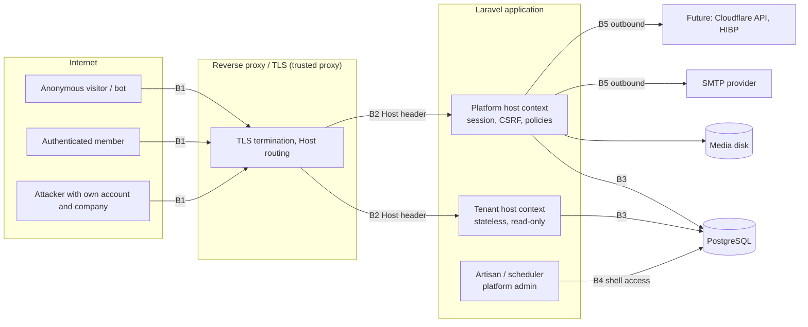

# FirmHub — Security Architecture & Threat Model

| | |
|---|---|
| **Phase / Task** | Phase 0 — Task 0.7 |
| **Status** | Draft — open questions (Section 13) pending decision |
| **Depends on** | [0.2](0.2-multi-tenancy-and-authorization.md), [0.3](0.3-postgresql-data-architecture.md), [0.4](0.4-subdomain-domain-and-publishing.md), [0.5](0.5-cms-and-website-builder.md), [0.6](0.6-public-website-seo-and-performance.md) |
| **Last updated** | 2026-10-29 |

> Architecture and requirements only. No middleware, configuration or package is added in Phase 0. Legal statements about KVKK / GDPR are engineering interpretations, **not legal advice**, and require review by a qualified person before production. Package and tooling decisions are deferred to 0.8; test mapping to 0.9.

---

## 1. Inputs & Verified Repository Facts

Read-only inspection of the repository on 2026-10-29 (Laravel 13.38, Fortify 1.41, Livewire 4.4, Flux 2.20, Pest 4.7, Larastan 3.13).

| # | Fact | Security consequence |
|---|---|---|
| RF-1 | Fortify features: registration, password reset, email verification, 2FA (`confirm`, `confirmPassword`). Passkeys not enabled | Baseline authentication is present; passkeys are a later option |
| RF-2 | `login` limiter: 5/min per lowercased email + IP. `two-factor` limiter: 5/min per `login.id` | Credential stuffing partially mitigated |
| RF-3 | `POST /forgot-password` and `POST /register` have **no route-level throttle** (Fortify routes); the password broker only throttles repeat links per user (60 s), link expiry 60 min | Email flooding and mass registration are unthrottled (AU-3, AU-4) |
| RF-4 | Password reset request returns a **distinct error for unknown emails** (`FailedPasswordResetLinkRequestResponse` with `passwords.user`) | Account enumeration (AU-5) |
| RF-5 | `fortify.lowercase_usernames = true` (login/reset lowercase the email); registration normalization not enforced in the database (0.3 D-6) | Case-variant duplicate accounts possible until D-6 is implemented |
| RF-6 | `Password::defaults()` strict **only in production** (min 12, mixed case, numbers, symbols, `uncompromised()`) | `uncompromised()` calls the HIBP range API (k-anonymity): an outbound dependency self-hosters must be able to disable |
| RF-7 | `User`: `#[Fillable(['name','email','password'])]`, 2FA secrets and recovery codes hidden | No mass-assignment of privileged fields today; `is_platform_admin` must stay out of `Fillable` (0.2 §10) |
| RF-8 | Session (`.env.example`): `database` driver, 120 min, `SESSION_ENCRYPT=false`, `SESSION_DOMAIN=null`, `secure` unset, `http_only=true`, `same_site=lax` | Host-only cookie is correct; `secure` must be forced in production |
| RF-9 | `bootstrap/app.php`: no custom middleware, **no trusted hosts, no trusted proxies, no security headers** | HH-1/HH-3 (0.4) and §6.4 headers are unimplemented |
| RF-10 | `.env.example`: `APP_DEBUG=true`, `LOG_LEVEL=debug`, `LOG_STACK=single` (no rotation), `MAIL_MAILER=log` | Development defaults; production must override (§6.9) |
| RF-11 | Self-service account deletion (Livewire modal) deletes the user after current-password check | Must enforce RM-8 (last owner) in Phase 2 |
| RF-12 | `password.confirm` protects settings/security; `password_timeout` = 3 h | Reusable for sensitive tenant actions (§6.1) |
| RF-13 | Encryption: `AES-256-CBC`, `APP_PREVIOUS_KEYS` supported | Key rotation possible without invalidating encrypted data |
| RF-14 | CI (`tests.yml`) runs `composer ci:check` → `test` = Pint check + Larastan (level 7) + Pest on PostgreSQL. No `composer audit` / `npm audit` step; Dependabot covers **GitHub Actions only** | Dependency audit is not a quality gate yet (0.8/0.9) |

---

## 2. Security Objectives & Scope

| ID | Objective | Priority |
|---|---|---|
| SO-1 | **Tenant isolation:** no user, visitor or host can read or modify another company's private data | Critical |
| SO-2 | **Integrity of published content:** only authorized members change or publish a site; public hosts never show draft or foreign content | Critical |
| SO-3 | **Account security:** accounts cannot be taken over through the platform's own flows | Critical |
| SO-4 | **Visitor privacy:** contact message data is minimized, protected and deleted on schedule | High |
| SO-5 | **Platform reputation:** tenant sites cannot easily be abused for phishing or malware, and abuse can be stopped | High |
| SO-6 | **Availability under abuse:** anonymous traffic cannot exhaust storage, mail or CPU | Medium |
| SO-7 | **Self-hosted safety:** secure by default with only app + PostgreSQL; no mandatory third-party service | Medium |

**In scope:** dashboard, public tenant sites, preview, contact form, media, invitations, platform admin (Artisan), local and production configuration, future custom domains (design level).
**Out of scope for MVP:** payments, public API, tenant-supplied code (HTML/CSS/JS), SSO, penetration testing (Phase 7).

---

## 3. Assets & Trust Boundaries

### 3.1 Assets

| Asset | Class (0.2 §2.1) | Sensitivity |
|---|---|---|
| User credentials, 2FA secrets, recovery codes, sessions, remember tokens | Identity | Critical |
| Invitation tokens, password reset tokens, email verification links | Identity / tenant | Critical (short-lived) |
| Memberships and roles | Tenant | Critical (authorization source) |
| Draft site content, unpublished sites | Tenant | High (business confidential until published) |
| Contact messages (visitor name, email, phone, free text) | Tenant, personal data | High |
| Company legal data (tax number, registry number) | Tenant | Medium (often public by law) |
| Published content and media | Tenant, public | Integrity-critical, not confidential |
| `APP_KEY`, DB credentials, mail credentials, future provider API tokens | Platform secrets | Critical |
| Platform admin flag, suspension state | Platform | Critical |

### 3.2 Trust boundaries

| Boundary | Crossing | Primary controls |
|---|---|---|
| B1 | Internet → edge | TLS, HSTS, rate limiting, request size limits |
| B2 | Edge → application | Trusted proxies, trusted hosts, host-based route split (0.4 §3) |
| B3 | Application → data | Policies, scoped queries, PostgreSQL constraints, least-privileged DB role |
| B4 | Operator → platform | Shell access, Artisan commands, platform admin 2FA |
| B5 | Application → third parties | Fixed endpoints, no user-controlled URLs, timeouts, secrets in env |

### 3.3 Threat actors

| Actor | Capability | Typical goal |
|---|---|---|
| TA-1 Anonymous visitor / bot | HTTP requests to any host | Spam, scraping, enumeration, resource exhaustion |
| TA-2 **Malicious tenant** | Own verified account, own company and site | Read or modify other tenants (IDOR), host phishing, XSS via content, abuse resources |
| TA-3 Malicious or compromised member | Legitimate role in a company | Privilege escalation inside the company, data exfiltration |
| TA-4 Account takeover attacker | Leaked passwords, phishing | Take over owners, hijack sites |
| TA-5 Network / infrastructure attacker | Host header manipulation, DNS | Poison links, subdomain takeover |
| TA-6 Supply-chain attacker | Compromised dependency | Code execution |

TA-2 is the **design-driving actor**: registration is open, so every tenant-facing feature must assume a hostile tenant.

---

## 4. Methodology

STRIDE per boundary and feature, rated with a simple scale:

- **Likelihood (L):** 1 rare · 2 possible · 3 likely (TA-2 can attempt it at no cost)
- **Impact (I):** 1 low · 2 moderate (single tenant) · 3 severe (cross-tenant, account takeover, platform-wide)
- **Risk = L × I** → 1–2 Low · 3–4 Medium · 6–9 High

Ratings are **inherent risk** (before mitigation). Mitigations reference requirement IDs from this and earlier documents.

---

## 5. Threat Catalog

### 5.1 Authentication & accounts

| ID | Threat | STRIDE | L | I | Risk | Mitigation |
|---|---|---|---|---|---|---|
| AU-1 | Credential stuffing / brute force on login | S | 3 | 3 | High | Fortify `login` limiter (RF-2); production password policy (RF-6); 2FA available; SEC-AUTH-3 |
| AU-2 | 2FA code brute force | S | 2 | 3 | High | `two-factor` limiter (RF-2); recovery codes hidden (RF-7) |
| AU-3 | Password reset email flooding (victim inbox, mail cost/reputation) | D | 3 | 2 | High | SEC-AUTH-1 per-IP and per-email throttle on `POST /forgot-password` |
| AU-4 | Mass registration (bot accounts → spam sites) | D, S | 3 | 2 | High | SEC-AUTH-1 throttle on `POST /register`; email verification required before company creation (0.1 FR-AUTH-02); company limit (0.2 RM-10) |
| AU-5 | Account enumeration via password reset response | I | 3 | 1 | Medium | SEC-AUTH-2 uniform response |
| AU-6 | Duplicate accounts with case-variant emails | S | 2 | 2 | Medium | 0.3 D-6 (lowercase + functional unique index) |
| AU-7 | Session fixation / theft | S | 1 | 3 | Medium | Laravel regenerates session on login; host-only `Secure` `HttpOnly` cookie (SEC-SESS) |
| AU-8 | Owner account takeover → site defacement | T | 2 | 3 | High | 2FA strongly encouraged for Owners (SQ-7); password confirmation for destructive actions (SEC-AUTH-4) |
| AU-9 | Account deletion orphaning a company | T, D | 2 | 2 | Medium | 0.2 RM-8 (RF-11) |

### 5.2 Authorization & tenant isolation

Fully specified in 0.2 §12 (T-1 … T-15). Summary of risk ratings:

| ID | Threat | L | I | Risk | Mitigation (0.2) |
|---|---|---|---|---|---|
| T-1/T-2 | IDOR on company or child resources | 3 | 3 | High | Opaque UUIDv7 keys, membership middleware, scoped bindings, 404 |
| T-3/T-4 | Livewire property tampering / action without authorization | 3 | 3 | High | `#[Locked]`, policy in every action (AR-3, AR-4) |
| T-5 | Attaching another tenant's record (media, location) | 3 | 3 | High | Scoped `exists` validation + composite FKs (0.3 OR-2) |
| T-6 | Mass assignment of `company_id`, `role`, `is_platform_admin` | 2 | 3 | High | Not fillable (AR-8, RF-7) |
| T-7/T-8 | Privilege escalation, zero owners | 2 | 3 | High | RM-1 … RM-5, row locking |
| T-10 | Invitation hijacking | 2 | 3 | High | Hashed single-use tokens, email match (INV-2/3/8) |
| T-13 | Platform admin bypassing tenant rules | 1 | 3 | Medium | No `Gate::before` |
| T-14 | Cross-tenant cache poisoning | 1 | 3 | Medium | Tenant-scoped keys (AR-9, 0.6 MT-4) |

Residual risk: no automatic global scope (0.2 §4.3) — a forgotten scope in new code is the most likely isolation bug. Compensated by mandatory cross-tenant tests (AR-14) and an architecture test that every tenant model has a policy (handed to 0.9).

### 5.3 Hosts, domains & publishing

| ID | Threat | STRIDE | L | I | Risk | Mitigation |
|---|---|---|---|---|---|---|
| HO-1 | Host header poisoning of reset / invitation / verification links | S, T | 2 | 3 | High | 0.4 HH-1, HH-2; SEC-HOST-1 |
| HO-2 | Forged `X-Forwarded-*` headers | S | 2 | 3 | High | 0.4 HH-3 trusted proxies |
| HO-3 | Draft / suspended content on public host | I | 2 | 3 | High | 0.4 §3.2 visibility rule, SD-1 |
| HO-4 | Dashboard routes reachable on tenant host | E | 2 | 3 | High | 0.4 SD-2 host-constrained platform routes |
| HO-5 | Session cookie readable by tenant hosts | I | 1 | 3 | Medium | Host-only cookie (RF-8), separate tenant domain (SQ-1 / 0.4 P-2), `__Host-` prefix (SEC-SESS-2) |
| HO-6 | Subdomain squatting of reserved / brand names | S | 3 | 2 | High | 0.4 §4.2 reserved list; brand screening Phase 6 |
| HO-7 | Re-registration of a released subdomain for phishing | S | 2 | 2 | Medium | 0.4 §5 90-day quarantine |
| HO-8 | Subdomain takeover via dangling explicit DNS records | S | 1 | 3 | Medium | 0.4 §8.4 |
| HO-9 | Custom domain hijack: attaching a domain the tenant does not own (Phase 5) | S | 2 | 3 | High | SEC-DOM-1 … 5 |
| HO-10 | Certificate issuance abuse via on-demand TLS (Phase 5, self-hosted) | D | 2 | 2 | Medium | 0.4 §10.1 "ask" endpoint approves verified hostnames only |

### 5.4 Content & rendering

| ID | Threat | STRIDE | L | I | Risk | Mitigation |
|---|---|---|---|---|---|---|
| CT-1 | Stored XSS via tenant text on public site | T, E | 3 | 2 | High | 0.5 CP-5 plain text, Blade escaping, no `{!! !!}` on tenant content; strict public CSP (SEC-HDR-1) |
| CT-2 | Stored XSS in the **dashboard** (tenant content shown to members, contact messages shown to Owners) | T, E | 3 | 3 | High | Same escaping rules in dashboard views and Flux components; contact message bodies rendered as text only; dashboard CSP (SEC-HDR-2) |
| CT-3 | Script breakout from JSON-LD block | T | 2 | 2 | Medium | 0.6 §4.3 `JSON_HEX_*` flags |
| CT-4 | `javascript:` / `data:` URLs in links (CTA, social links) | T | 3 | 2 | High | SEC-CONTENT-2 `https://` only, platform-domain match for social links (0.5 §9) |
| CT-5 | Wrong tenant's data rendered (resolver or cache mix-up) | I | 1 | 3 | Medium | 0.6 MT-1 … MT-5 |
| CT-6 | Clickjacking of dashboard or public site | T | 2 | 2 | Medium | `frame-ancestors 'none'` (SEC-HDR) |
| CT-7 | Phishing / malware content hosted on a tenant site | S | 3 | 3 | High | SEC-ABUSE-1 … 4 |
| CT-8 | Open redirect through `redirect()->intended()` or quarantine redirects | S | 2 | 2 | Medium | Laravel `intended` stores only same-app URLs; 0.4 HH-6 |

### 5.5 Contact form

| ID | Threat | STRIDE | L | I | Risk | Mitigation |
|---|---|---|---|---|---|---|
| CF-1 | Spam flood filling the inbox and database | D | 3 | 2 | High | SEC-CONTACT-1 … 6 |
| CF-2 | Using the form to send mail to arbitrary recipients (mail relay) | S | 2 | 3 | High | Notifications only go to company member addresses; visitor email used only as `Reply-To` (SEC-CONTACT-7) |
| CF-3 | Email header injection via name/subject | T | 2 | 2 | Medium | Validation rejects CR/LF in single-line fields; Symfony Mailer header encoding |
| CF-4 | Cross-site form posts | T | 2 | 1 | Low | Signed form token + `Origin` check (0.6 §3.3) |
| CF-5 | Personal data over-collection or retention beyond purpose | I | 3 | 2 | High | §7 privacy controls, no IP storage (0.3 D-5) |
| CF-6 | Messages for a non-visible site accepted | T | 2 | 1 | Low | `ResolvePublicSite` runs before the handler; preview disables the form (0.4 §7.4) |

### 5.6 Media & storage

| ID | Threat | STRIDE | L | I | Risk | Mitigation |
|---|---|---|---|---|---|---|
| ME-1 | Upload of executable / script files (PHP, HTML, SVG) | E, T | 3 | 3 | High | 0.5 §7.1 allow-list, content sniffing, decode + re-encode, generated names and extensions |
| ME-2 | Polyglot image (valid image + HTML/JS) served from a trusted origin | T | 2 | 3 | High | Re-encoding; `X-Content-Type-Options: nosniff`; correct `Content-Type`; media origin isolation (SEC-MEDIA-2) |
| ME-3 | Decompression bomb / oversized image (CPU, memory) | D | 3 | 2 | High | 0.5 §7.1 size and pixel limits checked **before** full decode |
| ME-4 | Path traversal through filenames | T | 2 | 3 | High | Storage paths generated server-side only (0.3 `company_media.path`) |
| ME-5 | EXIF metadata leak (GPS location of owner) | I | 3 | 1 | Medium | Re-encoding strips metadata |
| ME-6 | Storage exhaustion | D | 3 | 2 | High | Per-company quota (0.5 C-7), orphan cleanup |
| ME-7 | Enumeration of other tenants' media | I | 1 | 1 | Low | All MVP media is public content; UUID paths; no directory listing |
| ME-8 | Livewire temporary upload abuse | D | 2 | 2 | Medium | Livewire temporary upload rules (size, MIME, throttle) configured explicitly; temp cleanup (behavior verified against Livewire 4 docs in Phase 3) |

### 5.7 Platform, infrastructure & supply chain

| ID | Threat | STRIDE | L | I | Risk | Mitigation |
|---|---|---|---|---|---|---|
| PL-1 | Debug mode or stack traces in production | I | 2 | 3 | High | SEC-OPS-1 |
| PL-2 | Secrets leaked via logs, repo or error pages | I | 2 | 3 | High | SEC-LOG-1 … 4, `.env` never committed |
| PL-3 | Compromised platform admin account | E | 1 | 3 | Medium | Admin 2FA (O-4 resolved, SEC-ADMIN-1), Artisan-only actions in MVP |
| PL-4 | Vulnerable dependency | E | 2 | 3 | High | SEC-SUPPLY-1 … 4 |
| PL-5 | SSRF through server-side URL fetching | I, E | 1 | 3 | Medium | SEC-SSRF-1: no user-controlled outbound requests in MVP |
| PL-6 | Database account with excessive privileges | E | 2 | 3 | High | SEC-OPS-4 separate migration and runtime roles (production) |
| PL-7 | Backup exposure | I | 1 | 3 | Medium | Encrypted backups, restricted access (Phase 7) |
| PL-8 | Rate limiting ineffective behind a proxy (all clients share the proxy IP) | D | 2 | 2 | Medium | Trusted proxies (0.4 HH-3) so `$request->ip()` is the client |

---

## 6. Security Requirements

Requirement IDs are referenced by tests (0.9) and implementation tasks.

### 6.1 Authentication (SEC-AUTH)

| ID | Requirement | Phase |
|---|---|---|
| SEC-AUTH-1 | Throttle `POST /forgot-password`, `POST /register`, `POST /email/verification-notification` (already 6/min, RF-3) per IP and, where applicable, per normalized email | 1/2 |
| SEC-AUTH-2 | Password reset request returns the **same response** whether or not the email exists (custom `FailedPasswordResetLinkRequestResponse` or equivalent) | 1/2 |
| SEC-AUTH-3 | Production password policy (RF-6) kept; `uncompromised()` configurable so offline self-hosted instances can disable the HIBP call | 1 |
| SEC-AUTH-4 | Password confirmation (`password.confirm`) before: company deletion, ownership transfer, account deletion (already), 2FA changes (already) | 2 |
| SEC-AUTH-5 | Email normalization at registration + `lower(email)` unique index (0.3 D-6) | 1/2 |
| SEC-AUTH-6 | Verified email required for every `/dashboard/{company}` route and for invitation acceptance (0.2 AR-1, INV-3) | 2 |
| SEC-AUTH-7 | Security-relevant notifications: email the user on password change and 2FA disable (**Should**) | 2 |
| SEC-AUTH-8 | Login, logout, failed login and 2FA events logged without passwords, codes or full tokens (§6.9) | 1 |

### 6.2 Authorization (SEC-AUTHZ)

0.2 AR-1 … AR-14 and RM-1 … RM-10 are adopted unchanged as security requirements. Additional:

| ID | Requirement | Phase |
|---|---|---|
| SEC-AUTHZ-1 | Every tenant-owned model has a registered policy; enforced by an architecture test | 2 |
| SEC-AUTHZ-2 | Every Livewire component under the dashboard authorizes in each public action method; reviewed in code review checklist | 2/3 |
| SEC-AUTHZ-3 | Platform admin gate is separate and never grants tenant content access in the MVP (0.2 §7.5) | 2 |

### 6.3 Sessions, cookies & CSRF (SEC-SESS)

| ID | Requirement | Phase |
|---|---|---|
| SEC-SESS-1 | Production: `SESSION_SECURE_COOKIE=true`, `SESSION_HTTP_ONLY=true`, `SESSION_SAME_SITE=lax`, `SESSION_DOMAIN` unset (host-only) | 1/7 |
| SEC-SESS-2 | Production session cookie name uses the **`__Host-` prefix** (requires `Secure`, `Path=/`, no `Domain` — all already satisfied). Whether the `XSRF-TOKEN` cookie name can be prefixed must be verified; it is not required because CSRF validation does not trust the cookie alone | 7 |
| SEC-SESS-3 | Dashboard keeps Laravel CSRF protection on all state-changing routes and Livewire requests | 1 |
| SEC-SESS-4 | **Stateless contact form confirmed (resolves 0.6 S-7):** the tenant public group runs without sessions or CSRF cookies; `POST /contact` uses the signed form token + `Origin` check (§6.6). The exemption is limited to the tenant route group | 3 |
| SEC-SESS-5 | Session lifetime 120 min idle (current); "remember me" remains available; logout invalidates the session and regenerates the CSRF token (starter-kit behavior to be verified by test) | 1 |
| SEC-SESS-6 | `SESSION_ENCRYPT` stays `false` with the `database` driver (payload already server-side); revisit only if a client-side session driver is used | — |

### 6.4 Security headers (SEC-HDR)

Implemented by a small header middleware per route group (no package required; confirmed in 0.8).

| ID | Context | Header policy |
|---|---|---|
| SEC-HDR-1 | **Public tenant pages** | CSP from 0.6 §8 (`default-src 'none'; style-src 'self'; font-src 'self'; img-src 'self' {media origin} data:; form-action 'self'; base-uri 'none'; frame-ancestors 'none'`). Enforced (not report-only) from the first release, because public pages have no scripts. JSON-LD: data blocks (`type="application/ld+json"`) are not executed by browsers; verify in Phase 3 that no CSP violation is reported for them |
| SEC-HDR-2 | **Dashboard & preview** | Livewire, Alpine and Flux (`@fluxAppearance`) use inline scripts/styles. Start with a **report-only** CSP using `script-src 'self' 'nonce-…'`; move to enforcement once Livewire 4 / Flux nonce support is verified. `frame-ancestors 'none'` enforced from day one |
| SEC-HDR-3 | All responses | `X-Content-Type-Options: nosniff`; `Referrer-Policy: strict-origin-when-cross-origin`; `Permissions-Policy` denying camera, microphone, geolocation, payment, USB |
| SEC-HDR-4 | Production, HTTPS | `Strict-Transport-Security: max-age=31536000` on platform and tenant hosts. `includeSubDomains` on the tenant domain (wildcard certificate covers it). `preload` only after explicit decision (hard to undo) |
| SEC-HDR-5 | Authenticated pages, preview | `Cache-Control: private, no-store` (0.4 §7.4, 0.6 §7.4) |
| SEC-HDR-6 | Media responses | Correct `Content-Type`, `nosniff`, `Content-Disposition: inline` only for allowed image types (web-server configuration for the media disk) |

### 6.5 Host & URL security (SEC-HOST)

0.4 HH-1 … HH-6 are adopted. Additional:

| ID | Requirement |
|---|---|
| SEC-HOST-1 | A feature test sends a forged `Host` header to password reset and invitation flows and asserts generated links use `APP_URL` |
| SEC-HOST-2 | Trusted hosts and trusted proxies are **environment configuration**, documented in `.env.example`, with safe defaults for local development |
| SEC-HOST-3 | **Tenant domain decision (resolves 0.2 O-7 / 0.4 P-2, pending approval):** production uses a separate registrable domain for tenant sites (Option B). If the product owner chooses Option A, SEC-SESS-2 becomes mandatory before launch |

### 6.6 Contact form & anti-abuse (SEC-CONTACT)

| ID | Requirement |
|---|---|
| SEC-CONTACT-1 | Signed form token: HMAC-SHA256 (key derived from `APP_KEY` with a purpose label) over site ID + issue timestamp; minimum fill time 3 s, maximum age 2 h; constant-time comparison |
| SEC-CONTACT-2 | Honeypot field; submissions that fill it receive the normal success response but are discarded (no signal to bots) |
| SEC-CONTACT-3 | Rate limits (cache-backed): per IP + site 5/10 min; per site 100/day; global per IP 20/hour (proposals, configurable). Exceeding returns `429` |
| SEC-CONTACT-4 | `Origin` (fallback `Referer`) must equal the site's own host; missing both → rejected |
| SEC-CONTACT-5 | Field limits: name ≤ 100, email RFC + ≤ 254, phone ≤ 30, subject ≤ 150, message ≤ 5 000 characters; CR/LF rejected in single-line fields; the request body size is limited at the web server |
| SEC-CONTACT-6 | Optional, pluggable CAPTCHA interface (`ContactChallenge`) with a no-op default; no third-party CAPTCHA in the MVP (privacy, self-hosting). Revisit if spam is observed |
| SEC-CONTACT-7 | Notification emails are sent **from** the platform's sender address, **to** Owner/Admin members only (0.2 §7.4), with the visitor email as `Reply-To`. The notification contains a link to the dashboard message; whether it includes the message body is decided in SQ-6 |
| SEC-CONTACT-8 | Mail failure never loses a message: the database row is written first (0.1 Q10) |

### 6.7 Media (SEC-MEDIA)

0.5 §7 rules are adopted as security requirements. Additional:

| ID | Requirement |
|---|---|
| SEC-MEDIA-1 | Dimension and file-size checks run on header data before a full decode; decoding errors reject the upload |
| SEC-MEDIA-2 | **Media origin isolation:** the 0.5 default (`APP_URL`, platform host) serves tenant-uploaded bytes from the dashboard origin. Production should serve media from the tenant domain or a dedicated media host (e.g. `media.{tenant_domain}`), never from the platform host. Local development may keep `APP_URL/storage` |
| SEC-MEDIA-3 | The web server never executes scripts inside the media directory and disables directory listing (deployment documentation) |
| SEC-MEDIA-4 | SVG uploads remain disallowed (resolves 0.5 C-3 for MVP) |
| SEC-MEDIA-5 | Livewire temporary upload configuration (max size, allowed MIME, throttle, cleanup) set explicitly, not left to defaults |

### 6.8 Content (SEC-CONTENT)

| ID | Requirement |
|---|---|
| SEC-CONTENT-1 | No `{!! !!}` on any tenant- or visitor-supplied value, in public themes **and** dashboard views; enforced by a test or lint rule that scans Blade files (tooling in 0.8) |
| SEC-CONTENT-2 | User-supplied URLs: `https://` scheme only, validated host, max 2 048 characters; rendered with `rel="noopener noreferrer"` when opening a new tab |
| SEC-CONTENT-3 | Plain-text newline-to-paragraph conversion escapes first, then inserts markup |
| SEC-CONTENT-4 | Theme views receive data objects only (0.5 TH-1); no raw model serialization into HTML attributes or scripts |

### 6.9 Logging, secrets & operations (SEC-LOG / SEC-OPS)

| ID | Requirement |
|---|---|
| SEC-OPS-1 | Production: `APP_ENV=production`, `APP_DEBUG=false`, `LOG_LEVEL` ≥ `info`; a boot-time check refuses to start with `APP_DEBUG=true` in production (**Should**) |
| SEC-OPS-2 | `APP_KEY` rotation procedure documented using `APP_PREVIOUS_KEYS` (RF-13); keys never committed |
| SEC-OPS-3 | `DB::prohibitDestructiveCommands()` in production is kept (existing) |
| SEC-OPS-4 | Production DB: application role without DDL rights; migrations run with a separate role (Phase 7; optional for self-hosted) |
| SEC-LOG-1 | Never logged: passwords, 2FA secrets/codes, recovery codes, full tokens (reset, invitation, verification), session IDs, contact message bodies (0.2 AR-12) |
| SEC-LOG-2 | Logged with actor, target and timestamp: publish/unpublish, suspension, role changes, member removal, ownership transfer, company deletion/restore, failed authorization on tenant routes (debug-level counters, not personal data) |
| SEC-LOG-3 | Log rotation: `daily` channel with 14-day retention (proposal) instead of `single` in production |
| SEC-LOG-4 | Visitor IP addresses appear only in web-server access logs, which follow the same retention; application logs reference message UUIDs, not visitor data |

### 6.10 Platform administration (SEC-ADMIN)

| ID | Requirement |
|---|---|
| SEC-ADMIN-1 | **Platform admins must have 2FA enabled (resolves 0.2 O-4).** Admin routes (future UI) require confirmed 2FA; the Artisan command that grants the flag refuses users without confirmed 2FA |
| SEC-ADMIN-2 | MVP admin actions are Artisan commands requiring shell access; each logs actor (OS user or `--actor` email), target, reason |
| SEC-ADMIN-3 | No impersonation in MVP (0.2 §7.5) |

### 6.11 Abuse & content moderation (SEC-ABUSE)

| ID | Requirement | Phase |
|---|---|---|
| SEC-ABUSE-1 | A published abuse contact (e.g. `abuse@{platform domain}`) and a "Report this site" link on the platform 404 / footer (hosted SaaS) | 3 |
| SEC-ABUSE-2 | Suspension (0.4 §7.1) takes effect on the next request; no cache can keep a suspended site online longer than the public HTML cache (60 s, 0.6 S-4) | 3 |
| SEC-ABUSE-3 | Reserved name list extendable with brand / bank names; brand screening and moderation queue in Phase 6 | 3/6 |
| SEC-ABUSE-4 | Abuse signals for later automation: sites published within minutes of registration, unusual message volume | 6 |

### 6.12 Outbound requests & SSRF (SEC-SSRF)

| ID | Requirement |
|---|---|
| SEC-SSRF-1 | MVP performs **no server-side fetch of user-supplied URLs** (no "import logo from URL", no link previews). User URLs are only rendered |
| SEC-SSRF-2 | Outbound calls go only to configured endpoints (SMTP, HIBP, future Cloudflare API) with timeouts |
| SEC-SSRF-3 | Any future URL-fetch feature requires a guarded HTTP client (scheme allow-list, DNS resolution with private/link-local/metadata address blocking, no redirects to blocked ranges, size and time limits) and a security review |

### 6.13 Custom domains — Phase 5 (SEC-DOM)

| ID | Requirement |
|---|---|
| SEC-DOM-1 | Ownership verification before activation (provider TXT/HTTP validation or, for `ManualDnsProvider`, a random TXT token per hostname) |
| SEC-DOM-2 | Ownership status and certificate status tracked separately (0.4 §10.2); only `Active` domains serve content |
| SEC-DOM-3 | Re-attaching a hostname always requires fresh verification; detached hostnames are deleted from the provider (0.4 §8.4) |
| SEC-DOM-4 | Provider webhooks (if used) authenticated and idempotent; provider API token stored only in environment configuration, scoped to the minimum permissions |
| SEC-DOM-5 | Custom domain hosts never serve dashboard routes and never receive platform cookies |

### 6.14 Supply chain & quality gates (SEC-SUPPLY)

| ID | Requirement | Phase |
|---|---|---|
| SEC-SUPPLY-1 | `composer audit` and `npm audit` run in CI; findings triaged, never auto-fixed with `--force` | 1/0.9 |
| SEC-SUPPLY-2 | Dependabot extended to `composer` and `npm` ecosystems (currently GitHub Actions only, RF-14) | 1 |
| SEC-SUPPLY-3 | Lock files committed; new dependencies require approval and a short justification (0.8) | 1 |
| SEC-SUPPLY-4 | Larastan (level 7) and Pint stay CI gates (already part of `composer test`, RF-14) | 1 |

---

## 7. Privacy & Data Protection (KVKK / GDPR)

> Engineering interpretation only; roles, legal bases and retention periods must be confirmed by legal review before production.

### 7.1 Roles (proposed)

| Data | FirmHub (hosted SaaS) role | Company (tenant) role |
|---|---|---|
| User accounts, sessions, platform logs | Controller | — |
| Contact messages from site visitors | **Processor** (processes on the company's behalf) | Controller |
| Company data and site content | Processor (personal data inside, e.g. owner phone) | Controller |
| Self-hosted deployment | The operator of the instance assumes the platform role | — |

Consequences: the hosted service needs Terms of Service and a data processing agreement (DPA / KVKK "veri işleyen" terms); the privacy notice on each tenant site is the **company's** notice, filled from a platform template (0.5 §3.2).

### 7.2 Personal data inventory (MVP)

| Data | Subjects | Purpose | Storage | Retention (proposal) | Access |
|---|---|---|---|---|---|
| Name, email, password hash, 2FA secret | Users | Authentication | `users` | Until account deletion | User; platform (operational) |
| Sessions (IP, user agent) | Users | Session management | `sessions` table | Session lifetime + cleanup | Platform |
| Membership, invitations (email) | Users, invitees | Authorization | tenant tables | Invitations 90 days after closing (0.3 §9) | Owner/Admin |
| Contact messages (name, email, phone, text) | Visitors | Answering inquiries | `company_contact_messages` | **24 months**, then automatic purge (0.1 Q11) | Owner/Admin (0.2 O-1) |
| Privacy notice version per message | Visitors | Evidence of information | message row | Same as message | Owner/Admin |
| Rate-limiter keys (IP-derived) | Visitors | Abuse prevention | cache | Minutes (limiter window) | System only |
| Web-server access logs (IP) | Visitors, users | Security, operations | server | 14 days (proposal) | Operators |
| Application logs | Users (IDs) | Operations, security events | log files | 14 days (SEC-LOG-3) | Operators |
| Company contact data on public site | Business owners (natural persons for sole traders) | Publication by the company | tenant tables | Until changed / company purge | Public when published |
| Backups | All of the above | Recovery | Phase 7 | Rolling window (proposal ≤ 35 days); erasure takes effect when backups expire | Operators |

### 7.3 Privacy requirements

| ID | Requirement |
|---|---|
| PRIV-1 | Data minimization: contact form collects only the fields in SEC-CONTACT-5; **no IP address stored with messages** (resolves 0.3 D-5) |
| PRIV-2 | Each message stores the privacy notice version shown (0.3 §5.11); the notice is linked next to the submit button |
| PRIV-3 | Explicit consent checkbox is **not** assumed to be the legal basis (answering an inquiry is typically legitimate interest / pre-contractual); the form shows an information notice ("aydınlatma"). Whether an acknowledgement checkbox is required is a legal question (SQ-4) |
| PRIV-4 | Scheduled purge jobs: contact messages (24 months), closed invitations (90 days), soft-deleted companies (30 days, 0.3 D-4), orphan media (24 h, 0.5 §7.4) |
| PRIV-5 | Right to erasure: users delete their account (RF-11, with RM-8); visitors' requests are handled by the company (controller), which can delete individual messages (0.2 §7.4) |
| PRIV-6 | No third-party scripts, fonts or embeds on public sites (0.6 JS-3, 0.5 TH-4); public sites set no cookies (0.6 §3.2), so no cookie banner is needed for the MVP |
| PRIV-7 | Personal data never in URLs (0.6 §3.3 PRG redirect carries no data) or logs (SEC-LOG-1) |
| PRIV-8 | Data location for the hosted service must be defined (0.1 Q15); KVKK cross-border transfer rules apply if hosting or the mail provider is outside Türkiye |
| PRIV-9 | Data export for users (portability) is a **Should** for Phase 6 |

---

## 8. Resolutions of Carried Open Questions

Each item is a recommendation pending approval.

| Source | Question | Recommendation in this document |
|---|---|---|
| 0.1 Q11 | Contact message retention | 24 months + automatic purge; legal review required (PRIV-4) |
| 0.2 O-4 | 2FA for platform admins | Required (SEC-ADMIN-1) |
| 0.2 O-7 / 0.4 P-2 | Separate tenant domain | Yes for production (SEC-HOST-3) |
| 0.3 D-5 | Store visitor IPs | No (PRIV-1) |
| 0.4 SD-5 | `__Host-` prefix and HSTS | Session cookie `__Host-` in production (SEC-SESS-2); HSTS on all HTTPS hosts, no `preload` yet (SEC-HDR-4) |
| 0.5 C-3 | SVG logos | Not in MVP (SEC-MEDIA-4) |
| 0.6 S-7 | Stateless contact form | Confirmed with listed controls (SEC-SESS-4, SEC-CONTACT) |

---

## 9. MVP vs Production Security Requirements

| Area | MVP (Phases 1–3, local and early deployments) | Production readiness (Phase 7 gate) |
|---|---|---|
| Authentication | SEC-AUTH-1 … 6, 8 | + SEC-AUTH-7, optional passkeys, 2FA prompt for Owners |
| Authorization | All 0.2 rules, SEC-AUTHZ-1 … 3, cross-tenant tests | + periodic review; RLS re-evaluation (0.2 §4.3) |
| Sessions | Host-only cookie, CSRF, stateless tenant group | + `Secure`, `__Host-` prefix |
| Headers | Public CSP enforced; dashboard CSP report-only; `nosniff`, `Referrer-Policy`, `Permissions-Policy`, `frame-ancestors` | + HSTS; dashboard CSP enforced |
| Hosts | Platform/tenant route split, trusted hosts, `SiteUrlGenerator` | + trusted proxies for the real edge, separate tenant domain, media host isolation |
| Contact | Signed token, honeypot, rate limits, origin check, field limits | + abuse monitoring; optional challenge provider |
| Media | Allow-list, re-encode, limits, quotas, no SVG | + media served from a non-platform origin, web-server hardening |
| Privacy | Notice template, minimization, purge jobs | + legal review, DPA/ToS, data location, backup retention |
| Operations | `prohibitDestructiveCommands`, no secrets in repo | + `APP_DEBUG` guard, log rotation, DB role separation, encrypted backups, monitoring |
| Supply chain | Audits + Larastan in CI, Dependabot for composer/npm | + security review / external penetration test |
| Abuse | Reserved names, Artisan suspension | + abuse contact, report link, moderation (Phase 6) |

---

## 10. Technical Risk Register

Risks beyond individual threats: design or operational decisions that could weaken security or delivery.

| ID | Risk | L | I | Risk | Mitigation / owner phase |
|---|---|---|---|---|---|
| R-1 | Missing tenant scope in new code (no global scope) | 3 | 3 | High | AR-14 tests, SEC-AUTHZ-1 architecture test, review checklist — Phase 2+ |
| R-2 | Livewire authorization gaps (actions callable directly) | 3 | 3 | High | AR-3, tests calling actions without UI — Phase 2+ |
| R-3 | Dashboard CSP cannot be enforced due to Livewire/Flux inline code | 2 | 2 | Medium | Report-only first, nonce verification — Phase 3 |
| R-4 | Rate limiting state lost or per-node with `file` cache on multiple servers | 2 | 2 | Medium | Use the shared `database` cache store (current `.env.example`) or Redis when scaling — 0.8 / Phase 7 |
| R-5 | Synchronous image processing blocks workers under upload abuse | 2 | 2 | Medium | Pre-decode limits, quotas, upload throttle; queue evaluation Phase 7 |
| R-6 | Live content model (0.4 P-1) exposes half-finished or vandalized content immediately | 2 | 2 | Medium | Explicit save, Editor cannot publish but can edit live content — see SQ-5 |
| R-7 | Tenant sites under the platform domain (if Option A is chosen) | 2 | 3 | High | SEC-HOST-3, SEC-SESS-2 mandatory |
| R-8 | KVKK / GDPR obligations misinterpreted | 2 | 3 | High | Legal review before production (§7) |
| R-9 | Self-hosters deploy with development defaults (`APP_DEBUG=true`) | 3 | 3 | High | SEC-OPS-1 guard, production checklist in docs — Phase 1/7 |
| R-10 | Phishing sites damage domain reputation (blocklists) | 3 | 3 | High | Separate tenant domain, abuse process (SEC-ABUSE) — Phase 3/6 |
| R-11 | Dependency vulnerabilities unnoticed (no audit gate today) | 2 | 3 | High | SEC-SUPPLY-1 … 4 — Phase 1 |
| R-12 | Concurrency bugs (last owner, subdomain claim) only visible on PostgreSQL | 2 | 3 | High | Real PostgreSQL tests (0.3 §10) — 0.9 |

---

## 11. Security Test Requirements (Handed to 0.9)

| Area | Tests |
|---|---|
| Authentication | Throttles on login, 2FA, forgot password, register; uniform reset response; case-variant email registration rejected; logout invalidates session |
| Tenant isolation | Per tenant resource: cross-tenant read/update/delete → 404; role denial → 403; Livewire actions called directly with foreign IDs; locked property tampering |
| Mass assignment | `company_id`, `role`, `is_platform_admin` ignored or rejected from request data |
| Hosts | Forged `Host` in reset/invitation emails; dashboard on tenant host → 404; unknown host rejected; visibility matrix (0.4 §13) |
| Headers | Public CSP and baseline headers present; preview `no-store` + `noindex`; dashboard `frame-ancestors` |
| Contact | Missing/expired/tampered token rejected; too-fast submission rejected; honeypot discards silently; rate limit `429`; foreign `Origin` rejected; CR/LF rejected; no IP persisted; notification recipients only Owner/Admin |
| Media | Non-image with image extension rejected; SVG rejected; oversized dimensions rejected before decode; EXIF stripped; foreign media ID rejected; generated paths only |
| Content | XSS payloads in every text field rendered escaped (public and dashboard); `javascript:` URLs rejected; JSON-LD breakout payload escaped; Blade scan for `{!!` on tenant data |
| Privacy | Purge jobs delete expired messages, invitations, companies, orphan media |
| Admin | Granting platform admin without 2FA refused; tenant routes not accessible via admin flag alone |
| Supply chain | `composer audit`, `npm audit`, Larastan in CI |

---

## 12. Out of Scope (This Task)

- Implementation of middleware, configuration and tests (Phases 1–3).
- Penetration test, WAF, DDoS protection, SIEM (Phase 7).
- Formal legal documents (privacy notice text, DPA, ToS).
- Tooling choices for Blade scanning, CSP reporting endpoint and accessibility checks (0.8).

---

## 13. Open Questions

| # | Question | Recommendation | Affects |
|---|---|---|---|
| SQ-1 | Approve separate tenant domain for production (SEC-HOST-3)? | Yes | 0.8, Phase 7 |
| SQ-2 | Approve media origin isolation (SEC-MEDIA-2) for production? | Yes; local may use `APP_URL/storage` | 0.8, Phase 3 |
| SQ-3 | Contact rate-limit values (SEC-CONTACT-3) | 5 / 10 min per IP+site, 100 / day per site, 20 / hour per IP | Phase 3 |
| SQ-4 | Contact form: information notice only, or acknowledgement checkbox? | Notice + link; checkbox only if legal review requires it | Phase 3, legal |
| SQ-5 | Should Editors' edits on a published site go live immediately (live content model)? | Yes in MVP (accepted risk R-6); snapshot publishing with revisions later | Phase 3 |
| SQ-6 | Include the message body in notification emails? | No: notification with a dashboard link (keeps personal data out of mailboxes and mail provider logs) | Phase 3 |
| SQ-7 | Require 2FA for company Owners? | Encourage (dashboard prompt) in MVP; consider enforcement per company later | Phase 2 |
| SQ-8 | Log and access-log retention | 14 days | Phase 7 |
| SQ-9 | Hosting region / mail provider location (KVKK transfer) | Product owner decision (0.1 Q15) | 0.8 |
| SQ-10 | `security.txt` and responsible disclosure policy (`SECURITY.md`) | Yes, with the open-source release | Phase 1 docs |

---

## 14. Task 0.7 Acceptance Criteria Evaluation

| Criterion | Status | Evidence |
|---|---|---|
| Critical threats listed | Met | §3 assets, boundaries and actors; §5 threat catalog with STRIDE and inherent risk ratings across authentication, tenancy, hosts, content, contact, media, platform |
| Mitigation defined for each threat | Met | Every §5 row references a requirement in §6 or an earlier document; §11 maps requirements to tests |
| MVP and production security needs separated | Met | §9 MVP vs production matrix; phase column in §6 |
| Threat model, security requirements and technical risk register produced | Met | §5, §6–§7, §10 |
| Carried open questions addressed | Met | §8 (Q11, O-4, O-7/P-2, D-5, SD-5, C-3, S-7) |
