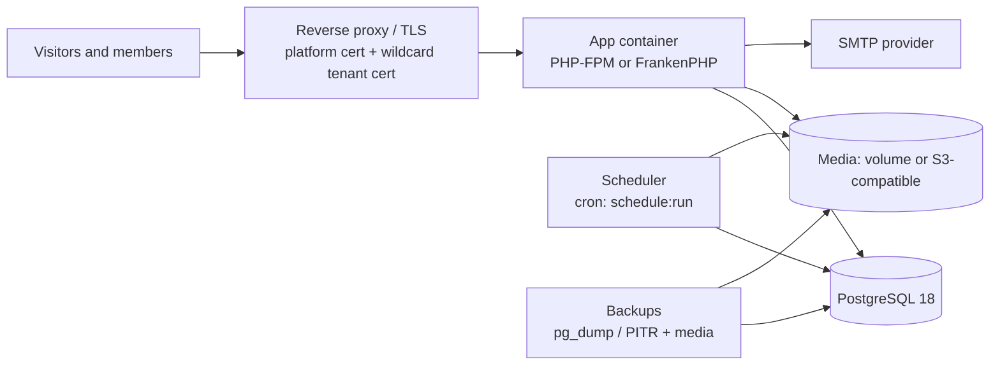

# FirmHub — Technology & Infrastructure Decisions

| | |
|---|---|
| **Phase / Task** | Phase 0 — Task 0.8 |
| **Status** | Draft — dependency approvals and open questions (Section 12) pending |
| **Depends on** | [0.1](0.1-product-scope-and-mvp.md) … [0.7](0.7-security-architecture-and-threat-model.md) |
| **Last updated** | 2026-10-29 |

> Decision record only. No package is installed, no configuration or container is changed in Phase 0. Every **new dependency** listed here requires explicit approval before the implementation task that needs it. Items marked *verify* were not confirmed against official documentation in this task.

---

## 1. Current State (Verified, Read-Only)

Inspection on 2026-10-29.

### 1.1 Backend

| Component | Constraint (`composer.json`) | Installed | Notes |
|---|---|---|---|
| PHP | `^8.3` | 8.3.35 (host), 8.3 (Sail runtime, CI) | Sail also ships runtimes 8.4 and 8.5 |
| `laravel/framework` | `^13.17` | 13.38.0 | |
| `laravel/fortify` | `^1.37.2` | 1.41.0 | Registration, reset, verification, 2FA |
| `livewire/livewire` | `^4.1` | 4.4.7 | Pages registered via `Route::livewire`, single-file components (`⚡*.blade.php`) |
| `livewire/flux` | `^2.13.1` | 2.20.1 | Free edition components |
| `livewire/blaze` | `^1.0` | 1.0.19 | Blade component compilation optimization (starter kit) |
| `laravel/chisel` | `^0.1.0` | 0.1.1 | Starter-kit scaffolding tool, in `require` (runtime) — see §9 |
| `laravel/tinker` | `^3.0` | 3.0.2 | |
| Dev: Pest / pest-plugin-laravel | `^4.7` / `^4.1` | 4.7.8 / 4.1.0 | |
| Dev: Larastan | `^3.9` | 3.13.0 | `phpstan.neon` level 7 (`app/`, `bootstrap/app.php`, `config/`, `database/`, `routes/`) |
| Dev: Pint | `^1.27` | 1.32.1 | `laravel` preset |
| Dev: Sail, Pail, Boost, Pao, Collision, Mockery, Faker | — | — | Development tooling |

Package metadata still reads `"name": "laravel/livewire-starter-kit"`, `"license": "MIT"` (inherited, license not yet decided — 0.1 Q18).

### 1.2 Frontend

| Package | Installed | Role |
|---|---|---|
| `vite` | 8.3.4 | Bundler |
| `vite-plus` | 0.3.0 (pinned) | Toolchain wrapper; `npm run build` = `vp build`, `npm run dev` = `vp dev`; brings `oxlint`, `oxfmt`, `vitest` |
| `laravel-vite-plugin` | 3.2.0 | Laravel integration + `fonts` (Bunny provider) |
| `tailwindcss`, `@tailwindcss/vite` | 4.3.3 | Styling |
| `fontaine` (dev) | 0.8.2 | Font fallback metrics |
| `concurrently`, `@laravel/multiplex` | — | Dev process runners |

- **Fonts are self-hosted (resolves 0.6 follow-up):** the build downloads `Instrument Sans` at build time and emits `woff2`/`woff` files into `public/build/assets` with `public/build/fonts-manifest.json`. Browsers never contact the Bunny CDN; the **build** needs network access (or a warm cache).
- `.npmrc`: `ignore-scripts=true`, `audit=true` (good supply-chain default; packages needing install scripts must be handled explicitly).
- No npm `lint`, `format` or `test` scripts exist; the tools inside `vite-plus` are not wired into the workflow.

### 1.3 Infrastructure & CI

| Item | State |
|---|---|
| Development | Laravel Sail (`compose.yaml`): `laravel.test` (PHP 8.3 runtime, Node 24, `php artisan serve` on port 80 via supervisor, health check `/up`) + `pgsql` (`postgres:18-alpine`, testing DB created by init script) |
| Tests | `phpunit.xml`: `DB_CONNECTION=pgsql`, `DB_DATABASE=testing`, array cache/session/mail, sync queue |
| CI | `.github/workflows/tests.yml`: PHP 8.3, **Node 22**, PostgreSQL 18 service; `composer setup` then `composer ci:check` (→ Pint check + Larastan + Pest). Triggers: push to **`main`** and all pull requests. Actions pinned by SHA, `persist-credentials: false`, `permissions: contents: read` |
| Dependabot | GitHub Actions ecosystem only |
| Missing project files | `README.md`, `LICENSE`, `CONTRIBUTING.md`, `SECURITY.md` (`.editorconfig` exists) |

### 1.4 Dependency audit results (this task)

| Check | Result |
|---|---|
| `npm audit` | **7 vulnerabilities (3 critical, 4 moderate)**, all through `vite-plus@0.3.0` → `vitest`, `@vitest/*`, `oxfmt` → `tinypool` (prototype-pollution-to-RCE advisory), `launch-editor`. The only fix offered is `vite-plus@1.4.0` (**major**). These are build/dev-time tools, not shipped to browsers; exposure is the developer machine and CI. Not auto-fixed (`--force` prohibited) |
| `composer audit` | **Not run:** host Composer is 2.2.30, which has no `audit` command (added in 2.4). CI uses latest `composer:v2` and the Sail image installs the latest Composer, so `sail composer audit` / CI can run it |

### 1.5 Correction to earlier documents

- 0.7 RF-14 originally stated that CI runs tests only; `composer test` already runs Pint and Larastan. RF-14 and SEC-SUPPLY-4 were corrected in this task.

---

## 2. Technology Decision Record

Status: **Existing** (already in the repository, kept) · **Proposed** (new, needs approval) · **Rejected** · **Deferred**.

| ID | Area | Decision | Status | Rationale |
|---|---|---|---|---|
| TDR-1 | Framework | Laravel 13, PHP 8.3 | Existing | Approved stack; matches CI and Sail. PHP 8.4/8.5 upgrade evaluated separately (requires Sail runtime + CI + production image change together) |
| TDR-2 | Auth | Fortify + starter-kit Livewire views | Existing | Covers 0.1 identity scope; hardening per 0.7 SEC-AUTH |
| TDR-3 | UI | Livewire 4 + Flux (free) + Tailwind 4 + Alpine (bundled by Livewire) | Existing | No second Alpine instance; no React/Vue/Inertia |
| TDR-4 | Public sites | Plain Blade theme views, separate Vite CSS entry per theme, no JS | Proposed (0.5/0.6) | Performance, CSP |
| TDR-5 | Database | PostgreSQL 18 everywhere (dev, test, CI, production) | Existing | Same major version in all environments; PostgreSQL-specific constraints tested for real (0.3 §10) |
| TDR-6 | Tenancy | Native Laravel (route binding, middleware, policies); no tenancy package | Decided in 0.2 | — |
| TDR-7 | Roles | PHP enums; no permission package | Decided in 0.2 | — |
| TDR-8 | Primary keys | UUIDv7 for tenant tables (`HasUuids`; *verify* version generated by Laravel 13) | Decided in 0.3 | — |
| TDR-9 | Session | `database` driver (current `.env.example`) | Existing, kept | Works across multiple app instances; no extra service. `file` (prompt §4.4 option) breaks with more than one node |
| TDR-10 | Cache | `database` store (current `.env.example`) | Existing, kept | Rate limiters (0.7 SEC-CONTACT-3) must be shared across instances; `file` would make limits per-node (0.7 R-4) |
| TDR-11 | Queue | `sync` in MVP | Existing | 0.1 NFR-OPS-01. Upgrade path without Redis: `database` queue + one worker process (Phase 7 evaluation) |
| TDR-12 | Scheduler | Laravel scheduler for purge jobs (0.7 PRIV-4), introduced with the first scheduled job (Phase 2/3) | Proposed | Dev: `php artisan schedule:work`; production: one cron entry or scheduler process |
| TDR-13 | Mail | Laravel mailer; `log` locally, SMTP in production | Existing | No provider SDK. Optional Mailpit container for local invitation testing — see Q-5 |
| TDR-14 | Storage | Dedicated `media` disk (local); S3-compatible via `league/flysystem-aws-s3-v3` only when object storage is adopted | Proposed (0.5 §7.2) / Deferred | Code uses only the `Storage` API |
| TDR-15 | Image processing | `intervention/image` (v3, GD driver; Imagick optional) | **Proposed — needs approval** (0.5 C-4) | Safe decode/re-encode/resize API, driver abstraction, avoids hand-written GD code. GD is present on host and in Sail image; Imagick is in the Sail image only |
| TDR-16 | Media library | No `spatie/laravel-medialibrary` | Rejected | Duplicates `company_media` (0.5 §7.5) |
| TDR-17 | Security headers / CSP | Small custom middleware per route group | Proposed (no package) | Two static policies (public, dashboard). `spatie/laravel-csp` only if Livewire/Flux nonce handling becomes complex (0.7 SEC-HDR-2) |
| TDR-18 | SEO / sitemap | No package | Proposed | One URL per site in MVP; a value object and two routes suffice (0.6) |
| TDR-19 | Custom domains | `CustomHostnameProvider` interface; Cloudflare via Laravel HTTP client (no SDK) | Deferred (Phase 5) | 0.4 §10 |
| TDR-20 | Debug tooling | Pail (existing); no Telescope / Debugbar | Existing | Keeps dependencies minimal |
| TDR-21 | Browser / a11y testing | `pestphp/pest-plugin-browser` (Playwright) | **Deferred — needs approval in Phase 3** | Accessibility assertions and real-browser tests (0.6 S-8). Requires Playwright browsers in CI and conflicts with `ignore-scripts=true` (explicit install step). *Verify* accessibility assertion support |
| TDR-22 | Frontend lint/format | No new tool; evaluate `oxlint`/`oxfmt` (already inside `vite-plus`) when meaningful JS exists | Deferred | Project has almost no custom JS |
| TDR-23 | Static analysis | Larastan level 7 (existing) | Existing | Raise level only with a dedicated task |
| TDR-24 | Redis, Horizon, Octane, Reverb | Not used | Rejected for MVP | 0.1 NFR-OPS-01; revisit in Phase 7 |

---

## 3. New Dependency Requests

| # | Package | Type | Needed in | Justification | Alternatives |
|---|---|---|---|---|---|
| ND-1 | `intervention/image` | composer, runtime | Phase 3 (media) | Re-encode, strip metadata, resize to WebP variants, dimension checks (0.5 §7.1, 0.7 SEC-MEDIA) | Raw GD functions (more code, more edge cases) |
| ND-2 | `league/flysystem-aws-s3-v3` | composer, runtime | When object storage is adopted (Phase 7 or hosted launch) | S3-compatible disk driver | Local disk + backups |
| ND-3 | `pestphp/pest-plugin-browser` (+ Playwright) | composer dev + npm dev | Phase 3 (public theme a11y) | Automated accessibility and real-browser checks | Manual Lighthouse / axe checks per theme |

No other new dependency is foreseen for Phases 1–3. Any additional package needs a request in this format.

---

## 4. Required Maintenance Decisions (Existing Dependencies)

| # | Item | Proposal | Phase |
|---|---|---|---|
| MD-1 | `vite-plus@0.3.0` critical advisories (§1.4) | Separate task: either upgrade to `vite-plus@1.x` after checking starter-kit compatibility, or replace `vp build` / `vp dev` with plain `vite` (already a direct dependency) and remove `vite-plus`. Recommendation: evaluate the removal first — FirmHub does not use the bundled test/lint tools | 1 |
| MD-2 | Node version mismatch (CI 22, Sail 24, host 24, prompt: 24) | Align CI to Node 24; add `.nvmrc` / `engines` | 1 |
| MD-3 | CI does not run on pushes to `develop` | Add `develop` to push triggers (default target branch per Git workflow) | 1 |
| MD-4 | No dependency audit in CI | Add `composer audit` and `npm audit --audit-level=high` steps; triage policy, no `--force` (0.7 SEC-SUPPLY-1) | 1 |
| MD-5 | Dependabot only for Actions | Add `composer` and `npm` ecosystems with grouping and cooldown (0.7 SEC-SUPPLY-2) | 1 |
| MD-6 | Host Composer 2.2 cannot audit | Document: use `sail composer …` or Composer ≥ 2.4 on the host | 1 |
| MD-7 | `composer.json` name/description from starter kit | Rename to the FirmHub package name; license field follows Q18 decision | 1 |
| MD-8 | `laravel/chisel` in runtime `require` | *Verify* whether it is needed after scaffolding; remove only after confirmation (dependency change requires approval) | 1 |
| MD-9 | Static `public/robots.txt` | Remove when the dynamic route exists (0.6 §5.1) | 3 |

---

## 5. Infrastructure Overview

### 5.1 Environments

| Environment | Runtime | Database | Hosts | Purpose |
|---|---|---|---|---|
| Local | Sail: `laravel.test` (`artisan serve`) + `pgsql` | PostgreSQL 18 (`laravel` + `testing` DBs) | `localhost`, `*.localhost` (0.4 §8.1) | Development |
| Test (local) | Same containers, `testing` DB | PostgreSQL 18 | Full URLs in tests set `Host` (no DNS) | Pest suite |
| CI | GitHub Actions, PHP 8.3 + PostgreSQL 18 service | `testing` | — | Quality gates (§8) |
| Staging (Phase 5/7) | Production image | Separate DB | Public domain + wildcard + test custom domains | Real DNS/TLS/custom-domain verification |
| Production (Phase 7) | Production image | PostgreSQL 18 (managed or self-run) | Platform host + tenant domain | Hosted SaaS or self-hosted |

### 5.2 Production reference topology (design, Phase 7)



| Concern | Decision for design |
|---|---|
| Sail image in production | **Not allowed**: development image (Xdebug, `artisan serve`, many extensions) |
| Production image | Multi-stage build: Composer `--no-dev`, `npm run build`, minimal PHP extensions (`pgsql`, `gd`, `intl`, `mbstring`, `zip`, `opcache`, `exif`), non-root user, read-only code |
| Web server | Candidates: **Caddy + PHP-FPM** or **FrankenPHP (classic mode)**. Both provide automatic HTTPS; wildcard certificates need a DNS-01 provider module (custom build) and Phase 5 self-hosted custom domains can use Caddy on-demand TLS with an "ask" endpoint (0.4 §10.1). Final choice in Phase 7 |
| TLS behind CDN | Alternative: CDN/proxy terminates TLS; then trusted proxies must be configured (0.4 HH-3) |
| Statelessness | App containers keep no local state except the media volume (until object storage); sessions/cache/rate limits in PostgreSQL → horizontal scaling possible |
| Scheduler | Exactly one scheduler (cron or `schedule:work` container); purge jobs use `onOneServer()` only once a shared lock store exists (database cache supports locks — *verify*) |
| Backups | PostgreSQL dumps or point-in-time recovery + media backup; retention ≤ 35 days (0.7 §7.2) |
| Managed platforms | Platforms such as Laravel Cloud may be evaluated in Phase 7 **if** they support wildcard tenant domains and custom hostnames (*not verified*) |

### 5.3 Self-hosted distribution (Phase 7)

- Ship a `Dockerfile` + `compose.production.yaml` example (app, PostgreSQL, optional scheduler) and an installation guide.
- Required configuration documented in `.env.example`: platform host, tenant domain, trusted proxies/hosts, mail, media disk, `uncompromised()` toggle (0.7 SEC-AUTH-3).
- Startup guard refuses `APP_DEBUG=true` in production (0.7 SEC-OPS-1).

---

## 6. Proposed Laravel Directory Structure

### 6.1 Approach

| Option | Assessment |
|---|---|
| **A. Laravel default layout, grouped by module inside each layer** | Works with `php artisan make:*`, factories, policy auto-discovery, Livewire page conventions and Boost guidelines; module boundaries visible through namespaces and checked with Pest `arch()` tests. **Chosen** |
| B. `app/Modules/{Module}/` with Models, Http, Livewire per module and module service providers | Stronger physical separation, but fights framework conventions (generators, factory resolution, policy discovery, Livewire paths); premature for ~12 models |
| C. Separate Composer packages per module | Rejected (prompt §5) |

Rules:

1. **Models stay flat in `app/Models`** (Eloquent conventions, factories, policy discovery).
2. **Business logic is grouped by module**: `app/Actions/{Module}/…`, and `app/Services/{Module}/…` only when a stateful service is justified.
3. Livewire dashboard pages live under `resources/views/pages/dashboard/{module}/` as single-file components, matching the existing `pages::settings.*` convention.
4. No repository classes (prompt §5.1).
5. Module dependencies are checked with Pest architecture tests (built into Pest 4, no package).

### 6.2 Proposed tree (created incrementally, only when a task needs it)

```text
app/
├── Actions/
│   ├── Fortify/                 existing
│   ├── Companies/               CreateCompany, UpdateCompanyProfile, DeleteCompany, RestoreCompany
│   ├── Memberships/             InviteMember, AcceptInvitation, ChangeMemberRole, RemoveMember, TransferOwnership
│   ├── Sites/                   CreateSite, ClaimSubdomain, ChangeSiteSubdomain, UpdateSiteSettings
│   ├── Content/                 UpdateSection, ReorderSections, SaveOffering, ReorderOfferings
│   ├── Media/                   StoreMedia, DeleteMedia
│   ├── Publishing/              PublishSite, UnpublishSite, SuspendSite, UnsuspendSite
│   └── Contact/                 StoreContactMessage
├── Console/Commands/            platform admin + purge commands
├── Enums/                       CompanyRole, CompanyPermission, SiteStatus, SectionType, MediaPurpose
├── Http/
│   ├── Controllers/
│   │   ├── Tenant/              PublicSiteController, ContactController, RobotsController, SitemapController
│   │   └── Dashboard/           PreviewController (and non-Livewire endpoints)
│   ├── Middleware/              EnsureCompanyMembership, ResolvePublicSite, SecurityHeaders, RequirePlatformAdmin
│   └── Requests/                form requests for non-Livewire endpoints (contact)
├── Models/                      User, Industry, Company, CompanyMembership, CompanyInvitation, CompanyLocation,
│                                CompanySite, CompanySiteSection, CompanyOffering, CompanyMedia,
│                                CompanyContactMessage, ReleasedSubdomain
├── Notifications/               CompanyInvitationNotification, NewContactMessageNotification
├── Policies/                    one per tenant model (0.7 SEC-AUTHZ-1)
├── Providers/                   existing
├── Rules/                       ValidSubdomain, CompanyOwnedMedia
├── Sections/                    SectionDefinition contract, SectionTypeRegistry, Hero/About/Offerings/Contact definitions
├── Support/
│   ├── Tenancy/                 CurrentCompany context
│   ├── Sites/                   SiteHostResolver, CurrentSite, SiteUrlGenerator, ReservedSubdomains
│   ├── Rendering/               SiteRenderer, SitePageData, SeoData
│   ├── Media/                   ImageProcessor, MediaUsageFinder
│   └── Contact/                 ContactFormToken, ContactChallenge
└── Themes/                      Contracts/Theme, ThemeRegistry, Base/BaseTheme

config/firmhub.php               platform_host, tenant_domain, subdomain rules, limits, quotas, indexing switch
routes/
├── web.php                      platform host (existing; becomes host-constrained)
├── settings.php                 existing
├── dashboard.php                /dashboard/{company}/...
├── tenant.php                   public site routes (no host constraint, registered last)
└── console.php                  existing; scheduler definitions
resources/
├── views/pages/dashboard/{companies,members,site,sections,offerings,media,messages}/
├── views/themes/base/           layout, sections/*, pages/privacy
├── css/themes/base.css          separate Vite entry
└── lang/{en,tr}/                dashboard strings, site.php theme strings, industries
tests/                           layout refined in 0.9 §4.1: files mirror the class/page under test
├── Feature/{Actions,Policies,Pages,Http,Database,Concurrency,Rendering,Console}/
├── Unit/
├── Fixtures/media/
└── Arch/                        module and security architecture tests (0.9 §4.8)
```

---

## 7. Module Responsibility Map

| # | Module | Responsibility | Owns (tables) | Main code | May depend on | Phase |
|---|---|---|---|---|---|---|
| 1 | Identity & Authentication | Accounts, login, 2FA, verification, account deletion guard | `users`, `sessions`, `password_reset_tokens` | Fortify actions, settings pages | — | 1 |
| 2 | Company Management | Company profile, industry, onboarding, legal info, locations, soft delete | `companies`, `industries`, `company_locations` | `Actions/Companies` | 1 | 2 |
| 3 | Tenant & Membership | Memberships, roles, permissions, invitations, company context | `company_memberships`, `company_invitations` | `Actions/Memberships`, `EnsureCompanyMembership`, policies, `CurrentCompany` | 1, 2 | 2 |
| 4 | Website Management | Site creation, subdomain, theme selection, branding, social links, SEO fields | `company_sites`, `released_subdomains` | `Actions/Sites`, `Support/Sites` | 2, 3, 7 | 3 |
| 5 | CMS & Content | Sections, offerings, settings validation | `company_site_sections`, `company_offerings` | `Sections/*`, `Actions/Content` | 3, 4, 7 | 3 |
| 6 | Theme Management | Theme manifests, presets, theme views and CSS | — (code) | `Themes/*`, `views/themes` | — (pure presentation) | 3 |
| 7 | Media Management | Upload, processing, storage, usage tracking, cleanup | `company_media` | `Actions/Media`, `Support/Media` | 2, 3 | 3 |
| 8 | Domain & Publishing | Host resolution, visibility, publish/unpublish, preview, public rendering, robots/sitemap; custom domains later | (status columns on `company_sites`); future `company_site_domains` | `Actions/Publishing`, `ResolvePublicSite`, `Support/Rendering`, `Http/Controllers/Tenant` | 4, 5, 6, 7 | 3 (5) |
| 9 | Contact & Notifications | Contact form, anti-abuse, inbox, notifications, retention purge | `company_contact_messages` | `Actions/Contact`, `Support/Contact`, notifications | 3, 4, 8 | 3 |
| 10 | Platform Administration | Platform admin flag, suspension commands, future admin UI and audit log | `users.is_platform_admin`, suspension columns | Console commands, `RequirePlatformAdmin` | 2, 4 | 2/3 (6) |

Boundary rules (verified by Pest `arch()` tests where practical):

| ID | Rule |
|---|---|
| MB-1 | Theme code (module 6) never uses Eloquent models or the database; it receives `SitePageData` only (0.5 TH-1) |
| MB-2 | Public rendering (module 8) never depends on dashboard components, session or `CurrentCompany` |
| MB-3 | Livewire components and controllers call Actions for writes; no business rules in views or components |
| MB-4 | Only module 8 reads `CurrentSite`; only dashboard code reads `CurrentCompany` |
| MB-5 | External providers (mail, future Cloudflare) are reached through Laravel abstractions or interfaces, never directly from Livewire components |
| MB-6 | Modules communicate by calling Actions or querying through relationships; events are introduced only for real decoupling needs (e.g. future audit log) |

---

## 8. Quality Gates & Tooling

| Gate | Tool | Existing / Proposed | Where |
|---|---|---|---|
| Code style | Pint (`composer lint:check`) | Existing | CI, local |
| Static analysis | Larastan level 7 (`composer types:check`) | Existing | CI, local |
| Tests | Pest on PostgreSQL 18 | Existing | CI, local (Sail) |
| Architecture tests | Pest `arch()` (built in) | Proposed, Phase 1 | CI |
| PHP dependency audit | `composer audit` | Proposed (MD-4) | CI |
| JS dependency audit | `npm audit --audit-level=high` | Proposed (MD-4); currently fails (§1.4) | CI |
| Frontend build | `npm run build` (inside `composer setup`) | Existing | CI |
| Blade raw-output scan | Pest test scanning `resources/views` for `{!!` (allow-list for framework partials) | Proposed, Phase 3 (0.7 SEC-CONTENT-1) | CI |
| Accessibility / browser | ND-3 | Deferred | Phase 3 |
| Lighthouse / Web Vitals | Manual per theme | Proposed (0.6 §7.1) | Phase 3; automation later |

Details and coverage matrix in 0.9.

---

## 9. Local Development Decisions

| Item | Decision |
|---|---|
| Container setup | Keep Sail as is (app + PostgreSQL); no Redis, Mailpit or queue worker by default |
| Running commands | Prefer `vendor/bin/sail artisan|composer|npm …` so PHP, Composer (≥ 2.4) and Node versions match CI/production |
| Tenant subdomains | `*.localhost` on `APP_PORT` (default 80); `artisan serve` accepts any `Host` — trusted-host configuration must keep `*.localhost` allowed in local (0.4 §8.1, 0.7 SEC-HOST-2). Safari behavior *verify* |
| Scheduler | `sail artisan schedule:work` when scheduled jobs exist |
| Mail | `log` mailer; optional Mailpit (Q-5) |
| Fonts | Build needs network access once to fetch fonts (cached afterwards) |

---

## 10. Technology Risks

| ID | Risk | Mitigation |
|---|---|---|
| TR-1 | Critical advisories in `vite-plus` toolchain | MD-1 in Phase 1 |
| TR-2 | Starter-kit packages at early versions (`vite-plus` 0.x, `blaze` 1.0, `chisel` 0.1) change quickly | Lock files, Dependabot with cooldown, upgrade tasks with tests |
| TR-3 | Livewire 4 / Flux behavior assumed but not verified (locked properties, temporary uploads, CSP nonces) | Verify against official docs in the implementing task; tests (0.2 AR-4, 0.7 SEC-HDR-2, SEC-MEDIA-5) |
| TR-4 | Synchronous mail and image processing slow requests | Input limits; database queue + worker evaluation in Phase 7 (TDR-11) |
| TR-5 | Environment drift (Node 22/24, Composer 2.2/2.x) | MD-2, MD-6 |
| TR-6 | Wildcard TLS and custom-domain TLS operationally complex for self-hosters | Documented reference setup (Caddy/FrankenPHP), CDN alternative (§5.2) |

---

## 11. Deployment Approach (Summary)

1. **MVP (Phases 1–3):** local Sail + CI only; no public deployment required.
2. **Public staging (before Phase 5):** production image, real platform host and tenant domain, wildcard certificate — needed for DNS/TLS and custom-domain verification (0.4 §8.1).
3. **Production readiness (Phase 7):** production image, reverse proxy with TLS, PostgreSQL backups, scheduler, SMTP, monitoring, security checklist (0.7 §9).
4. Hosted SaaS and self-hosted installs use the **same image and configuration contract**; hosted-only integrations (Cloudflare for SaaS) are optional providers.

---

## 12. Open Questions

| # | Question | Recommendation | Affects |
|---|---|---|---|
| Q-1 | Approve ND-1 `intervention/image` for Phase 3? | Yes | Phase 3 |
| Q-2 | MD-1: replace `vite-plus` with plain `vite`, or upgrade to `vite-plus@1.x`? | Evaluate replacement first in a Phase 1 task | Phase 1 |
| Q-3 | Stay on PHP 8.3 for the MVP? | Yes; evaluate 8.4/8.5 together with the production image | Phase 7 |
| Q-4 | Production web server: Caddy + PHP-FPM or FrankenPHP? | Decide in Phase 7 with a small benchmark and TLS setup test | Phase 7 |
| Q-5 | Add Mailpit to Sail for invitation/notification testing? | Optional, only when Phase 2 invitations are built (requires approval: new container) | Phase 2 |
| Q-6 | Keep `database` session and cache instead of `file` (prompt §4.4)? | Yes (TDR-9, TDR-10) | Phase 1 |
| Q-7 | License (0.1 Q18) | MIT pending product owner decision; needed before the `LICENSE` file and public repository | Phase 1 |
| Q-8 | Remove `laravel/chisel` after verification (MD-8)? | Only after confirming it is unused at runtime | Phase 1 |

---

## 13. Task 0.8 Acceptance Criteria Evaluation

| Criterion | Status | Evidence |
|---|---|---|
| Existing and planned technologies separated | Met | §1 verified current state; §2 TDR with Existing / Proposed / Deferred / Rejected status |
| New package requirements justified | Met | §3 ND-1 … ND-3 with justification and alternatives; §4 maintenance of existing dependencies |
| Initial infrastructure kept simple | Met | App + PostgreSQL only; database session/cache, sync queue; no Redis/Horizon/Octane (TDR-9 … 11, 24) |
| Deployment approach explained | Met | §5 environments, production reference topology, self-hosted distribution; §11 |
| Directory structure and module responsibilities defined | Met | §6 structure with rationale; §7 module map and boundary rules |
